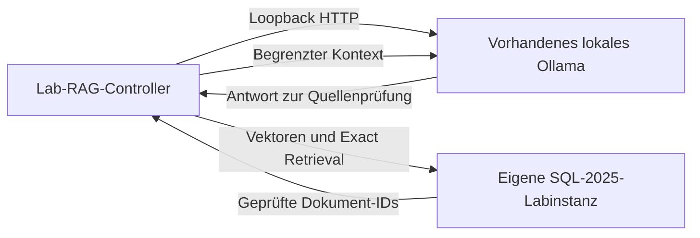

# Lokale Modellpfade über SQL_Server_Lab

Stand: 2026-10-11. TSK-007; öffentliche Verträge SRC-101 bis SRC-103 am Commit
`26468023f74c85d97b253d4dde6c0c5a80b88782`. Dies ist die Integrationsauswahl,
noch keine neue Runtimeabnahme dieses Schulungsprojekts.

## Wahl des Aufrufpfads

| Pfad | Aufrufer und Transport | Frameworkvertrag | Aktuelle Grenze |
|---|---|---|---|
| Lokaler Pflichtpfad | T-SQL, ohne Modell | FWK-010, QRY-014 bis QRY-017 | Konstruiert Geometrie; keine Sprachsemantik |
| Lokales RAG | PowerShell-Controller → Ollama per Loopback-HTTP; Controller → eigene SQL-Instanz | Öffentliche Invoke-SqlServerLabAiRag-API | Vorhandene Modelle, Versions-/Capability-/Dimensions-/Digestprüfung; keine Downloads oder Dienständerungen |
| SQL-seitige Embeddings | SQL → eigenes HTTPS-Gateway → vorhandener lokaler Provider | Interner Docker-Referenzslice AI_SQL_HTTPS_BRIDGE | Kein allgemeines öffentliches Ollama-Gateway-API; CA-/Credential-/Restart-Lifecycle separat qualifizieren |
| Lokale Acceleratoren | Providerabhängige TLS-/API-Strecke | Öffentliche Modellplan-/Preflight- und ausgewählte OVMS-Gateway-APIs | OVMS-Gateway ist keine generische Ollama-Bridge; offene TLS-/Providergrenzen bleiben offen |
| Cloud/ONNX | Ausdrücklich gewählter Zusatzpfad | Eigene Provider-/Kosten-/Hostgrenzen | In diesem Implementierungsauftrag noch nicht konkret freigegeben |

Ollama muss für den lokalen Anwendungspfad keine eigene HTTPS-Funktion bereitstellen.
Diese Route führt AI_GENERATE_EMBEDDINGS nicht innerhalb von SQL aus: Der Controller
erzeugt Embeddings und lässt SQL die exakte Vektorsuche durchführen. Das ist eine
andere Architektur als CREATE EXTERNAL MODEL mit einem SQL-seitigen HTTPS-Aufruf.



## Vorbereiteter öffentlicher Controlleraufruf

Voraussetzung ist ein eigener durch SQL_Server_Lab erzeugter Run mit dessen gültiger
RunId und StateRoot; ein beliebiger manuell erzeugter Container wird nicht adoptiert.
Das Modul wird explizit importiert. State/Data/Secrets liegen in einem eigenen
unversionierten Runtimebereich; das SQL_Server_Lab-Repository wird nur gelesen.
SaPassword ist ein kurzlebiger SecureString des eigenen Lab-Runs.

Die Modelle müssen bereits vorhanden sein. Modellkey und tatsächlicher Tag sind
verschiedene Werte. Der Frameworkkatalog bindet für das folgende Beispiel Nomic
mit dem rollenbezogenen Suchpräfix und lokale Qwen-Generierung. Er lehnt Remote-
oder Cloudmodelle in der lokalen Lane ab und prüft Bindungen vor/nach Inferenz.

```powershell
$documents = @(
    @{ Id = 'module-a'; Content = 'Das synthetische Modul A speichert rote Bausteine.' },
    @{ Id = 'module-b'; Content = 'Das synthetische Modul B speichert blaue Bausteine.' }
)
$ragParameters = @{
    RunId = $runId
    StateRoot = $stateRoot
    SaPassword = ${saPassword}
    Document = $documents
    Question = 'Welches Modul speichert rote Bausteine?'
    TopK = 1
    EmbeddingModelKey = 'ollama-nomic-embed-text-v1-5'
    GenerationModelKey = 'ollama-qwen25-coder-7b-local'
    GenerationLane = 'local'
    DataClassification = 'synthetic-only'
    GenerationTimeoutSeconds = 120
    GenerationRetryCount = 0
}
Invoke-SqlServerLabAiRag @ragParameters -WhatIf
```

Der gezeigte öffentliche WhatIf-Aufruf wurde am 2026-10-11 tatsächlich ausgeführt:
Status READY, GenerationLane local, Egress denied, TopK 1. Das ist ein API-Planbeleg,
keine Inferenz- oder Retrievalabnahme. WhatIf liest keine Secrets und führt weder SQL noch Inferenz aus. Die Schulungs-
Integration muss vor dem tatsächlichen Aufruf einen endlichen Gesamtumfang,
Hostmodellbindung und scopegebundenen Cleanup qualifizieren. Der Frameworkvertrag
begrenzt einzelne Requests, ersetzt aber keinen Gesamtbudget- oder Antwortqualitätsbeleg.
Es wird weder ein eigener Proxy noch ein zweites Lab-Provisionierungssystem aufgebaut.

Die Antwort wird erst nach Prüfung der tatsächlich zurückgegebenen Dokument-IDs,
Dokumentversionen und Quelleninhalte bewertet. Eine nichtleere Antwort belegt keine
fachliche Korrektheit. Prompts, Antworten und Hostinventar werden nicht als Git-Artefakte
gespeichert. Der Cloudpfad wird nicht als automatischer Fallback verwendet.
