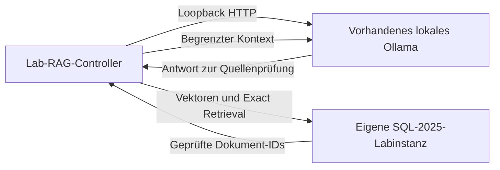

# Lokale Modellpfade über SQL_Server_Lab

Stand: 2026-10-11. TSK-007; öffentliche Verträge SRC-101 bis SRC-103 am Commit
`26468023f74c85d97b253d4dde6c0c5a80b88782`. Dies ist die Integrationsauswahl,
noch keine neue Runtimeabnahme dieses Schulungsprojekts.

## Wahl des Aufrufpfads

| Pfad | Aufrufer und Transport | Frameworkvertrag | Aktuelle Grenze |
|---|---|---|---|
| Lokaler Pflichtpfad | T-SQL, ohne Modell | FWK-010, QRY-014 bis QRY-017 | Konstruiert Geometrie; keine Sprachsemantik |
| Lokales RAG | PowerShell-Controller → Ollama per Loopback-HTTP; Controller → eigene SQL-Instanz | Öffentliche Invoke-SqlServerLabAiRag-API | Vorhandene Modelle, Versions-/Capability-/Dimensions-/Digestprüfung; keine Downloads oder Dienständerungen |
| SQL-seitige Embeddings | SQL → eigenes HTTPS-Gateway → vorhandener lokaler Provider | Interner Docker-Referenzslice AI_SQL_HTTPS_BRIDGE | Kein allgemeines öffentliches Ollama-Gateway-API; CA-/Credential-/Restart-Lifecycle separat qualifizieren |
| Lokale Acceleratoren | Providerabhängige TLS-/API-Strecke | Öffentliche Modellplan-/Preflight- und ausgewählte OVMS-Gateway-APIs | OVMS-Gateway ist keine generische Ollama-Bridge; offene TLS-/Providergrenzen bleiben offen |
| Cloud/ONNX | Ausdrücklich gewählter Zusatzpfad | Eigene Provider-/Kosten-/Hostgrenzen | In diesem Implementierungsauftrag noch nicht konkret freigegeben |

Ollama muss für den lokalen Anwendungspfad keine eigene HTTPS-Funktion bereitstellen.
Diese Route führt AI_GENERATE_EMBEDDINGS nicht innerhalb von SQL aus: Der Controller
erzeugt Embeddings und lässt SQL die exakte Vektorsuche durchführen. Das ist eine
andere Architektur als CREATE EXTERNAL MODEL mit einem SQL-seitigen HTTPS-Aufruf.



## Vorbereiteter öffentlicher Controlleraufruf

Voraussetzung ist ein eigener durch SQL_Server_Lab erzeugter Run mit dessen gültiger
RunId und StateRoot; ein beliebiger manuell erzeugter Container wird nicht adoptiert.
Das Modul wird explizit importiert. State/Data/Secrets liegen in einem eigenen
unversionierten Runtimebereich; das SQL_Server_Lab-Repository wird nur gelesen.
SaPassword ist ein kurzlebiger SecureString des eigenen Lab-Runs.

Die Modelle müssen bereits vorhanden sein. Modellkey und tatsächlicher Tag sind
verschiedene Werte. Der Frameworkkatalog bindet für das folgende Beispiel Nomic
mit dem rollenbezogenen Suchpräfix und lokale Qwen-Generierung. Er lehnt Remote-
oder Cloudmodelle in der lokalen Lane ab und prüft Bindungen vor/nach Inferenz.

```powershell
$documents = @(
    @{ Id = 'module-a'; Content = 'Das synthetische Modul A speichert rote Bausteine.' },
    @{ Id = 'module-b'; Content = 'Das synthetische Modul B speichert blaue Bausteine.' }
)
$ragParameters = @{
    RunId = $runId
    StateRoot = $stateRoot
    SaPassword = ${saPassword}
    Document = $documents
    Question = 'Welches Modul speichert rote Bausteine?'
    TopK = 1
    EmbeddingModelKey = 'ollama-nomic-embed-text-v1-5'
    GenerationModelKey = 'ollama-qwen25-coder-7b-local'
    GenerationLane = 'local'
    DataClassification = 'synthetic-only'
    GenerationTimeoutSeconds = 120
    GenerationRetryCount = 0
}
Invoke-SqlServerLabAiRag @ragParameters -WhatIf
```

Der gezeigte öffentliche WhatIf-Aufruf wurde am 2026-10-11 tatsächlich ausgeführt:
Status READY, GenerationLane local, Egress denied, TopK 1. Das ist ein API-Planbeleg,
keine Inferenz- oder Retrievalabnahme. WhatIf liest keine Secrets und führt weder SQL noch Inferenz aus. Die Schulungs-
Integration muss vor dem tatsächlichen Aufruf einen endlichen Gesamtumfang,
Hostmodellbindung und scopegebundenen Cleanup qualifizieren. Der Frameworkvertrag
begrenzt einzelne Requests, ersetzt aber keinen Gesamtbudget- oder Antwortqualitätsbeleg.
Es wird weder ein eigener Proxy noch ein zweites Lab-Provisionierungssystem aufgebaut.

## Offene Secret-Grenze vor Live-RAG

Die Quellenprüfung des öffentlichen Controllers am oben gebundenen Commit zeigt:
`Invoke-SqlServerLabAiRag` ruft intern `Invoke-LabAiRag` auf. Dessen SQL-Pfad
verwendet `Invoke-SqlQuery`; in `Private/SqlReadiness.ps1`, Zeilen 491–501, wird
das flüchtige Passwort mit `sqlcmd -P` als Prozessargument übergeben. Der öffentliche
Controller besitzt keinen Parameter für einen anderen SQL-Executor. SecureString
am API-Eingang verhindert diese spätere Klartextübergabe nicht.

Das widerspricht dem hier verbindlichen [DEC-033](../../.ai/DECISIONS.md):
SQL-Passwörter ausschließlich über SQLCMDPASSWORD, passwortfreie Kommandozeilen.
WhatIf bleibt ein gültiger Planbeleg; der Live-Aufruf wird mit diesem Frameworkstand
nicht ausgeführt. Es wurde noch kein Lab-Run provisioniert und kein Modell aufgerufen.
Kein privater Moduloverride und keine Umgehung des Secret-Vertrags.

Wiederaufnahme: öffentlich nutzbarer, nachweislich passwortfreier SQL-Pfad für
Provisionierung, Readiness und RAG, einschließlich Gegenprobe gegen Passwortargumente
und eigenem Cleanup. Änderungen an SQL_Server_Lab benötigen einen ausdrücklich auf
dieses andere Repository erweiterten Auftrag. Der Offline-RAG-Schnitt QRY-018 aus
TSK-008 kann unabhängig fortschreiten.

Die Antwort wird erst nach Prüfung der tatsächlich zurückgegebenen Dokument-IDs,
Dokumentversionen und Quelleninhalte bewertet. Eine nichtleere Antwort belegt keine
fachliche Korrektheit. Prompts, Antworten und Hostinventar werden nicht als Git-Artefakte
gespeichert. Der Cloudpfad wird nicht als automatischer Fallback verwendet.

## Aktualisierte öffentliche Verträge am 2026-10-12

Die erneute Quellenprüfung bindet den aktuellen sauberen SQL_Server_Lab-Stand
`f4c9fcd30c397e25c95e57d7aeecc98dc194063e`. Der ursprüngliche Stand und dessen
WhatIf-Nachweis oben bleiben historische Evidenz. Der Live-RAG-Secretblocker
besteht weiterhin: öffentliche API ohne SQL-Executorparameter → Invoke-LabAiRag
→ Invoke-SqlQuery → sqlcmd mit `-P`. SecureString am Eingang erfüllt DEC-033
für diesen nachfolgenden Prozessaufruf weiterhin nicht. Kein Live-Aufruf,
Lab-Provisionierung, privater Override oder anderes Repository verändert.

Der aktuelle öffentliche HTTPS-Vertragsumfang ist größer als im ursprünglichen
Leitfaden: Get-SqlServerLabAiSharedGatewayPlan, die getrennten Preflight-/Storage-/
Upstream-APIs sowie Start-SqlServerLabAiSharedGatewaySession und die zugehörige
Stop-API sind vorhanden. Der Plan allein startet keinen Gateway; die separate
Session-API kann eine besitzgebundene, zeitlich begrenzte Sitzung starten.
Die Backend-ValidateSets in öffentlichem Plan und Implementierung erlauben
LlamaCppCpu, LlamaCppCuda, LlamaCppOpenVino, LlamaCppRocm, LlamaCppVulkan,
LlamaCppSycl und OpenVinoModelServer. Ollama ist dort kein zulässiges Backend.
Gebundene Upstreampfade sind `/v1/embeddings` beziehungsweise `/v3/embeddings`.
Dies ersetzt weder den internen Docker-Ollama-Referenzslice noch dessen fehlende
allgemeine öffentliche Gateway-API. Vor einer eigenen Nutzung sind tatsächliche
Modell-/Runtimeartefakte, TLS-/Consumerbindungen und Cleanup zu qualifizieren;
die bloße API-Verfügbarkeit ist keine solche Abnahme.

Quellen: öffentliche RAG-/Shared-Gateway-APIs sowie Private/AiRag.ps1,
Private/SqlReadiness.ps1 und Private/AiSharedGatewayPlan.ps1 am genannten Commit,
Abruf 2026-10-12. Die lokale reine Quellenprüfung bindet die vollständigen Bytes
dieser sieben betroffenen Dateien; null SQL- oder Modellaufrufe. Ein separater
Runtime-Probe und Katalogabruf bestätigten einen erreichbaren lokalen Ollama-Dienst
und vorhandene lokale Modelle. Katalogverfügbarkeit attestiert weder Embedding-
Capability, Dimension, Live-Digest noch semantische Qualität. Cloud-Tags bleiben
REMOTE und wurden nicht aufgerufen. Kein Modellinventar oder Hostdetail wird
als Repository-Artefakt übernommen; Modell-/Tokenverbrauch bleibt unbekannt.

TSK-007 bleibt offen. Wiederaufnahme des RAG-Pfads erst nach öffentlich nutzbarem
passwortfreiem SQL-Pfad einschließlich Provisionierung, Readiness und Cleanup.
Ein anderer lokaler Backendpfad braucht nachweislich vorhandene passende Artefakte
und einen begrenzten eigenen Qualifikationsschnitt. Bis dahin werden unabhängige
Offline-/Runtimeaufgaben fortgesetzt; Cloud-, ONNX- und rote Hostgrenzen bleiben.

## Getrennte öffentliche Embeddingkomponente

Die [AiModel-Komponentenprüfung](../Project_Planning/SQL_SERVER_2025_AI_MODEL_COMPONENT_REVIEW.md)
verwendet die öffentliche Invoke-SqlServerLabAiModel-API ohne SQL-Verbindung, mit
expliziter lokaler Lane, festen synthetischen Eingaben und separater Modell-/
Digest-/Capability-/Dimensionsbindung vor und nach Inferenz. Zwei tatsächliche
vollständige768-Vektorrückgaben sind lokal bestanden und rein gebunden; weder
Live-RAG noch SQL-seitige Embeddings werden daraus
als bestanden ausgegeben. Keine Änderung am DEC-033-Secretblocker des RAG-API.


## TSK-008/007: fester lokaler Dokument-/Fragekorpus

Nach vollständig geschlossenem PR215 folgt der [eigene Korpusvertrag](../Project_Planning/SQL_SERVER_2025_AI_MODEL_CORPUS_REVIEW.md):
drei feste synthetische Dokumente A/red, B/blue, C/green mit search_document:
und die feste crimson-Frage mit search_query:. Die vorhandene öffentliche lokale
AiModel-API ist der einzige Inferenzweg; Nominaldimension768, vollständige
Live-Bindung und Fullvectororacle. Vorab eingefrorenes Top1=A; alle Rangties,
identischen Vektoren und nicht endlichen Werte sind FAIL. Keine allgemeine
Qualitäts-/Live-RAG-/SQLHTTPS-/TSK007/008-Abnahme. 13 reine Mockmethoden,
PS-Input-/Counterselftest und unabhängiger Rootreview ohne offene P1/P2;
C1-Native noch offen. Sechs Kandidaten/Checkpoint3/hard6, max24+162 Calls,
C1 vier Inferenz-/27 Metadatenrequests, eigener300s-Parent plus gemeinsame5s-
Recovery; UNKNOWN sperrt neue Inferenz. Rawvectors/Receipt rein privat,
Modell-/Tokenverbrauch unbekannt; SRC-112/SRC-113 unverändert wiederverwendet.

Der getrennte Vier-Input-C1 ist lokal bestanden: tatsächliche drei Dokument-
und eine Frageembeddingrückgabe, vollständige768-Vektoren und unabhängig
berechnetes vorabTop1A. Dieser einzelne synthetische Synonymfall belegt weder
allgemeine Retrievalqualität noch SQL-Persistenz, generative Antwort oder
Live-RAG. Die vollständige Evidenz und Ergebnisgrenzen stehen im Korpusreview.

## Getrennte SQL-Persistenz des Modellkorpus

Die [SQL-Korpuskomponentenprüfung](../Project_Planning/SQL_SERVER_2025_AI_CORPUS_SQL_REVIEW.md)
verwendet ausschließlich die bereits erzeugten vier Vektoren. Sie prüft eigene
SQL2025-VECTOR768-Persistenz, vollständigen Transport und Exact Retrieval
mit separatem Ownership-/Negativ-/Cleanupvertrag. Vorbereitung läuft; keine
neuen Modellaufrufe und keine Umgehung des Lab-RAG-Secretblockers.
SQL-HTTPS, Generator und voller Live-RAG bleiben eigene offene Grenzen.

Die getrennte SQL-Korpus-C1 ist anschließend tatsächlich bestanden: ein neuer
eigener SQL17.0.5005.3-Container/CL170,69Nativephasen ohneBootstrap/29Vollstates,
vier vollständige768-float32-Records und unabhängiges Top1A-/Cosine-/Koordinaten-
oracle. Drei tatsächliche51003-Resultatgegenproben,16 tatsächliche51004-
Ownershipabweisungen und4Vollstaterestores. Eigentumsgebundener echterDrop,
Probe-/Parent-DB-Abwesenheit und frischeOwnCID-/Namensabsence, Inputdateien0/
UNKNOWNfalse. EinKandidat/einContainer,0 neueModellaufrufe, keine Runtime-
wiederholung für reinen Vollrecordabschluss; ModeltokensUNKNOWN. Einzelner
synthetischer Suchfall, keine volle Live-RAG-/SQLHTTPS-/Generator-/TSK007/008-
Abnahme; aktuelle Integration folgt.

## Getrennte lokale Generation am geprüften SQL-Snapshot

Die [Generatorkomponentenprüfung](../Project_Planning/SQL_SERVER_2025_AI_GENERATION_COMPONENT_REVIEW.md)
verwendet den vorhandenen öffentlichen lokalenQwenkey. Drei feste positive/
Nichtantwortcases sind vorgesehen; tatsächlicher positiverContext aus dem
geprüften SQL-Korpus-Snapshot. Discovery3Metadata/1WhatIf/0Inference belegt
Route, keineAntwortqualität. Kein vollständiger Live-End-to-End-RAG, kein
SQLHTTPS oder Lab-RAG-Secretbypass. Sourceprep/Review/Native bleiben offen.

Die lokale Generation C1 ist FAIL_RESULT_CONTRACT: ein Inferenz- und sechs
Metadatenrequests. Der positive Case liefert eine Nichtantwort im Markdown-
Codeblock statt des festgelegten JSONobjekts ANSWER/A/red. Case2 und Case3
wurden nicht aufgerufen; kein ABSTAIN-PASS. Fail-first greift tatsächlich.
Requestenden bekannt, eigener Caller beendet, kein UNKNOWN und keine SQL-/
Hoständerung. C1 bleibt FAIL. C2 ändert ausschließlich den Prompt: festes
crimson=red-Übungsglossar und rohe JSONbeispiele. Quellen-/Fragebytes und alle
Ergebnisoracles bleiben unverändert; keine Codefenceentfernung oder Anpassung
des Solls an das beobachtete Ergebnis. Budget sechs Kandidaten, 18 Inferenz-/
126 Metadatenrequests unverändert; neue Quellenprüfung und Admission vor Calls.

C2 der lokalen Generation ist vor API-Aufrufen mit FAIL beendet: null neue
Inferenz-/Metadatenrequests, keine Records, eigener Caller beendet und kein
UNKNOWN. Nachfolgend festgestellte parallele Lab-Änderungen bleiben unangetastet;
der Receipt enthält keinen konkreten Fehlercode. C3 bereitet einen unveränderten
vollständigen Export des geprüften Lab-Commits in eigenes Runtime mit voller
Tree-/Blob-/SHA-/Populationbindung vor. C2-Prompts und Ergebnisoracles bleiben
unverändert. Beide historischen FAILs bleiben erhalten; bisher insgesamt ein
Inferenz- und sechs Metadatenrequests. Quellenreview und Admission vor C3 offen,
Budget sechs Kandidaten mit Dreiercheckpoint unverändert. Details und Grenzen:
[Generationsnachweis](../Project_Planning/SQL_SERVER_2025_AI_GENERATION_COMPONENT_REVIEW.md).

Die Generation C3 ist semantisch FAIL: ein Inferenz-/sechs Metadatenrequests,
gültiges rohes JSON mit Nichtantwort im positiven Fall. Weitere Cases wurden
nicht gestartet; eigener Caller beendet, bekannte Requestenden, kein UNKNOWN.
Dreiercheckpoint gebunden; drei FAIL-Kandidaten erhalten, insgesamt zwei
Inferenz-/zwölf Metadatenrequests. C4 ändert ausschließlich die Promptstruktur
und entfernt konkrete Antwortbeispiele; tatsächliche SQL-Quellen, Frage und
Ergebnisoracles unverändert. Hard6 und übrige Effekte unverändert. Quellenreview
und Admission vor weiteren Calls offen; keine allgemeine Qualitätsabnahme.

Generation C4 ist ebenfalls FAIL (ein Inferenz-/sechs Metadatenrequests,
Nichtantwort mit Codeblock im positiven Fall). Eigener Caller beendet,
Requestenden bekannt, kein UNKNOWN; weitere Cases nicht gestartet. Eine
einzelne anschließende read-only Vorlagendiagnose liefert keinen belegten
Enthaltungszwang. C4 inklusive Diagnose sieben Metadatenrequests innerhalb
seiner Reservation21; global tatsächlich drei Inferenz-/19 Metadatenrequests.
Vier historische FAIL-Kandidaten erhalten. C5 wird als kürzere generische
Fallentscheidung bei unveränderten Quellen und Oracles vorbereitet; keine
unveränderte Wiederholung. Hard6 bleibt, neue Review-/Admissiongates offen.

Generation C5 semantisch FAIL: gültiges JSON mit Nichtantwort im positiven Fall,
ein Inferenz-/sechs Metadatenrequests. Eigener Caller beendet, Requestenden
bekannt, kein UNKNOWN. Fünf FAIL-Kandidaten archiviert; global tatsächlich vier
Inferenz-/25 Metadatenrequests. Letzter C6-Kandidat ergänzt separat deklarierte
deterministische Glossarnormalisierung zur erhaltenen Originalfrage. Tatsächliche
SQL-Quelle und Oracles unverändert; Pipelineänderung und eingeschränkter Claim
ausdrücklich sichtbar. Review/Admission offen; nach C6 Hardstop dieser Welle.

## Lokale Generatorwelle abgeschlossen: FAIL

Sechs geschlossene Kandidaten, fünf tatsächliche Inferenz-/31 Metadatenrequests,
kein korrekter positiver Antwortfall. Kein Negativfall gestartet; keine bestandene
Enthaltung. Alle eigenen Caller und Requestenden bestätigt, kein UNKNOWN. Null
neue SQL-/Container-/Cloud-/Hoständerungen. Vollständiger unveränderter Lab-Export
nach Native erneut geprüft. Historische FAILs und ausdrückliche C6-Vorverarbeitung
bleiben sichtbar. Hard6 erreicht, keine weiteren Calls dieser Welle. Eine neue
begründete Route benötigt geänderten Vertrag/Evidenz und endliche neue Planung;
volle Live-RAG-/QRY-020-/TSK-007/008-Abnahme bleibt offen. Modell-/Tokens unbekannt.
Details: [begrenzter Generationsnachweis](../Project_Planning/SQL_SERVER_2025_AI_GENERATION_COMPONENT_REVIEW.md).
Unabhängige lokale Tenant-/Serverloginqualifikation unter TSK-009 folgt nach
vollständiger Integration; allgemeine Entwicklung und DGN-007 bleiben pausiert.
