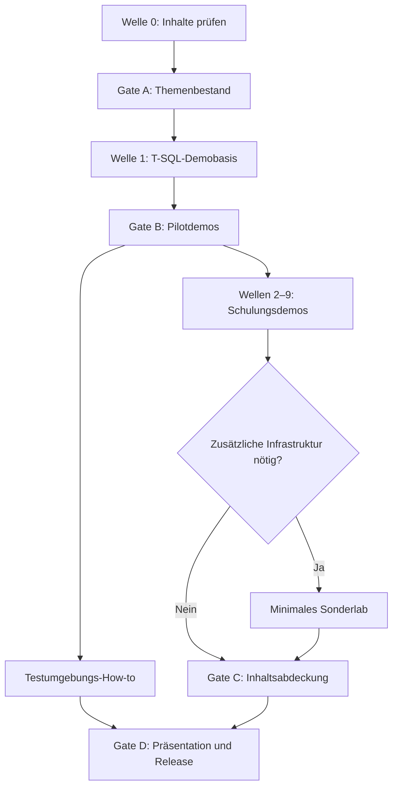

# Master-Umsetzungsplan – SQL-Server-Performance-Schulung

## Operativer Auftrag vom 26. Oktober 2026

Die autonome Wiederaufnahme folgt der vom Menschen bestätigten Priorisierung.
Aktuelle Reihenfolge, gemeinsamer endlicher Rahmen, jeweilige Subwelle und
Blocker stehen ausschließlich im [aktuellen Ausführungsstand](CURRENT_EXECUTION_STATUS.md#autonomer-auftrag-vom-26-oktober-2026).
Jede konsistente, relevant geprüfte Welle wird über Pull Request integriert.
Die älteren datierten Aufträge unten erhalten ihre historische Aussage;
ihre Pausen begrenzen den neuen Auftrag nicht, ihre fachlichen und technischen
Abnahmebedingungen bleiben bestehen. Der begrenzte DGN-004-Plan für
Standard-Planerzwingung und festen Hint-Kontrollzustand bleibt unverändert.

## DGN-004: Aktiver begrenzter Umfang vom 25. Oktober 2026

Der aktuelle Auftrag begrenzt DGN-004 (Planerzwingung) bei TSK-016
(gezielte Curriculum-Ergänzungen) auf klassische Planerzwingung über Standard-
Force/Unforce und einen festen Inline-Hint-Kontrollzustand. R ist Referenz ohne
Hint, H die getrennte Hint-Kontrolle. Nur Planung und statische CI (Continuous
Integration; automatisierte Integrationsprüfungen) im Pull-Request-Verfahren;
keine Umsetzung oder SQL-/Lab-Läufe. Übrige Verarbeitung pausiert.

Die [kanonische Registry](../../.ai/identity/registry.json) wählt bei TSK-016 für
DGN-004 über `active_plan` ausschließlich `classical_forcing_hint_control_plan`.
Die [abgeleitete aktive Planansicht](../../.ai/BACKLOG.md#aktiver-begrenzter-plan-klassische-planerzwingung-und-hint-kontrollzustand)
führt die neuen Abnahmekriterien. Klassisch bezeichnet die dokumentierte
Zwei-Argument-Standardschnittstelle und belegte Planverwendung, keine Aussage
über den internen Optimierungs-/Replay-Weg. Replay bedeutet Wiederverwendung
von Optimierungsschritten; Nutzung und Nichtnutzung werden hier nicht abgenommen.

Unverändertes R/H-Quellpaar, Form A und neun Nutzaufrufe je Build: R aufwärmen
(1/2), R-Force belegen (3), H binden (4), zweimal H-Force/Kontrollzustand (5/6),
erneut R-Force (7), H/R unforced abschließen (8/9). Kein R-Replay-Skript,
QueryCompilationReplay-Wert oder H-Nichtnutzungsmarker als Eintritts-/Erfolgsgate.
Vollständige Quellen-/Identitäts-/Plan-/Kontext-/Tupelbindung, aktuelle Erfassung,
strenger Kompilierungszuwachs +1, eigener regulärer Ausführungszuwachs und
Fehlerfreiheit bleiben Pflicht. H verlangt zusätzlich den vollständigen festen
Inline-Hint und keine fremde überschreibende Steuerung.

Ein späterer PASS (bestanden) gilt ausschließlich für
CLASSICAL_FORCING_AND_HINT_CONTROL. H bleibt CONTROL_ONLY (nur Kontrollzustand
belegt), ohne empirische Replay-Abschaltung oder isolierte kausale Hintwirkung.
Gesamt-PASS im engeren Umfang erst nach allen neun Aufrufen und sicherer
Bereinigung auf beiden Builds. Fehlende aktive Pflichtbelege bleiben Nichtabnahme;
Vertrags-/Bereinigungsfehler dürfen nicht durch die Begrenzung verdeckt werden.

Replay-Vergleich samt offenen Marker-Gates, alter Ein–Aus–Ein-/Gleichidentitäts-
vergleich, erweiterte Deaktivierungssignatur, gezielte Fehler-/Fallback-Demo,
gespeicherte Query-Store-Hints und 2019-Qualifikation sind zurückgestellt.
Frühere FAIL-/NOT_PROVEN-Befunde und Quellen-/Planstände unverändert erhalten.
Die offenen Replay-Gates blockieren diesen engeren Aussageumfang nicht und
bleiben für spätere Erweiterungen zwingend. Die [Quelleneinordnung](../Research/SOURCE_REGISTER.md#dgn-004-begrenzung-auf-standard-planerzwingung-und-hint-kontrollzustand-vom-25-oktober-2026)
trennt die Abnahmeumfänge; keine zweite Planungsliste.

Unverändert zwei eigene sequenzielle Container für 2022/16.0.4265.3 und
2025/17.0.4075.5, 900 Sekunden gemeinsames reguläres Budget plus je 60 Sekunden
Cleanup und alle bisherigen Text-/Transport-/Eigentums-/Ressourcengrenzen.
Vor Umsetzung unabhängigen Review des engeren Quellen-/Identitäts-/Transport-/
Mess-/Statusvertrags und statische Gegenfälle abschließen; diese Freigabe ist
noch offen. Danach neuer ausdrücklicher Umsetzungs-/Laufauftrag. Tatsächliche
Build-/Text-/Planqualifikation bleibt spätere Pflicht. Die folgenden älteren
Abschnitte sind historische Befunde und Pläne; ihre Replay-Abnahme wird nicht
zum Erfolg oder zur aktuellen Eintrittsbedingung umgedeutet.

## DGN-004: Quellenklärung der Marker-Gates vom 25. Oktober 2026

Der vorausgehende Quellenklärungsauftrag dokumentierte bei TSK-016 (gezielte Curriculum-Ergänzungen)
die Quellenklärung für DGN-004 (Planerzwingung). R ist Referenz ohne Hint, H die
Negativkontrolle mit festem Abschalthinweis; Replay bedeutet Wiederverwendung
von Optimierungsschritten. Nur Dokumentation und statische CI (Continuous
Integration; automatisierte Integrationsprüfungen) im Pull-Request-Verfahren;
keine Umsetzung oder SQL-/Lab-Läufe. Übrige Verarbeitung pausiert.

Die [kanonische Quellenklärung](../../.ai/identity/registry.json) steht bei TSK-016
unter `rh_marker_gate_source_clarification_result`; die [abgeleitete Detailansicht](../../.ai/BACKLOG.md#quellenklärung-der-offenen-rh-marker-gates)
und die [Quelleneinordnung](../Research/SOURCE_REGISTER.md#dgn-004-quellenklärung-der-marker-gates-vom-25-oktober-2026)
führen die technische Evidenz und deren Grenzen. Herstellerstand b6fe4934643919b28ddea54ad04c66ff1b2a82d1
erneut gebunden: allgemeiner Funktions-/Hintumfang ab 2022 einschließlich 2025
ist dokumentiert. Dies ist kein aktueller Marker-Nutzungsnachweis.

Beide Gates bleiben für 2022/16.0.4265.3 und 2025/17.0.4075.5 offen.
QueryCompilationReplay = 1 bleibt positiver Quellenkandidat. Das optionale
Ganzzahlattribut besitzt im Hersteller-Schema keine Zustandswerttabelle; für H
fehlt ein qualifizierter beobachtbarer Nichtnutzungszustand. 0, Abwesenheit,
Hint, Skriptvorhandensein, fehlender Fehler oder Kompilierungszuwachs ersetzen
die aktuelle Nutzungs-/Nichtnutzungssemantik nicht. Abwesenheit verlangt einen
eigenständigen Vollständigkeits- und Bedeutungsnachweis des Erfassungswegs.

Öffentlich geprüfte Quellen schließen diese Lücke nicht; keine Behauptung einer
vollständigen Recherche oder fehlender Featureunterstützung in 2025. Zusätzliche
Buchspur nicht im relevanten Originalvolltext zugänglich und nicht als technische
Evidenz verwendet. Keine neue empirische Beobachtung oder unabhängige Freigabe.
CONTROL_ONLY (nur Kontrollzustand belegt) bleibt Teilbefund, der Vergleich ohne
Markerabnahme NOT_PROVEN (nicht nachgewiesen), soweit kein höherer Fehlerstatus
greift. Die Aussagegrenze zur isolierten kausalen Hintwirkung bleibt erhalten.

Quellpaar, Markerprobenplan, Abnahmekriterien, Mess-/Statusvertrag und sämtliche
Budgets unverändert: neun Nutzaufrufe je Build, zwei eigene sequenzielle Container,
900 Sekunden gemeinsam plus je 60 Sekunden Cleanup. Unabhängige Marker-, Quellen-/
Identitäts-/Transport-/Mess-/Statusfreigaben und tatsächliche Buildnachweise
bleiben offen. Erst danach neuer ausdrücklicher Umsetzungs-/Laufauftrag im
gewählten Gesamtrahmen; keine alte Lauf- oder Telemetriefreigabe wird aktiviert.
Frühere Befunde und Pläne bleiben erhalten.

## DGN-004: Markerprobenreview und Hintwirkung vom 25. Oktober 2026

Der vorausgehende Dokumentationsauftrag erfasste bei TSK-016 (gezielte Curriculum-Ergänzungen)
den Prüfbefund für DGN-004 (Planerzwingung). R ist Referenz ohne Hint, H die
Negativkontrolle mit festem Abschalthinweis. Replay bezeichnet Wiederverwendung
von Optimierungsschritten. Nur Dokumentation und statische CI (Continuous
Integration; automatisierte Integrationsprüfungen) im Pull-Request-Verfahren;
keine Umsetzung oder SQL-/Lab-Läufe. Übrige Verarbeitung pausiert.

Der [kanonische Prüfbefund](../../.ai/identity/registry.json) steht bei TSK-016
unter `rh_marker_probe_review_result`; die [abgeleitete Detailansicht](../../.ai/BACKLOG.md#prüfbefund-zum-rh-markerprobenplan-und-zur-hintwirkung)
führt Ergebnis und Aussagegrenze. Im konkret geprüften Beobachtungs-/Abnahmevertrag
kein neuer konkreter Widerspruch zu den bestehenden Text-, Mess-, Status-,
Sequenz- und Budgetverträgen festgestellt. Dies ist keine unabhängige Methoden-
freigabe, Ausführungsreife oder Laufzeit-/Demoabnahme.

Ein späterer PASS (bestanden) würde die unabhängig freigegebenen beobachteten
Nutzungs-/Nichtnutzungszustände der getrennten R/H-Abfragen belegen. R/H haben
verschiedene Identitäten und eigene Zielpläne; für H ist ein gespeichertes
Replay-Skript keine Voraussetzung. Daraus folgt als methodische Aussagegrenze:
keine isolierte kausale Hintwirkung und keine reversible Abschaltung derselben
query_id nachgewiesen. Die dokumentierte Hintbedeutung bleibt quellenbasiert.
Keine zusätzliche Gegenfaktualprobe oder Kontrollreihe in den Rahmen aufnehmen.

Positive R-Markersemantik und beobachtbarer H-Nichtnutzungszustand bleiben für
2022/16.0.4265.3 und 2025/17.0.4075.5 unabhängig zu klären. Abwesenheit trägt
nur mit vorab belegter vollständiger Nutzungskennzeichnung und geklärter
Nichtnutzungsbedeutung; sonst höchstens CONTROL_ONLY (nur Kontrollzustand belegt).
Der Vergleich bleibt bei fehlender Evidenz NOT_PROVEN (nicht nachgewiesen),
soweit kein höherer Fehler-/Bereinigungsstatus greift. Die [Quelleneinordnung](../Research/SOURCE_REGISTER.md#dgn-004-markerprobenreview-und-hintwirkung-vom-25-oktober-2026)
trennt Quellenbefund und Inferenz aus dem Versuchsaufbau.

Quellpaar, rh_marker_probe_plan, übrige Pläne, Abnahmekriterien und Mess-/Status-
vertrag unverändert: neun Nutzaufrufe je Build, zwei eigene sequenzielle Container,
900 Sekunden gemeinsames reguläres Budget plus je 60 Sekunden Cleanup. Keine
neue Telemetrie, Kalibrierung oder Budgetaddition. Unabhängige Quellen-/Identitäts-/
Transport-/Mess-/Statusfreigaben und tatsächliche Buildnachweise bleiben offen.
Erst danach neuer ausdrücklicher Umsetzungs-/Laufauftrag; alte Freigaben werden
nicht wiederaufgenommen. Frühere Befunde und Pläne bleiben erhalten.

## DGN-004: Begrenzte R/H-Markerprobe vom 25. Oktober 2026

Der Planungsauftrag vom 25. Oktober 2026 plante bei TSK-016 (gezielte Curriculum-Ergänzungen) für
DGN-004 (Planerzwingung) eine begrenzte R/H-Markerprobe. R ist Referenz ohne Hint,
H die Negativkontrolle mit festem Abschalthinweis. Replay bedeutet Wiederverwendung
von Optimierungsschritten bei der Kompilierung. Nur Dokumentation und statische
CI (Continuous Integration; automatisierte Integrationsprüfungen) im bestehenden
Pull-Request-Verfahren; keine Umsetzung oder SQL-/Lab-Läufe. Die übrige
Verarbeitung bleibt pausiert, alte Laufrechte werden nicht wiederaufgenommen.

Der [kanonische Vertrag](../../.ai/identity/registry.json) steht unter
`artifacts.TSK-016.candidates[DGN-004].rh_marker_probe_plan`; die
[abgeleitete Detailansicht](../../.ai/BACKLOG.md#begrenzte-rh-markerprobe-für-nutzung-und-nichtnutzung)
führt denselben ergänzenden Beobachtungs-/Abnahmevertrag. Quellpaar, Form A und
Neun-Aufruf-Folge bleiben unverändert: R aufwärmen (1/2), R-Nutzung (3), H binden
(4), zweimal H-Nichtnutzung (5/6), erneut R-Nutzung (7), H/R unforced abschließen
(8/9). Höchstens zwei eigene Container, sequenziell einer je festgelegtem Build,
und 900 Sekunden gemeinsames reguläres Budget plus je 60 Sekunden Cleanup.
Keine zusätzliche Kalibrierungsrunde oder Addition mit alten Probenbudgets.

Abnahme getrennt für 2022/16.0.4265.3, Developer/Linux, Compatibility Level 160,
und 2025/17.0.4075.5, Enterprise Developer/Linux, Compatibility Level 170.
Aktuelle vollständige Plan-/Text-/Kontext-/Query-/Tupelbindung und strenger
Kompilierungszuwachs +1 bleiben Pflicht. Markerpräsenz, Rohwert und XML-Pfad
(XML: Extensible Markup Language; strukturiertes Planformat) bleiben je aktueller
Kompilierung erhalten; keine Umdeutung von Abwesenheit zu 0.

Vor Umsetzung unabhängig freigeben: tatsächliche erfolgreiche R-Nutzungssemantik
und beobachtbaren H-Nichtnutzungszustand je Build und Erfassungsweg. Beide Gates
bleiben offen. QueryCompilationReplay = 1 ist nur ein Kandidat; ein Muster aus
R/H-Werten allein begründet seine Bedeutung nicht. Fehlender H-Marker trägt nur
dann eine Nichtnutzungsregel, wenn vorab unabhängig nachgewiesen ist, dass dieser
Erfassungsweg jede tatsächliche Nutzung zwingend markiert und Abwesenheit am
aktuellen Zielstatement Nichtnutzung bedeutet. Solange das fehlt, höchstens
CONTROL_ONLY (nur Kontrollzustand belegt), kein empirischer Abschaltungsbeweis.

PASS (bestanden) je Build erst mit beiden positiven R- und beiden belegten
H-Gegenphasen, allen neun Aufrufen und vollständiger Bereinigung; Gesamt-PASS
nur für beide Builds. NOT_PROVEN (nicht nachgewiesen) bleibt bei fehlender
Semantik/Evidenz; FAIL (belegte Vertragsverletzung) und FAIL_CLEANUP
(Bereinigung fehlgeschlagen) haben Vorrang. Ohne Freigabegates kein Start,
Zustand nicht ausgeführt. Die [Quelleneinordnung](../Research/SOURCE_REGISTER.md#dgn-004-markerprobenplan-vom-25-oktober-2026)
begründet die offenen Grenzen. Neuer ausdrücklicher Auftrag für spätere Umsetzung
und Läufe erforderlich; dieser Plan ist keine unabhängige Freigabe oder
Laufzeit-/Demoabnahme. Bisherige Befunde und Pläne bleiben erhalten.

## DGN-004: R-Markersemantik und H-Gegenvertrag vom 24. Oktober 2026

Der Auftrag vom 24. Oktober 2026 dokumentierte bei TSK-016 die DGN-004-Quellenbefunde zur
positiven R-Markersemantik und zum beobachtbaren H-Gegenvertrag. R ist Referenz
ohne Hint, H die Negativkontrolle mit festem Abfragehinweis. Nur Dokumentation
und statische CI (Continuous Integration; automatisierte Integrationsprüfungen)
im bestehenden Pull-Request-Verfahren. Keine Umsetzung, Demotests oder SQL-/Lab-
Läufe; übrige Verarbeitung pausiert. Frühere Ausführungsfreigaben und Laufbudgets
werden nicht wiederaufgenommen.

Der [kanonische Plan](../../.ai/identity/registry.json) unter `hint_negative_control_plan`,
die [abgeleitete Detailansicht](../../.ai/BACKLOG.md#gesonderte-hint-negativkontrolle-mit-getrennten-abfrageidentitäten)
und die [Quelleneinordnung](../Research/SOURCE_REGISTER.md#dgn-004-r-markersemantik-und-h-gegenvertrag-vom-24-oktober-2026)
binden zwei getrennte eigene Modul-/Query-Identitäten: R ohne Hint, H mit festem
Inline-Hint. Ein gleicher QueryHash ist möglich, weil Query Hints nicht eingehen;
er darf keine Kennungen oder Planrollen zusammenführen. Je Modul vollständige
Text-/Kontext-/Plan-/Ergebnisbindung und frische Kompilierung/Ausführung verlangen.

Der neue [Marker-/Gegenvertragsbefund](../../.ai/BACKLOG.md#r-markersemantik-und-beobachtbarer-h-gegenvertrag)
steht kanonisch unter `rh_replay_marker_review_result`. Beide Gates bleiben für
2022/16.0.4265.3 und 2025/17.0.4075.5 offen. QueryCompilationReplay = 1 ist
weiterhin nur ein Quellenkandidat für tatsächliche Replay-Nutzung, also die
Wiederverwendung von Optimierungsschritten. Das Hersteller-Schema nennt eine
optionale Ganzzahl ohne Zustandswerttabelle; 0 oder Abwesenheit sind kein
freigegebener Aus-Zustand. Gespeichertes Skript und Erzwingungsanforderung sind
keine aktuelle Nutzungskennzeichnung.

Der feste H-Hint ist dokumentierte Abschaltkontrolle; mit frischer Kompilierung,
eigener klassischer Erzwingung und vollständigen Tupeln höchstens CONTROL_ONLY
(nur Kontrollzustand belegt). Für einen beobachteten H-Gegenbeleg fehlt weiterhin
die unabhängig geklärte Nichtnutzungssemantik. Fehler 8675 und die zusätzliche
2022-Ereignisliste zu opt_replay_exception_info betreffen gescheiterten Replay;
ausbleibende Fehler beweisen weder Nutzung noch Nichtnutzung. Keine neue
Ereignissession oder Ersatztelemetrie ist autorisiert.

Der empirische Vergleich bleibt NOT_PROVEN (nicht nachgewiesen), soweit kein
höherer Fehlerstatus greift. Quellen-/Textpläne, Abnahmekriterien, Mess-/Statusvertrag,
neun Nutzaufrufe, zwei eigene Container und sämtliche bisherigen Budgets bleiben
unverändert. Unabhängige Freigabe und tatsächliche Build-/Erfassungsnachweise
bleiben offen; dieser Review liefert keine Laufzeit- oder Demoabnahme.

Der vorausgehende [lesende Prüfbefund](../../.ai/BACKLOG.md#lesender-prüfbefund-zum-rh-quellpaar-und-textvertrag)
steht kanonisch unter `rh_source_text_review_result`. Quellpaar, endlicher Textvertrag
und Abnahmekriterien sind im konkret geprüften Umfang dokumentarisch schlüssig;
kein weiterer konkreter Widerspruch festgestellt. Quellen-/Spaltenbezüge, einziger
terminaler Hint-Unterschied und rechnerische Tupelerwartung passen zum Aufbau.
Die erwarteten Textdarstellungen stammen aus der Quelle; Erstzuordnung und
Darstellungswahl ersetzen keinen aktuellen Ausführungsnachweis oder Beleg für
wiederverwendete Optimierungsschritte. Die Sonderregel für erste
Bindungen in Aufrufen 1/4 erlaubt keinen erfundenen Null-Kompilierungszähler.

Der Review aus demselben Arbeitskontext ist keine unabhängige Freigabe. Tatsächliche
Darstellungen, Byteoffsets, Beobachtbarkeit und positive R-/beobachtete H-Replay-
Kennzeichnung (Wiederverwendung von Optimierungsschritten) auf beiden Zielbuilds
bleiben offen. Aktive Quellvorlagen/Pläne,
Abnahmekriterien, Mess-/Statusvertrag und Laufbudgets bleiben vollständig unverändert.
Kein zusätzlicher Lauf oder Ersatzablauf ist autorisiert.

Der [konkrete Quellen-/Textentwurf](../../.ai/BACKLOG.md#geplantes-vollständiges-rh-quellpaar-und-begrenzte-textzuordnung)
steht kanonisch unter `rh_source_text_plan`. Er legt zwei vollständige
CREATE-PROCEDURE-Quellwerte im eigenen Schema dgn004 fest. Beide verwenden die
unveränderte synthetische Form A; ausschließlich H erhält den terminalen Hint.
Die Vorlagen bestehen je aus einer ASCII-Zeile (7-Bit-Zeichensatz) ohne Kommentare
oder Zeilenumbrüche;
Bytepositionen und Offline-Prüfsummen binden die Quellen, keine Engine-Ausführung.

M bezeichnet den vollständigen Modultext, S dessen Nutzstatement mit Semikolon,
T nur denselben Text ohne letztes Semikolon. Modul-/Cachebatch müssen M entsprechen;
Cache-, Query-Store- und Planstatement dürfen ausschließlich S oder T entsprechen.
Die Erstzuordnung muss Quelle, eigenes Objekt, Kontext, Abfrage-/Textkennung und
aktuellen Plan gemeinsam belegen. Erst danach die je Ansicht gewählte Darstellung
versiegeln und unverändert fortführen; keine freie Normalisierung oder Neubindung.
Ein unbekanntes wohlgeformtes Engine-Format bleibt NOT_PROVEN (nicht nachgewiesen),
eine positiv belegte Vertragsverletzung FAIL; Bereinigungsfehler haben Vorrang.

Die Quellenlücke ist als Planungsvorlage geschlossen. Unabhängige fachliche Freigabe,
Überführung in ausführbare Quellen und tatsächliche M/S/T-/Offsetqualifikation auf
2022/16.0.4265.3 und 2025/17.0.4075.5 bleiben offen. Positive R-/beobachtete
H-Replay-Kennzeichnung ist weiterhin gesondert nachzuweisen. Neun Nutzaufrufe,
zwei Container, Mess-/Statusvertrag und Laufbudgets unverändert; keine Kalibrierung
oder Umsetzung durch diesen Plan autorisiert.

Der [vorausgehende Quellenbefund](../../.ai/BACKLOG.md#rh-abfrageform-und-engine-textzuordnung)
unter `rh_query_text_review_result` bleibt mit Basis PR325 erhalten. Er stellte
die damalige Quellenlücke und fehlende Erstzuordnung fest; der neue Entwurf liefert
die vollständigen Planungsvorlagen und begrenzt die Darstellungsauswahl. Der damalige
Review und die jetzige Planung ersetzen weder unabhängige Freigabe noch Buildnachweise.

Der vorherige [lesende Prüfbefund](../../.ai/BACKLOG.md#lesender-prüfbefund-zum-präzisierten-mess--und-statusvertrag)
steht bei TSK-016 unter `hint_evidence_status_review_result`. Beide vorigen
Präzisierungslücken sind dokumentarisch behoben; im geprüften Kompilierungs-/
Statusvertrag wurde kein weiterer Widerspruch festgestellt. Dieser damalige
Review änderte den Plan nicht; die aktuelle Ergänzung begrenzt
nur seine Quelltext-/Darstellungsabnahme. Messgrenzen und Ergebnisvorränge bleiben
unverändert. Diese Einordnung ist keine unabhängige Methodenfreigabe und keine
technische Qualifikation der Builds
2022/16.0.4265.3 oder 2025/17.0.4075.5. Quelltext-, Marker-/Gegenvertrags-,
Zuordnungs-/Transport- und Laufzeitgates bleiben offen; kein zusätzlicher Lauf
oder Kontroll-only-Ersatzablauf ist autorisiert.

Der vorausgehende lesende [Prüfbefund](../../.ai/BACKLOG.md#prüfbefunde-zur-gesonderten-hint-negativkontrolle)
steht kanonisch unter `hint_negative_control_review_result`. Im aktiven Plan
benennt `compilation_evidence_contract` ausdrücklich
`sys.query_store_query.count_compiles` je festgebundener eigener query_id.
Vorhermessung B0 nach bestätigtem Force, danach eigene sp_recompile-Markierung,
genau ein Nutzaufruf, vollständige Erfassung, budgetierter Flush und Nachhermessung
B1. R/H und Planstatistik getrennt; genau +1 ist eine strenge Abnahmebedingung,
keine allgemeine Herstellergarantie. Fehlende Daten oder unbekannte Zählerepoche
allein bleiben NOT_PROVEN (nicht nachgewiesen).

`outcome_precedence` trennt fehlende Evidenz von positiv belegter falscher oder
veralteter Zuordnung: Letztere ist FAIL (Vertragsverletzung). Der Schlussstatus
folgt FAIL_CLEANUP (Bereinigung fehlgeschlagen) vor FAIL vor NOT_PROVEN vor PASS;
alle Ursachen bleiben erhalten. CONTROL_ONLY bleibt Teilbefund und kann keinen
Gesamterfolg oder H-Ersatzablauf erzeugen. Beide Präzisierungen brauchen vor
Umsetzung unabhängige Freigabe; Marker-, Identitäts- und Versionsgates bleiben offen.

Nur der bereits geplante Form-A-Aufbau: 529 Datenzeilen, 768 Ergebnistupel je Aufruf.
Höchstens neun Nutzaufrufe je Version einschließlich beider positiver R-Phasen,
zweier H-Gegenphasen und beidseitigem unforced Abschluss. Zwei eigene Container
insgesamt, sequenziell, 900 Sekunden gemeinsames reguläres Budget plus je
60 Sekunden Cleanup. Kein Ersatzkandidat, Hintwechsel oder automatisches Addieren
zum bisherigen Ein–Aus–Ein-Plan aus PR319; dieser bleibt unverändert.

Kontrollzustand und empirische Replay-Nutzung (Wiederverwendung von
Optimierungsschritten bei Kompilierung) getrennt abnehmen. CONTROL_ONLY bedeutet
nur Kontrollzustand belegt und schließt kein Replay-Gate. Vor Umsetzung positive
R-Marker und beobachteten H-Gegenvertrag für 2022/16.0.4265.3 und 2025/17.0.4075.5,
Zuordnung und Transport unabhängig freigeben. Bisheriger Quellenkonflikt und
Reviews aus PR320/PR321 bleiben erhalten; unbekannte Rohwerte werden nicht zu
Erfolgskriterien. Neue Umsetzung/Läufe brauchen einen ausdrücklichen Auftrag für
genau den ausgewählten Schnitt. Die [Auftragsgrenzen](CURRENT_EXECUTION_STATUS.md)
halten die übrige Verarbeitung pausiert; keine zweite Planungsliste.

Die früheren begrenzten Schnitte bleiben erhalten: OPT-007
(Ad-hoc-Plancache; Zwischenspeicher spontan formulierter Abfragen) ist über
[PR313](https://github.com/gecompat/SQL_PerformanceSchulung/pull/313), CON-005
(Schemasperren) über [PR310](https://github.com/gecompat/SQL_PerformanceSchulung/pull/310)
integriert. Weitere Demo- oder Infrastrukturarbeit wird nicht begonnen;
eine zweite Planungsliste wird nicht angelegt.

## Wiederaufnahme vom 22. Oktober 2026: Eigentumsprüfungen zuerst

Der neue menschliche Auftrag autorisiert die vollständige Korrektur der
22 Cleanup-Eigentumskandidaten einschließlich Tests, Dokumentation und
Integration per Pull Request nach `origin/main`. Anschließend wird autonom mit
den nächsten priorisierten Punkten fortgefahren; der historische Arbeitsstopp
unten ist aufgehoben. Es wurde keine Automation aktiviert.

1. Die bestätigte Fehlerklasse in allen 22 Cleanupquellen ist abgeschlossen;
   der verlinkte Ausführungsstand führt Integration und tatsächliche Nachweise.
   FWK-002 bezeichnet den Schutzvertrag für synthetische Testdatenbanken.
2. Zehn weitere Setups sind über PR297, der Markerschutz der Frameworkreferenz
   über PR299 vollständig geprüft und integriert. Als Nächstes vollständige
   Rohparameter vor der Namens- und Aktionsableitung prüfen, danach Recovery
   bei fehlgeschlagener Erstmarkierung.
   Recovery bedeutet Wiederherstellung nach einem Fehler oder Abbruch.
3. Anschließend vollständige menschliche Lesepfade und gezieltere Testauswahl
   bearbeiten. Teilnehmerpiloten benötigen eine tatsächliche Durchführung.

Verbindlicher Arbeitsstand, endlicher Aufgabenrahmen, Prüfgates und Grenzen:
[aktueller Ausführungsstand](CURRENT_EXECUTION_STATUS.md). Der erste
[abgegrenzte Nachweis](FWK_002_CLEANUP_OWNERSHIP_REVIEW.md)
enthält die 22 Quellen und die tatsächliche Evidenz. Eine Cleanupabnahme ist
keine globale Freigabe des gesamten Ausführungspfads.

## Benutzerabschluss vom 22. Oktober 2026

Der aktuelle Demoauftrag endet nach vollständigem Abschluss. Es werden keine
weiteren Demo-Implementierungen oder Entwicklungswellen in diesem Chat begonnen;
der Chat wird anschließend beendet. Der 30-Minuten-Heartbeat ist gelöscht.
Die frühere kontinuierliche Fortsetzung ist aufgehoben. Eine Wiederaufnahme
benötigt einen neuen menschlichen Auftrag.

QRY-001 (Indexfreundliche Suchbedingungen) ist mit
[PR293](https://github.com/gecompat/SQL_PerformanceSchulung/pull/293) vollständig
in Main `6407a105e656bd0669c81a1921265c292dc622cd` integriert: unabhängiger
Review, lokale Gegenproben, 48 grüne Head-, 46 Base- und 46 frische
Main-Prüfungen, vollständige Baumübernahme, Synchronisation und eigene lokale
sowie Remote-Branchbereinigung. Head bezeichnet den geprüften
Pull-Request-Commit, Base dessen Main-Basis. Foundation 1.25.0 bleibt integriert.

Offene Eigentums-, Wiederherstellungs- und Dokumentationsaufgaben bleiben
erhalten, ohne automatische Fortsetzung. Der
[aktuelle Ausführungsstand](CURRENT_EXECUTION_STATUS.md) ist für diesen Abschluss
maßgeblich. Die folgenden Teilstände und Fortsetzungspläne sind historisch;
sie begründen keinen weiteren Arbeitsauftrag.

## Historischer Schnitt: Setup-Eigentumsprüfung nach abgeschlossenem Cleanup

PR292 ist vollständig in Main `0558add5d2d030fd0b19829c5f8e4150ee05a234`
abgeschlossen: unabhängiger Review, lokale Gegenproben, 48 grüne Head-,
46 Base- und 46 frische Main-Prüfungen, vollständige Baumübernahme,
Synchronisation und eigene Branchbereinigung. Head ist der geprüfte
Pull-Request-Commit, Base dessen Main-Basis. Foundation 1.25.0 bleibt integriert.

Der getrennte Schnitt `codex/qry001-setup-ownership` behebt ausschließlich die
Setupprüfung einer bestehenden Datenbank für QRY-001 (Indexfreundliche
Suchbedingungen). Vier vollständige Marker vor jeder Konfigurations- und
Tabellenänderung; normale Konfiguration und Datenmodell bleiben erhalten.
Ein Implementierungsverantwortlicher, derselbe unabhängige Reviewer, Checkpoint
am zweiten stabilen Kandidaten oder ersten blockierenden Befund, harte Grenze
vier Kandidaten einschließlich Reviews, Tests und Integration sowie höchstens
vier lokale eigene Dockerprüfläufe. Verbrauch UNKNOWN, nicht verlässlich
gemessen. Auswahl, Effektgrenzen, Gegenfälle und tatsächliche Testauslöser stehen
im [aktuellen Ausführungsstand](CURRENT_EXECUTION_STATUS.md).

Lokal sind beide tatsächlichen Altfehler und der korrigierte Stand mit 27
Ablehnungsfällen, zweimaliger Wiederverwendung, Neuanlage und zwei vollständigen
Demo-Läufen nachgewiesen. C1-/C2-Fixturefehler bleiben erhalten; C3 besteht.
Vier eigene lokale Prüfläufe, insgesamt 322,672 gemessene Sekunden, alle
Container unabhängig abwesend. Native Grenze geschlossen, C4 nur Dokumentation.
Unabhängiger Ergebnisabschluss und reguläre Integrationsgates folgen;
vollständiger Abschluss erfordert frische Main-Gates und eigene Branchbereinigung.

Weitere Cleanupkandidaten und Wiederherstellung nach fehlgeschlagener erstmaliger
Markierung bleiben offen. Keine globale Freigabe von FWK-002 (Schutzvertrag für
Testdatenbanken) oder einer gemeinsam genutzten Instanz. Nach vollständiger
Integration zuerst die übrigen Eigentumslücken, dann weitere Lesepfade und
native Anbindung. Die folgenden Abschnitte sind historische Nachweise.

## Historischer Schnitt: Cleanup-Eigentumsprüfung vor weiterer nativer Anbindung

PR291 ist vollständig in Main `65089ac2c42a47fe961a1de7dc04d1e41da78f31`
abgeschlossen: unabhängiger Review, lokale Prüfungen, 48 grüne Head-, fünf
Base- und 46 frische Main-Prüfungen, vollständige Übernahme, Synchronisation
und eigene Branchbereinigung. Head ist der geprüfte Pull-Request-Commit, Base
dessen Main-Basis. Foundation 1.25.0 aus PR290 bleibt abgeschlossen.

Der eigene Schnitt `codex/qry001-cleanup-ownership` behebt unter FWK-002
(Schutzvertrag für Testdatenbanken) nur den direkten Cleanup für QRY-001
(Indexfreundliche Suchbedingungen), mit echten negativen Eigentumsgegenproben
und erhaltenen positiven Läufen. Die separate Setup-Lücke und weitere
Cleanupkandidaten bleiben offen; keine allgemeine Eigentumssicherheits- oder
Freigabe einer gemeinsam genutzten Instanz. Auswahl, Tests, Aufrufgrenzen und
Aufwand stehen im [aktuellen Ausführungsstand](CURRENT_EXECUTION_STATUS.md).
Ein Implementierungsverantwortlicher, derselbe unabhängige Reviewer, Checkpoint
nach zwei stabilen Kandidaten beziehungsweise erstem blockierenden Befund,
harte Grenze vier Kandidaten einschließlich Reviews, Tests und Integration;
Verbrauch UNKNOWN, nicht verlässlich gemessen. Danach werden zuerst die
restlichen Eigentumslücken begrenzt, erst anschließend die native Kanalanbindung.
Die folgenden Abschnitte sind historische Nachweise.

## Historische Priorität: menschlicher Ausführungspfad und Schutzvertrag für Cleanup

Foundation 1.25.0 ist mit PR290 in Main
`2f4c427b3da36ae3c5f24770aeaee75ce3488ea0` vollständig abgeschlossen:
unabhängiger Review, lokale Prüfungen, sieben grüne Head-, sechs Base- und
fünf frische Main-Prüfungen, Übernahme, Synchronisation und eigene
Branchbereinigung. Head bezeichnet den geprüften Pull-Request-Commit, Base
seine Main-Basis. Der frühere Runner-Fix aus PR289 bleibt abgeschlossen;
Runner bedeutet vollständige Ausführungssteuerung.

Der erste TSK-015-Ausführungspfad (Demo-Auswahl, Vorbereitung, Ergebnisdeutung
und Erhalt nach Abbruch) wurde mit [PR291](https://github.com/gecompat/SQL_PerformanceSchulung/pull/291)
integriert. Die damalige Einschränkung des QRY-001-Cleanupclaims und der
Dokumentationsschnitt ohne SQL-Änderung sind abgeschlossene historische Arbeit;
der alte Workerrahmen ist geschlossen. Der damalige Plan, vor weiterer
DGN-007-Anbindung zunächst funktionale FWK-002-Korrekturen auszuführen, ist
ebenfalls kein aktueller Ausführungsauftrag. Für die heutige Reihenfolge,
verbleibende Lesepfade und offene Prüfgates sind der
[aktuelle Ausführungsstand](CURRENT_EXECUTION_STATUS.md) und der
[aktuelle Backlog](../../.ai/BACKLOG.md#aktuelle-priorität-nach-abgeschlossenem-foundation-upgrade)
maßgeblich. Historische Kennungen und Nachweise bleiben erhalten; die folgenden
Abschnitte dokumentieren frühere Planungs- und Ausführungsstände.

## Erste Runnerprofilaufnahme sicher beendet, tatsächlicher Report fehlt

Die [erste tatsächliche Aufnahme](DGN_007_RUNNER_PROFILE_OBSERVATION_REVIEW.md#tatsächliches-ergebnis-des-dritten-standes)
des Runners, der vollständigen Ausführungssteuerung, ist nach unabhängigem
Quellen-/Test-/Aufruf-GO abgelehnt beendet: 19 portable Methoden und sechs
native Gegenfälle bestanden ohne übersprungene Tests, danach genau ein
unveränderter Runnerstart mit `EARLY_EOF`, frühem Ende des Ausgabestroms vor
jedem Profilreport. Alle eigenen Prozesse, Datenströme und Windows-Jobs sind
nachweislich beendet; unabhängige Absenz und Wiederherstellung belegt.

Drei von höchstens sechs Quellenständen, Checkpoint nach zwei, ein Prüflauf
mit sieben synthetischen Prozessen und der einzige ausgewählte native Versuch
sind verbraucht. Ursache UNKNOWN, also mit dieser Evidenz unbekannt; weder
Auswahländerung noch Wiederholung oder Body-/Importfreigabe erlaubt.
Unabhängiger Ergebnisreview ohne offene priorisierte Befunde und lokale Dokumentationsprüfung abgeschlossen. [PR288](https://github.com/gecompat/SQL_PerformanceSchulung/pull/288) bindet den regulären Dokumentationsabschluss mit aktuellen Gates und Übernahmenachweis. Weitere native Diagnose braucht eine ausdrücklich neue
Versuchsgrenze. Ein sicherer Abschluss ersetzt keinen vollständigen Report
und keinen Runtime-, Trust-, Importbyte-, Methoden- oder SQL-Nachweis.

## Erste native Runnerprofilaufnahme als getrennte Folge planen

[PR286](https://github.com/gecompat/SQL_PerformanceSchulung/pull/286) ist mit
unabhängigen Reviews, vollständigem lokalem Auswahlpaket, sieben grünen Head-,
fünf Base- und fünf frischen Main-Prüfungen, vollständiger Übernahme und eigener
Branchbereinigung in `a714c7d578a18d2fa31fe862bc1e184ed1037444` abgeschlossen.
Der Auswahlrahmen mit acht von hart acht Ständen bleibt geschlossen.

Der [neue Beobachtungsplan](DGN_007_NATIVE_PROFILE_OBSERVATION_PLAN.md)
bereitet ausschließlich die erste frische Runneraufnahme vor; Runner bezeichnet
die vollständige Ausführungssteuerung. Ein Owner, derselbe unabhängige Reviewer,
Checkpoint am Entwurf, harte Grenze zwei Dokumentationsstände einschließlich
Nacharbeit, Tests, Koordination und Integration; Verbrauch UNKNOWN, nicht
verlässlich gemessen. Keine Implementierung oder native Ausführung in diesem
Schnitt. Die vollständige Aufnahme gegen unveränderte Felder, der Halt vor
Body-/Importfreigabe und unabhängiger eigener Linux-Cleanup benötigen später
einen konkreten endlichen Quellen-/Test-/Aufrufrahmen und ausdrückliches Lauf-GO.
Ein reiner Plan oder passender Teilreport belegt keinen vollständigen Worker,
keine tatsächlich verwendeten Kandidatenbytes und keine Runtime-/SQL-Abnahme.

## Vollständiges Auswahlpaket im achten Stand lokal bestanden

Der Mensch hat den [vorhandenen Poolvergleich samt Gegenproben und offenen
Paketprüfungen](DGN_007_WORKER_PROFILE_SELECTION_REVIEW.md#achter-stand-poolvergleich-mit-unabhängiger-erwartung)
als achten Quellen-/Teststand freigegeben. Ein Implementierungsverantwortlicher
und derselbe unabhängige Reviewer; acht/hart acht einschließlich Tests,
Koordination und vollständiger Integration, Verbrauch UNKNOWN. PR285 ist
vollständig in Main `0ae7cb735cc7961fffbac79c7837b4c60dae1cd5` integriert,
eigene Branches bereinigt. Die folgenden früheren Grenzen sind historisch.

Der private Helfer ersetzt den flachen Vergleich durch den vorhandenen
Fünfformenvergleich mit Stringpools, also Referenzen auf einmal gespeicherte
Texte. Die separat gehaltene Erwartung bleibt bei Gegenproben unverändert.
Alle bisherigen 37 und drei neue gültige Kontextabweichungen, sämtliche
Fünfformenprüfungen und drei unveränderte Ganz-AST-/Fitmethoden bleiben
erforderlich; AST bezeichnet den abstrakten Syntaxbaum. Bytegrenzen,
Originalprofilbytes und feste Hashes ändern sich nicht. Der zusätzliche
unabhängige Testencoder wird als 22. Quelle vor Import und Ausgabe geprüft.
Der unabhängige Quellen-/Testreview schloss den Stand ohne offene priorisierte
Befunde und erteilte genau ein gestuftes Lauf-GO. Der einmalige Windows-Lauf
bestand alle 40 Datengegenproben, die drei Fünfformensätze und alle drei
ursprünglichen Ganz-AST-/Fitmethoden. Beide Argumentgegenproben, zwei
Provider-Testmethoden mit neun negativen Konfigurationen und zwei
Cleanup-Gegenproben bestanden; alle vier Jobs sind bereinigt.
Quellenpins vor Import und nach Prüfung bestätigt. Die drei erzeugten Scripts
passen mit 129807/130693/130415 Bytes unter 131072; die fünf Formen zusammen
jeweils 28192/28185/28174 unter 65536 und einzeln unter 16384 Bytes.

Das Paket ist vollständig, bleibt aber ausschließlich quellenbegründete
Deklarationsauswahl (`SOURCE_SELECTED_DECLARATIONS_ONLY`). Kein Linux-/Worker-/
SQL-Start; Runtime-, Trust-, tatsächlicher Importbyte- und Methodennachweis
bleiben offen. Frühere Fehler und private Evidenz bleiben erhalten. Der
zugehörige Pull Request bindet unabhängigen Ergebnisabschluss, aktuelle
Head-/Base-/Main-Gates und vollständige Integration samt eigener Bereinigung.
Kein neunter Stand oder Retry in diesem ausgeschöpften Rahmen.

## Argumentkorrektur bestätigt, Paketvergleich am Einzelrahmenlimit gestoppt

Der Mensch hat die [siebte Fortsetzung im bestehenden Auswahlrahmen](DGN_007_WORKER_PROFILE_SELECTION_REVIEW.md#aktueller-siebter-stand-bereinigte-argumentübergabe)
ausdrücklich freigegeben. Ein Owner/ein unabhängiger Reviewer, sieben/hartsieben
einschließlich Gegenproben, Paketpflichten, Koordination und vollständiger
Integration; Verbrauch UNKNOWN. PR284 ist vollständig in Main
`4d758c1f8c52a7dce621eafc838063524fcd5a28` integriert, eigene Branches bereinigt.
Die folgenden Sechsergrenzen und Entscheidungsvorbehalte sind historisch.

Der siebte Stand wurde unabhängig ohne offene Befunde und mit genau einem
gestuften Lauf-GO freigegeben. Argumentgegenproben, beide Provider-Testmethoden
mit neun negativen Konfigurationen und beide Cleanup-Gegenproben bestanden;
alle vier begonnenen Jobs sind bereinigt. Der Pakethelfer unter vorhandenem
Windows-CPython 3.12 bestand die Eingangsprüfung und den Fünfformenvergleich
des ersten Workers, stoppte anschließend aber beim zusätzlichen flachen
Profilvergleich. Dessen 16384-Byte-Limit wird bereits von einer rein lesend
hergeleiteten konservativen Untergrenze von 17156 Bytes überschritten.
Kein vollständiges Paket, keine Worker-Scripts; übrige 36 Datengegenproben
und alle Ganz-AST-/Fitmethoden nicht ausgeführt; AST bezeichnet den abstrakten
Syntaxbaum. Kein Linux-/SQL-Start.
Für die verbleibende Korrektur über den vorhandenen Poolvergleich ist eine
neue ausdrückliche Erweiterung erforderlich; kein automatischer achter Stand,
kein Capwechsel oder Retry. Quellen und Fehlversuche bleiben erhalten;
unabhängiger Diagnoseabschluss und reguläre Integration folgen.

## Interpreterkorrektur am Aufruffehler gestoppt

Nach dem vollständig abgeschlossenen Diagnose-PR283 in Main
`e0cec9842971d0ecdf3f1604cdd5f59f3109a946` hat der Mensch den bestehenden
[Auswahlrahmen](DGN_007_WORKER_PROFILE_SELECTION_REVIEW.md#freigegebene-interpreterkorrektur-nach-dem-diagnoseabschluss)
auf höchstens sechs Quellen-/Teststände mit Checkpoint nach fünf erweitert.
Ein Owner/ein unabhängiger Reviewer einschließlich Tests, Koordination und
vollständigem Integrationsabschluss; Verbrauch UNKNOWN, kein Scope-Reset.
Die Korrektur legt den tatsächlichen Windows-Prüfinterpreter auf
CPython 3.12 fest und ergänzt die frühe Ablehnung falscher Provider samt Gegenprobe.
Eine vorhandene gebündelte Laufzeit genügt, kein Linux-Prozess oder neue
Installation. Der Checkpoint nach fünf schloss die Interpreterkorrektur statisch,
lehnte den Aufruf aber wegen zweier Befunde an Fehlercleanup und Zeitgrenzen
des Windows-Owners ab. Kein fünfter Lauf. Der sechste Stand bündelt den
Abschluss beider Befunde und vorgeschaltete Fehler-/Timeout-Gegenproben;
der unabhängige Review schloss beide Befunde und gab genau einen gestuften
Aufruf frei. Beide Cleanup-Gegenproben bestanden mit Jobabsenz. Anschließend
scheiterte die Provider-Testauswahl an der zusätzlichen Zielpfadangabe in
`sys.argv`; kein Provider-Testmethoden- oder Paketlauf. Alle drei begonnenen
Windows-Jobs sind bereinigt, keine neuen Workerartefakte oder Linux-/SQL-Ausführung.
Sechs/hartsechs, kein siebter Stand oder Retry ohne neue ausdrückliche
Erweiterung für Argumentübergabe/Gegenprobe. Die noch offenen Paketprüfungen bleiben vollständig
erforderlich, Hashes und Bytegrenzen unverändert. Die nachfolgenden Stopps
sind historische Evidenz; aktueller Einstieg ist der
[Ausführungsstand](CURRENT_EXECUTION_STATUS.md).

## Historischer Einstieg nach funktionalem Runnerabschluss

[PR281](https://github.com/gecompat/SQL_PerformanceSchulung/pull/281) ist vollständig
in Main `f143c968f5fec26c60fcc8b32e8baac637fdbcd1` integriert. Der unabhängige
Review, je 21 lokale Windows-/Linuxmethoden, aktuelle grüne PR-/Main-Prüfungen,
vollständige Baumübernahme und eigene Branchbereinigung sind abgeschlossen.
Die [synthetische vollständige Runnerroute](DGN_007_RUNNER_SHARED_SOURCE_REVIEW.md#abschluss-des-funktionalen-schnitts)
passt mit vollständiger Profilfixture in das unveränderte 131072-Byte-Limit.
Damit ist der frühere Quellenarchitekturblocker für diese Fixture geschlossen;
eine tatsächliche Workerinstallation oder echte Quellenverwendung ist nicht belegt.

Der [Auswahlplan für frische Workerprofile](DGN_007_WORKER_PROFILE_SELECTION_PLAN.md)
ist über PR282 vollständig in Main `e4b373d679ef2f8670913239664e55623cf7caaa`
integriert: sieben Head-/drei Base-/fünf Main-Prüfungen grün, unabhängiger
Review, lokale Dokumentationsprüfung, vollständige Übernahme, Synchronisation
und eigene Branchbereinigung. Ein Entwurfsstand, kein nativer Lauf.

Der damals gestoppte Schnitt war das [konkrete quellenbegründete Auswahlpaket](DGN_007_WORKER_PROFILE_SELECTION_REVIEW.md)
für eine vorhandene Installation und drei vollständige Profile. Ein Owner/ein
Reviewer, Checkpoint eins/hart vier Quellen-/Teststände einschließlich
Koordination und vollständigem Integrationsabschluss; Verbrauch UNKNOWN.
Der dritte Stand wurde vor Lauf mit drei Befunden abgelehnt; der vierte schloss
sie unabhängig. Sein einmaliger freigegebener Windows-Lauf scheiterte am
AST-Prüfinterpreter (AST: Abstract Syntax Tree; abstrakter Syntaxbaum): 3.14.7
statt des vertraglich festen 3.12. Rohbytes unverändert, Diagnose erklärt die
Meldung `BOOTSTRAP_CHANGED`; keine Änderung am Prüfer oder Wiederholung.
Vier Leser-Gegenproben, ein statischer Binärread und eine negative Pinprobe
erreicht, übrige 36 Fälle und sämtliche Form-/Fitprüfungen nicht ausgeführt.
Kein fertiges Paket oder Worker-Script, kein Linux-/WSL-, Worker- oder SQL-Lauf.
Der sichere Diagnoseabschluss wird unabhängig geprüft regulär integriert;
für Providerkorrektur und Gegenprobe ist eine ausdrückliche begrenzte
Erweiterung erforderlich. Kein fünfter Stand oder Scope-/Budgetreset. Die
folgenden Stände sind historische Evidenz und keine aktuellen C6-/C7-/C8-Sperren.
Maßgeblich bleibt der [aktuelle Ausführungsstand](CURRENT_EXECUTION_STATUS.md).

## Historische Runner- und Kompositionsstände

PR275 ist vollständig in Main750844bbfe61f6b12c98354c034ea3441abbde91
integriert: sieben Head-/sechs Base-/fünf frische Main-Gates SUCCESS,
unabhängige Schließung, FullTree/Sync und eigene Branchbereinigung.
Der [gemeinsame Rootkontrollanker](DGN_007_RUNNER_SHARED_CONTROL_DESIGN.md)
bleibt ausschließlich DESIGNED, zwei/hartzwei Entwurfsstände geschlossen.
PR274-Quellenfit-Diagnose ist ebenfalls vollständig integriert.

Der letzte [C6-Source-/Testkandidat](DGN_007_RUNNER_SHARED_SOURCE_REVIEW.md)
d0470fc ist unabhängig mit drei P2 abgelehnt: `parent` vor Zuweisung,
ungeprüfter Guard-Slot vor Bootstrap, veränderbare Closurezellen im Cleanup.
Keine Generierung/Tests/Nativeexecution, Fit weiterhin unbekannt. Zusätzliche
Textkorruption ist benannt, reine Doc-Recovery erfolgt aus UTF-8-Gitbytes.
Neue Runnerquelle/Tests/Workflow aus finalem Diff entfernt; nur belegter
Befundabschluss wird integriert. Sechs/hartsechs, fünf geänderte Nachläufe,
Verbrauch UNKNOWN. Der konkrete Vorschlag einer ausdrücklich zu entscheidenden
Erweiterung um genau einen C7 ist keine Freigabe oder Budgetreset.
Bis zu dieser Entscheidung keine weitere Sourcewelle oder Wiederholungsprobe.
Der reine Dokumentationsabschluss mit Review, tatsächlichen grünen Head-/Base-/
Main-Gates, FullTree/Sync und eigener Branchbereinigung wird über
[PR276](https://github.com/gecompat/SQL_PerformanceSchulung/pull/276) gebunden.
Echte Runtime-/Trust-/Usedbytes-/Methoden-/SESSION_END-/SQL-Gates bleiben offen.

PR273 vollständig in Mainb00418ca74cd6ff4a0d194f8276ca365f9558f56 geschlossen:
neun PR-/sieben Main-Gates SUCCESS, Parent12/Harness16 ohne SKIP, unabhängige
Befundschließung, FullTree/Sync und eigene Branchbereinigung. Drei Kandidaten/
zwei Nachläufe geschlossen. [Runner-Quellenfit-Diagnose](DGN_007_RUNNER_LOADER_SOURCE_REVIEW.md)
sachlich als CLOSED_REJECTED_SOURCE_FIT verworfen: fünf/max6 Kandidaten, vier
Nachläufe, Verbrauch UNKNOWN. C4 weiterhin140097Bytes/9025überCap; C5-Auswahl
scheitert an bereits ausgespartem Parentmatcher, Fehlannahme berichtigt. Neue
Quelle/Tests/Workflow aus finalem Diff entfernt, keine Runnerabnahme. Unabhängige
Disposition bestätigt, Dokumentationsintegration/Bereinigung noch offen.
Quellenarchitekturblocker verlangt konkreten unabhängig geprüften Plan und
gebundenen Versuchsrahmen vor Wiederaufnahme; kein Reset oder blinder C6-Versuch.
Keine tatsächliche DGN-Raw-/Native-/SQL- oder Gesamtfreigabe.

PR272 vollständig in Main4a165c20840193e26b05a789d8e6e067c0bca7b9 geschlossen:
neun PR-/sieben Main-Gates SUCCESS, neue Harness16/Proxy16 ohne SKIP PASS,
unabhängige Befundschließung, FullTree/Sync und eigene Branchbereinigung.
Nächster priorisierter begrenzter Schnitt: [codefreie Parentregistrierung](DGN_007_CODEFREE_PARENT_REGISTRATION_REVIEW.md),
ein Owner/max4/Checkpoint1/hart4, Auswahl-/Source-/Test-/Fixture-PRE geschlossen,
drei Kandidaten/zwei Nachläufe. Zwölf Methoden Windows/Linux lokal ohne SKIP
belegt; C2-Codec-Fixturefehler in C3 gezielt korrigiert, keine grüne Vollsuite
wiederholt. CI (Continuous Integration; automatisierte Integrationsprüfungen) und vollständige Integration offen. Eigenständige vorbereitende
Komponente für Tests/Tests.Contracts; tatsächliche Runner-/Kontrollanker-/I/O-
Anbindung, vollständiger Scriptfit und reale Gesamtgates bleiben offen.

PR271 vollständig in Main `3387e308c8ae4f45d1cf8eb56176666e9e9355d4`
geschlossen: zehn PR-/acht Main-Gates SUCCESS, neue16/Eingangs16/Budget12 ohne
SKIP PASS, unabhängige Befundschließung, FullTree/Sync und eigene Branchbereinigung.
Nächster endlicher Funktionsschnitt: [verschachtelte Harness-Quellenfolge](DGN_007_HARNESS_LOADER_SOURCE_REVIEW.md),
ein Owner/max6/Checkpoint2/hart6 einschließlich Review/Test/Integration/Cleanup.
Auswahl-/Source-/Test-/Fixture-PRE unabhängig geschlossen. C4 nach gestuftem
einmaligem GO16/16 Methoden Windows/Linux ohne SKIP PASS, tatsächliche CRLF-/
LF-Quellen130337/128569Bytes innerhalb unverändertem131072Cap, ganze unabhängige
AST-/Literal-/Alphaoracle bestanden. Vier Kandidaten/drei Nachläufe, Verbrauch
UNKNOWN. CI, reguläre Integration und vollständiger Abschluss stehen aus.
Genau Worker3 mit SOURCES3/4/5 und Abschlüssen5/4/3, keine Parents. Keine native
Admission oder DGN-Raw-/SQLexecution; übrige Gesamtgates bleiben offen.

PR270 vollständig in Main `20549ae4e7dbb31c2ffb4d5b051395b8033db18e`
geschlossen: zwölf PR-/zehn Main-Checks SUCCESS, neue12/Handshake12/28Native/
Session16/Workerinput16 ohne SKIP, unabhängiger Review, FullTree/Sync/Branchcleanup.
Nächster begrenzter Schnitt: [erste direkte Proxyquelleninvocation](DGN_007_PROXY_LOADER_SOURCE_REVIEW.md), ein Owner/max6/Checkpoint2/hart6,
Auswahl-PRE freigegeben, C1 mit additiver Quelle und16eigenen sicheren Modellen,
Source/Test-PRE/Lauf-GO ausstehend, keine Suiteimporte/Proben. EOF-/Raw-/Code-/
Objektpfad zunächst nur Proxy2/Index2 mit eigenen synthetischen Modellen; übrige
Worker/Parents/Footer/Gesamtnachweise, operative Inventur und SQL bleiben offen.

PR269 vollständig in Main `e456c535bc7a75d72d5034587657f6bcb46a27dd`
geschlossen: neun PR-/sieben Main-Checks SUCCESS, neue16 Windows/Linux/Main
und Report16 ohne SKIP, unabhängige Befundschließung, FullTree/Sync/Branchcleanup.
Nächster begrenzter Schnitt: [gemeinsame Child-I/O-Vorbuchung](DGN_007_CHILD_IO_RESERVATION_REVIEW.md), ein Owner/max4/Checkpoint1/hart4,
Auswahl-PRE unabhängig freigegeben, C1 mit einmaliger Vorbuchung und zwölf
portablen Budget-/Ownerordnungsmodellen. Checkpoint1: ein Kandidat/max4,
Source/Test-PRE und Lauf-GO ausstehend, keine Suiteimporte/neuen Proben;
keine operative neue Quellenwahl, Inventur oder SQL. Offene Gesamtgates erhalten.

PR268 vollständig in Main `dcc5893af0c50c88aa0f848c3c908733c15dcbdc`
geschlossen: dreizehn PR-/elf Main-Checks SUCCESS, neue16/alte15 ohne SKIP,
unabhängiger Review/FullTree/Sync/Branchcleanup. Nächste Sourcearbeit:
[vollständige Worker-Eingangsfolge](DGN_007_WORKER_INPUT_SOURCE_REVIEW.md),
ein Owner/max6/Checkpoint2, Auswahl-PRE freigegeben. C1 mit16I/O-Modellmethoden
und tatsächlichem Kernelhandoff vor Snapshot; Source/Test-PRE/Lauf-GO ausstehend.
Nur eigene I/O-Modelle,
keine nativen Starts; Childreserve muss vor späterer Parent-Admission aus dem
bisherigen Globalbudget gebucht werden. Inventur-/Loader-/Gesamtgates offen.

PR267 vollständig in Main `84272af549d1c7c1320b5b1c77a55a4b721f8d18`
geschlossen: zwölf PR-/zehn Main-Checks SUCCESS, unabhängige Befundschließung,
neue15 Windows/Linux und bestehende Consumer ohne SKIP PASS, FullTree/Sync/
Branchcleanup. Nächster Schnitt: [empfangene Metadata und tatsächlichen
Workerreport verbinden](DGN_007_OBSERVED_WORKER_REPORT_REVIEW.md),
max6/Checkpoint2, Auswahl-PRE freigegeben; C1 mit16Modellmethoden und privaten
äußeren Ankern/einmaligem Versuch. C2 schließt zwei P2 zu Builtinslot und
Bindingautorität, Checkpoint2; C2-Läufe stoppen am SCRIPT_LIMIT. C3 wählt nur
in der neuen Route benötigte Funktionen und erhält deren gesamten AST bei
Wegfall reiner Kommentar-/Leerzeilen. C3 unabhängig geschlossen mit Lauf-GO;
neue16 Windows/Linux ohne SKIP, Quellenfit und vollständiger AST-Erhalt PASS.
PR268 neue16/zwölf Gates PASS, eine alte Builderzählungsoracle FAIL. C4 korrigiert
nur die eigene sechzehnte Position/eindeutige API (Application Programming Interface; Programmierschnittstelle)/festen Unterbau dieser Methode;
vier Kandidaten. C4 unabhängig geschlossen mit gezieltem Lauf-GO; eine
geänderte Methode Windows/Linux PASS, frische finale Headgates folgen,
keine operative Ausführung oder Inventur.

PR266 vollständig in Main `ded09f685f747bb614c68c0fa78a6e54be7514be`
abgeschlossen: sieben PR-/fünf Main-Checks SUCCESS, unabhängige Einordnung,
FullTree/Sync/Branchcleanup. Neuer tatsächlicher Änderungsscope:
[Workerquelle mit gebundener Aufnahme](DGN_007_WORKER_PROFILE_SOURCE_REVIEW.md),
max6/Checkpoint2, Auswahl-PRE freigegeben; C2 schließt Annotation-/Key-P2 mit
15Modellmethoden, gemeinsamer Zustandsgrenze und einem Nachlauf. C2 unabhängig
ohne offene Befunde mit Lauf-GO; neue15 Windows/Linux ohne SKIP und neuer
vollständiger Arbeitsdatei-Quellenfit PASS. Reguläre Integration folgt.
Alte abgelehnte Vollroute bleibt FAIL;
neue Workerzusammensetzung behält alle Caps und Workerprüfungen.

PR265 vollständig in Main `966f2251bc301a1ac80997c591962f929a7a136c`
abgeschlossen: zehn PR-/acht Main-Checks SUCCESS, unabhängige Befundschließung,
FullTree/Sync/Branchcleanup. Nächster endlicher Schritt ist der
[aktuelle vollständige Kontrollquellen-Fit](DGN_007_CURRENT_CONTROL_SOURCE_FIT_REVIEW.md)
mit bestehendem Generator: max3/Checkpoint1, unabhängig erteiltes Lauf-GO.
Aktuelle vollständige CRLF-/LF-Profilquelle scheitert SCRIPT_LIMIT; Tiny-
Positivkontrolle und PROFILE_SIZE-Negativkontrolle korrekt. Unabhängige Einordnung
ohne offene Befunde bestätigt; nur reguläre Integration dieses Nachweises folgt.
Max3Dokumentationsstände erreicht, keine weiteren Versuche. Keine generierte Ausführung,
Inventur, Capänderung oder operative Abnahme.

PR264 vollständig in Main `5bf9d14a46b0fba1184f6a5a6dc3772c6278cb17`
abgeschlossen:13PR-/11Main-Checks SUCCESS, unabhängiger Review, FullTree/Sync/
eigener Branchcleanup. Der korrigierte menschliche Projekteinstieg bleibt
maßgeblich. Danach folgt der endlich gewählte [lokale Auswahl-/Aufnahmeweg](DGN_007_SELECTED_PROFILE_OBSERVATION_REVIEW.md)
mit einem Owner/max6/Checkpoint2/hart6. Auswahl-PRE unabhängig freigegeben;
C2 schließt Runtime-POST-P2 und Hooktest-P3 mit16 eigenen Modellmethoden;
Checkpoint2 erreicht, unabhängig ohne offene Befunde und mit Lauf-GO;
neue16/Binder16 unter Windows/Linux ohne SKIP PASS. Reguläre Gates folgen.
Kein neuer operativer Installations-/Worker-/Loaderbeleg.

PR263 vollständig in Main `4a8d5aa2e6252803d7773b9e075c1bbfc4d8e5df`
abgeschlossen, neun PR-/sieben Main-Gates SUCCESS, unabhängiger Review und
FullTree/Sync/Branchcleanup bestätigt. Neue menschliche Priorität:
[Projekteinstieg und didaktischer Maßstab](PROJECT_ENTRY_AND_TEACHING_SCOPE_REVIEW.md).
Nützliche Erklärungen, SQL-Techniken und Lösungsmuster benötigen keinen eigenen
Benchmark als Aufnahmekriterium. README und Folgeeinstiege werden für Menschen
aufgebaut; historische Migrationsentscheidungen erklären keine Themenverbote.
Ein Owner/max4/Checkpoint1/hart4, unabhängige inhaltliche Abnahme und aktuelle
relevante lokale/PR-/Main-Gates vor Abschluss. Keine Runtime-/SQL-/Gateänderung.

PR262 vollständig in `9938091d7de38bb95152cc06e055470e5fb8b7cc` abgeschlossen:
zehn PR-/acht Main-Gates grün, neue12/alte Kanal16/pure Eingangsplan16 Methoden
in CI/Main ohne SKIP, unabhängiger Review und FullTree/Sync/Branchcleanup.
Nächste endliche Welle: [separat gewählte volle Profilauswahl an lokale Anker
binden](DGN_007_SELECTED_PROFILE_ANCHORS_REVIEW.md), ein Owner/max6/Checkpoint2/hart6,
Auswahl-PRE ausdrücklich freigegeben. C1 ergänzt reine API, engen Frozen-/
Mixed-Guardfix; C2 ergänzt die16.Methoden-Gegenprobe und schließt den Key-P2.
Unabhängiger Delta-PRE ohne offene Befunde/Lauf-GO; neue16/16 Windows/Linux
und alte57/57 Linux isoliert ohne SKIP PASS. Historischer alter Windows57-FAIL
aufgrund unveränderter POSIX-isabs-Fixture bleibt erhalten. Aktuelle Gates und
FullTree/Sync/Branchcleanup folgen. Keine operative Aufnahme dadurch behauptet.
C1-Keygrenzen-P2 wird im gebündelten C2 mit16.Methoden-Gegenprobe geschlossen;
Checkpoint2/hart6 und ausdrücklicher Delta-PRE/Lauf-GO bleiben maßgeblich.
Danach hat der menschlich neu priorisierte anwenderorientierte Projekteinstieg
mit verständlicher README und Archiv-/Migrationsklärung Vorrang vor der nächsten
operativen Profilaufnahme.

PR261 vollständig in `0d851dc9f87915a4952ad6fae1fe0f269f94d5e7` abgeschlossen:
acht PR-/sechs Main-Gates grün,16/16 neue Methoden Windows/Linux/Main ohne
SKIP, unabhängiger Review und FullTree/Sync/Branchcleanup. Danach unabhängig
ausgewählt: [nativer bidirektionaler Phasenowner](DGN_007_BIDIRECTIONAL_HANDSHAKE_REVIEW.md),
ein Owner/max8/Checkpoint2/hart8. C1 mit gemeinsamer nativer Ownersperre,
gehaltenen tatsächlichen Writes/Reads und einmaligen Freigaben ist unabhängig
ohne offene Befunde und mit ausdrücklichem Source/Test-Lauf-GO bestätigt.
Lokal Linux neue12/12 und alte16/16 Methoden ohne SKIP PASS; Windows drei/fünf
portable PASS, neun/elf native SKIP. Ein Kandidat, keine Befundnachläufe;
aktuelle PR-/Main-Gates und FullTree/Sync/Branchcleanup folgen vor Abschluss.
Reale Workerprofile, Loader-/Importprovenienz und SQL-/Methodenbelege offen.

PR260 vollständig abgeschlossen in `256e43d6d4ca4ac7a248dadbe4c88e6923577ef4`:
acht PR-/sechs Main-Gates grün, native16/16 ohne SKIP, unabhängige C4-Abnahme,
FullTree/Sync/eigene lokale und Remote-Branchbereinigung. Anschließend folgt
der unabhängig ausgewählte [gehaltene Handshakeeingang](DGN_007_HANDSHAKE_INPUT_PLAN_REVIEW.md)
mit vollständigen I/W/K/R, neun Rawbodies, fünf Darstellungsformen und drei
gebundenen Commands vor Start. Neuer endlicher Rahmen max6/Checkpoint2/hart6,
ein Owner; C1 unabhängig ohne offene Befunde/Lauf-GO bestätigt,16/16 neue
isolierte Methoden auf Windows und Linux ohne SKIP PASS. Aktuelle PR-/Main-
Gates und Integration/Branchabschluss folgen. Tatsächliche bidirektionale I/O (Input/Output; Ein- und Ausgabezugriffe) und
einmalige Phasenübergänge bleiben anschließende eigene Abnahmegrenzen.

PR259 ist vollständig in `d4151093bdd4de115b660352345f3e5c47e9b650` integriert,
einschließlich grüner PR-/Main-Gates, FullTree, Sync und Branchcleanup.
Auf ausdrücklichen kontinuierlichen Benutzerauftrag folgt der
[operative Linux-Abschlussweg](DGN_007_NATIVE_SESSION_CHANNEL_REVIEW.md):
echte getrennte Pipes, EOF (End of File; Ende eines Eingabestroms), Exit0 und eigenes Cleanup für feste kontrollierte
Testworker; gemeinsame Budgets und unveränderte deklarative Matcherbasis.
Ein Owner, höchstens drei Quellen-/Teststände, Checkpoint C1/hart C3,
unabhängiger Auswahl- und Quellen-/Test-PRE vor dem ersten Lauf. Danach genau
eine neue priorisierte endliche Folgewelle; reale Import-/Loaderprovenienz
und vollständige Start-/Body-/Commandintegration bleiben eigene Abnahmegrenzen.

C3-Stop dieser Welle: C3 ist unabhängig laufzulässig, Windows portable
grün, Linux15/16 Methoden PASS; `bad_nonce` scheitert vor Start an einer JSON-
Suche über P-Fragmente. Max3 und beide Nachläufe verbraucht. Der Mensch hat
genau eine gezielte C4-Fixturekorrektur samt unabhängigem Delta-PRE/Lauf-GO,
lokalem Ziellauf und aktueller vollständiger CI/Main-Integration/Branchcleanup
ausdrücklich freigegeben. Danach nächste priorisierte endliche Welle autonom.
Status C4 unabhängig ohne offene Befunde/Lauf-GO bestätigt, lokaler Linux-
Ziellauf mit fünf Fällen PASS; aktuelle vollständige CI16 und Main-Abschluss
folgen. Branch erhalten, Main unverändert.

Nach abgeschlossenen PR257/258 folgt auf ausdrücklichen Benutzerauftrag der
[vollständige deklarative SESSION_END-Matcher](DGN_007_SESSION_END_MATCHER_REVIEW.md).
Additive fünfzehnte Kontrollquellenroute, ganze Profil-/INPUT_COMPLETE-/Loader-/
Footerfolge und Rohbytebindung gegen separates vollständiges R4/K8; keine
operative Kanal-/EOF-/Exit-/Cleanupattestation. Unabhängiger Auswahl-PRE ohne
Befunde; C1-P2 in C2 geschlossen und C2-Fixture-FAIL erhalten. C3 korrigiert
den Testhelper, unabhängig mit Delta-Lauf-GO bestätigt; 30 neue Methoden auf
Python 3.12/Linux und 3.14/Windows ohne SKIP sowie 460 bisherige
Kontrollquellenmethoden unter Windows bestanden. Keine offenen Reviewbefunde;
PR259 bindet finale Head-/Base-Gates, Main-Integration und Branchbereinigung.

Am 20. Oktober 2026 nimmt der Benutzer die allgemeine Entwicklung nach
Bestandsprüfung ausdrücklich wieder auf. Die
[interne DGN-007-Capture-Rückgabe](DGN_007_INTERNAL_CAPTURE_RECEIPT_REVIEW.md)
ist nach unabhängigem Review und 14 grünen PR-Gates über PR255 in Main
`b3f023a…` integriert; Treevergleich und eigene Branchbereinigung sind bestätigt.
Der abgeschlossene
[SESSION_END-Entwurf §34](DGN_007_IMPORT_PROFILE_BINDING_DESIGN.md#34-session_end-counts-und-kanalhashpräbild)
legt exakte Counts und das nicht selbstreferentielle Kanalhashpräbild fest. Zwei
Entwurfsstände, Checkpoint nach dem ersten; unabhängiger Designreview ohne
Befunde und acht grüne Dokumentationsgates zum Erststand. PR256 ist mit acht
verschiedenen grünen finalen PR-Checks in Main `131e196…` integriert; alle sechs
Main-Workflows und eigene Branchbereinigung sind bestätigt. Auf erneuten
Benutzerauftrag folgen die [reinen SESSION_END-Komponenten](DGN_007_SESSION_END_COMPONENTS.md):
zuerst Footer-Codec, danach Kanalhash, je höchstens zwei Quellenkandidaten und
Checkpoint nach dem ersten. Gemeinsamer unabhängiger Auswahl-PRE ohne Befunde;
Footer-Erststand mit 13 lokalen isolierten Testmethoden auf Python 3.12/3.14
bestanden. PR257 ist nach unabhängigem Implementierungsreview ohne Befunde
und acht verschiedenen grünen finalen PR-Gates in Main `5466a44…` integriert;
alle sechs Main-Workflows, Treevergleich und eigene Branchbereinigung bestätigt.
Der erste Kanalhashkandidat besteht 22 isolierte Testmethoden auf Python
3.12/3.14 einschließlich aller Footergegenproben. Unabhängiger Review ohne
Befunde und acht grüne CI-Gates zum Quellenstand; die Evidenzrevision von PR258
bindet finale Integrationsgates und eigene Bereinigung. Vollständiger Matcher
und operative Provenienz bleiben offen.
Historische Pausenangaben unten werden nur in diesem Umfang abgelöst.
Automation und operative Provenienz- oder Workerfreigaben folgen daraus nicht.

Der ausdrücklich beauftragte [VERTIEFUNG-Zweitageskurs](../HowTo/SQL_SERVER_2025_AI_VERTIEFUNG_COURSE.md)
ergänzt nach STANDARD/PR251 den vollständigen Unterrichtspfad mit 61 Kursfolien,
acht Offline-Praxisaufgaben und konkreten Tag-2-Beleg-/Entwurfsaufgaben.
Die [technische/redaktionelle Generalprobe](SQL_SERVER_2025_AI_VERTIEFUNG_REHEARSAL.md)
ist abgeschlossen; optionaler Full-Text-WARN und Teilnehmerpilot bleiben getrennt.
Begrenzter TSK-012-/TSK-014-Materialabschluss, keine volle Streamfreigabe oder
Wiederaufnahme anderer technischer Wellen/Automationen.

Die nächste beauftragte KI-Welle nach BASIS/PR250 ist der
[STANDARD-Tageskurs](../HowTo/SQL_SERVER_2025_AI_STANDARD_COURSE.md) mit 45 Folien
und acht Offline-Aufgaben. Die [technische/redaktionelle Generalprobe](SQL_SERVER_2025_AI_STANDARD_REHEARSAL.md)
ist abgeschlossen; optionaler Full-Text-WARN und tatsächlicher Teilnehmerpilot
bleiben getrennt dokumentiert. Dies ist ein weiterer begrenzter Teilabschluss
von TSK-012/TSK-014; übrige technische Wellen und Automation bleiben pausiert.

Der gesondert beauftragte [BASIS-Kurs vom 18. Oktober 2026](../HowTo/SQL_SERVER_2025_AI_BASIS_COURSE.md)
ist als begrenztes Teilprodukt von TSK-012/TSK-014 technisch und redaktionell
geprobt. [Nachweis und verbleibender Teilnehmerpilot](SQL_SERVER_2025_AI_BASIS_REHEARSAL.md)
trennen Kursbereitstellung und Human-Evidenz. Die Gesamtfreigabe des KI-Streams
und die übrigen pausierten Wellen bleiben davon unberührt.

| Merkmal | Wert |
|---|---|
| Status | `PLANNED` |
| Planversion | 1.3 |
| Stand | 2026-07-24 |
| Primäre Zielplattform | SQL Server 2025 |
| Kompatibilitätsmatrix | SQL Server 2019, 2022 und 2025 |
| Bevorzugtes Demonstrationsmittel | T-SQL (Transact-SQL; SQL-Server-Dialekt der Abfragesprache SQL) |
| Verbindlicher Datenschutzstatus | ausschließlich synthetische und firmenneutrale Inhalte |

## 1. Zweck dieses Plans

Dieser Plan beschreibt die vollständige Umsetzung des Schulungsprojekts so detailliert, dass eine spätere Bearbeitung ohne Rekonstruktion der bisherigen Überlegungen begonnen oder fortgesetzt werden kann. Er konkretisiert die Wellen aus [`.ai/ROADMAP.md`](../../.ai/ROADMAP.md), ersetzt aber weder die verbindlichen Projektregeln noch den Demo-Vertrag.

Der Plan erzeugt selbst noch keine Demo-Skripte, Infrastrukturdefinitionen oder Präsentationen. Er legt Arbeitspakete, Reihenfolge, Abhängigkeiten, erwartete Artefakte, Prüfschritte und Abschlusskriterien fest.

### Eigenständige Curriculumerweiterung vom 2026-10-11

`DEC-073` (Eigenständiger KI-Workstream: Curriculumerweiterung und Planungsgrenze)/`TSK-003` (KI (künstliche Intelligenz; Verfahren für Aufgaben wie Textverarbeitung oder Vorhersagen) mit und für Microsoft SQL Server 2025: Planungsintegration) ergänzen den [KI-Workstream](SQL_SERVER_2025_AI_WORKSTREAM_PLAN.md).
Dieser Plan ist für zehn neue Module, 18 geplante Demos, elf Folgepakete, Provider-/Previewgates
und Security-/Benchmarkanforderungen maßgeblich; kein konkurrierender Masterplan wird gepflegt.
Produktgrenzen stehen in der [Featurematrix](../Research/SQL_SERVER_2025_AI_FEATURE_MATRIX.md),
Lifecycles im [Demoentwurf](../Demo_Catalog/SQL_SERVER_2025_AI_DEMO_DESIGNS.md).
Bestehende Wellen und Abnahmestände bleiben erhalten. Implementierung, Masterdeckänderung
und allgemeine Wiederaufnahme sind nicht freigegeben.

## 2. Verbindlicher Ausgangspunkt

Der aktuelle scopebezogene Einstieg steht gemäß `DEC-070` (Foundation 1.20.0 und scopebezogene wirtschaftliche Projektsteuerung) in
[`.ai/README.md`](../../.ai/README.md). Dieser Plan wird mit den betroffenen
Arbeitspaketen und Abhängigkeiten gelesen, wenn sich Planung, Gates,
Demo-Bestand oder Wiederaufnahmeverfahren ändern. Die frühere allgemeine
Pflichtfolge entfällt; fachliche Paketverträge und erforderliche Validierung
bleiben erhalten. Das ist eine Prozesskorrektur, kein Beginn einer neuen Welle.

Die Repository-Grundstruktur wurde mit Commit `25bc970d8b9bb6d4519e52e3d5ab85e85c1c5e66` angelegt. Dieser Commit ist nur die technische Ausgangsbasis; der fachliche und ausführbare Inhalt ist noch zu erstellen.

## 3. Zielzustand

Das Projekt ist abgeschlossen, wenn folgende Artefaktgruppen konsistent vorliegen:

- ein fachlich validiertes Curriculum mit Einsteigerpfad und Expertenvertiefungen,
- eine bereinigte, firmenneutrale Präsentation mit Quellen, Sprecherhinweisen und Demo-Zuordnung,
- ein vollständiger Demo-Katalog mit stabilen IDs,
- reproduzierbare T-SQL-Demos mit Setup, Evidenz, Gegenmaßnahme, Vergleich und Cleanup,
- reproduzierbare T-SQL-Demos, die ihre isolierten synthetischen Testdatenbanken selbst aufbauen und bereinigen,
- ein kompaktes Testumgebungs-How-to für Personen ohne verfügbaren SQL Server,
- zusätzliche Container- oder Hyper-V-Szenarien ausschließlich für fachlich begründete Sonderfälle,
- statische und dynamische Tests für Datenschutz, Struktur, Syntax, Wiederholbarkeit und Versionsverhalten,
- Trainer- und Teilnehmerhinweise für Durchführung, Interpretation und Fehlerbehebung,
- ein Releasepaket mit nachvollziehbarer Versions- und Quellenbasis.

## 3.1 Verbindliche Umsetzungsreihenfolge

Die Schulungsinhalte bestimmen die technische Umsetzung, nicht umgekehrt:

1. Das Thema wird fachlich erklärt und einem überprüfbaren Lernziel zugeordnet.
2. Die Vorführung wird als T-SQL-Demo in einer isolierten synthetischen Testdatenbank entworfen.
3. Die Testdatenbank wird durch Setup und Cleanup reproduzierbar aufgebaut und entfernt.
4. Erst wenn die Kernaussage damit nicht glaubwürdig, sicher oder messbar gezeigt werden kann, wird zusätzliche Infrastruktur vorgesehen.
5. Ein Testumgebungs-How-to bleibt ein unterstützender Bereitstellungspfad und ist kein eigener fachlicher Schwerpunkt.

Zusätzliche Infrastruktur benötigt im Demo-Katalog eine Begründung: welcher Effekt ohne sie fehlt, welche minimale Topologie erforderlich ist und warum eine reine T-SQL-Variante nicht genügt.

## 4. Nichtziele

- Kein Bestandteil dieses Projekts darf ein anderes Repository verändern.
- Es werden keine realen Diagnoseausgaben, Screenshots, Namen, Logos, Hostnamen, Datenbanknamen, Pfade oder Organisationsinformationen versioniert.
- Dieses Projekt baut kein Lab für ein anderes Analyseframework auf.
- Infrastruktur wird nicht vorsorglich aufgebaut, wenn eine T-SQL-Demo mit Testdatenbank ausreicht.
- Ein gemessener Effekt auf einer Labormaschine wird nicht als universeller Schwellenwert dargestellt.
- Rot eingestufte Demos werden nicht für Produktionssysteme freigegeben.
- Drittanbieter-Werkzeuge werden nicht ungeprüft eingebettet oder stillschweigend vorausgesetzt.

## 5. Steuerungsmodell

### 5.1 Statuswerte

Jedes Arbeitspaket und jede Demo verwendet genau einen Status:

| Status | Bedeutung |
|---|---|
| `PROPOSED` | vorgesehen, fachlicher Zuschnitt noch offen |
| `RESEARCHED` | Quellen und Versionsgrenzen sind geprüft |
| `DESIGNED` | Ablauf, Datenmodell, Evidenz und Tests sind festgelegt |
| `IMPLEMENTED` | Artefakte sind vorhanden, aber noch nicht vollständig validiert |
| `VALIDATED` | zutreffende Tests und fachliches Review sind erfolgreich |
| `RELEASED` | in einer freigegebenen Schulungsfassung enthalten |
| `BLOCKED` | Fortsetzung benötigt eine dokumentierte Entscheidung oder Voraussetzung |
| `DEFERRED` | bewusst zurückgestellt; Begründung ist dokumentiert |

### 5.2 Größenklassen

- `S`: einzelne, klar begrenzte Änderung ohne neue Infrastruktur.
- `M`: eine vollständige Demo oder ein begrenztes Querschnittsmodul.
- `L`: mehrere abhängige Artefakte oder Multi-Session-/Versionslogik.
- `XL`: eigener Infrastruktur- oder Präsentations-Workstream; zwingend in kleinere PRs aufteilen.

### 5.3 Definition of Ready

Ein Arbeitspaket darf implementiert werden, wenn:

- Ziel und Nichtziel eindeutig formuliert sind,
- Datenschutz- und Sicherheitsstufe feststehen,
- betroffene Versionen, Compatibility Levels, Editionen und Betriebssysteme benannt sind,
- Quellenlage und offene fachliche Fragen dokumentiert sind,
- erwartete Evidenz und Messmethode feststehen,
- Abhängigkeiten erfüllt oder als kontrollierte Annahmen dokumentiert sind,
- der geplante Cleanup den Ausgangszustand wiederherstellt.

### 5.4 Definition of Done

Ein Arbeitspaket gilt als erledigt, wenn:

- alle vorgesehenen Artefakte im Repository vorhanden sind,
- Inhalte und Metadaten den Datenschutzregeln entsprechen,
- technische Aussagen auf belastbare Quellen oder klar gekennzeichnete Messungen gestützt sind,
- Setup und Cleanup mindestens zweimal hintereinander erfolgreich ausgeführt wurden,
- alle zutreffenden Tests erfolgreich sind,
- versions- oder editionsbedingte Skip-Regeln begründet sind,
- Dokumentation, Demo-Katalog und Status gemeinsam aktualisiert wurden,
- bekannte Grenzen und Abbruchbedingungen dokumentiert sind.

## 6. Kritischer Pfad und Gates

### Gate A – Fachlicher Bestand freigegeben

- Quelleninventar vollständig.
- Reale oder interne Inhalte sind ausgeschlossen oder sanitisiert.
- Aussagenregister mit `KEEP`, `REFINE`, `REPLACE` oder `REMOVE` gepflegt.
- Fehlende Themen priorisiert.
- Vorläufige Demo-IDs und Curriculum-Zuordnung vorhanden.

Gate A wurde am 24. Juli 2026 validiert. Maßgeblich ist der [Gate-A-Review](GATE_A_REVIEW.md).

### Gate B – Demo-Framework belastbar

Vier Pilotdemos müssen den vollständigen Vertrag erfüllen:

1. eine grüne Single-Session-Demo,
2. eine grüne Plan-/Statistik-Demo,
3. eine gelbe Multi-Session-Blocking-Demo,
4. eine gelbe Ressourcen-Demo mit Abbruchkriterien.

Erst danach werden größere Mengen fachlicher Demos umgesetzt.

### Gate C – Inhaltliche Abdeckung vollständig

- Jeder freigegebene Schulungsabschnitt besitzt mindestens eine Erklärung oder Demo.
- Jede Demo ist einem Curriculum- und Präsentationsabschnitt zugeordnet.
- Überschneidungen wurden bewusst zusammengeführt oder begründet getrennt.
- Alle Demos besitzen Version, Risiko, Laufzeitklasse und Ausführungsvoraussetzung; Standard ist T-SQL mit isolierter Testdatenbank.
- Jede zusätzliche Infrastrukturabhängigkeit ist fachlich begründet.

### Gate D – Releasefähig

- Statische Prüfungen vollständig grün.
- Alle grünen Demos in der zutreffenden Versionsmatrix validiert.
- Gelbe und rote Demos in den tatsächlich benötigten isolierten Profilen validiert.
- Das Testumgebungs-How-to ermöglicht die Ausführung der normalen T-SQL-Beispiele ohne bereits vorhandenen SQL Server.
- Nicht benötigte Sonderinfrastruktur ist ausdrücklich `DEFERRED` und blockiert den Release nicht.
- Präsentation, Sprecherhinweise, Teilnehmeranleitung und Demo-Katalog stimmen überein.
- Release- und Wiederherstellungsanleitung geprüft.

## 7. Welle 0 – Inventar, Datenschutz und fachliche Konsolidierung

### Ziel

Alle vorhandenen Schulungsunterlagen und Beispiele werden nachvollziehbar erfasst, datenschutzsicher klassifiziert und fachlich gegen aktuelle Primärquellen geprüft. In dieser Welle werden noch keine vorhandenen Office-Dateien unverändert veröffentlicht.

### Arbeitspakete

| ID | Größe | Arbeit | Ergebnis / Abnahme |
|---|---:|---|---|
| `W0-001` | M | Quellenmanifest für Folien, Dokumente und Beispiele erstellen | Hash, Typ, Umfang, Herkunftsklasse, Privacy-Status und Importentscheidung je Quelle |
| `W0-002` | M | Privacy- und Metadatenprüfung definieren | Prüfliste für sichtbaren Inhalt, Notes, Alt-Text, Office-Metadaten, eingebettete Objekte, Bilder und Exporte |
| `W0-003` | L | Themen- und Aussagenregister erstellen | Jede relevante Aussage erhält Quelle, Folienbezug, Versionsgrenze und Status `KEEP/REFINE/REPLACE/REMOVE` |
| `W0-004` | L | Kritische Bestandsaussagen prüfen | Mindestens CTE (Common Table Expression; benannter Abfrageausdruck innerhalb einer Anweisung), Table Variables, Fill Factor, Partition-Metadaten, Isolation, Columnstore, CE (Cardinality Estimation; Schätzung der Zeilenanzahl), Filegroups und Memory Grants vollständig bewertet |
| `W0-005` | M | Fehlende Themen bewerten | Priorisierte Gap-Liste mit Lernwert, Demo-Eignung, Aufwand, Risiko und Versionsbezug |
| `W0-006` | M | Quellenregister strukturieren | Primärquelle, Aktualisierungsdatum, Abrufdatum, Aussagebezug und Gültigkeitsbereich je Eintrag |
| `W0-007` | S | Begriffs- und Schreibstandard festlegen | Einheitliche Terminologie, deutsche Erklärung und unveränderte etablierte Fachbegriffe |
| `W0-008` | M | Konflikt- und Entscheidungslog einführen | Offene fachliche Widersprüche werden nicht stillschweigend aufgelöst |

Abnahmeevidenz für `W0-005` bis `W0-008` bilden die [Gap-Analyse](../Reviews/CONTENT_GAP_ANALYSIS.md), das [projektweite Quellenregister](../Research/SOURCE_REGISTER.md), der [Terminologie- und Schreibstandard](../Standards/TERMINOLOGY_AND_STYLE_STANDARD.md) sowie das [Konflikt- und Entscheidungslog](CONFLICT_AND_DECISION_LOG.md).

### Besonders zu prüfende Themen

- CTE-Ausführung und mögliche Spool-Operatoren,
- lesende und schreibende Zugriffe auf Table Variables,
- Deferred Compilation und Compatibility Level,
- Fill Factor, Page Density, Page Splits und Fragmentation,
- korrekte Interpretation von `index_id` und Partition-Metadaten,
- RCSI (Read Committed Snapshot Isolation; zeilenversionierte Variante von READ COMMITTED) gegenüber SNAPSHOT und Update-Konflikte,
- versionsabhängige Columnstore-Funktionen,
- Cardinality-Estimation-Modelle gegenüber Feedback-Funktionen,
- tatsächliche Wirkung von Filegroups ohne getrennte physische I/O-Pfade,
- grantable memory, Required/Desired/Requested/Granted/Used Memory,
- Threads, Tasks, Workers, Schedulers und Partitionierung,
- produktive Relevanz und Grenzen undokumentierter Diagnosefunktionen.

## 8. Querschnitt A – Curriculum und Nachverfolgbarkeit

Dieser Workstream beginnt nach `W0-003` und läuft bis zum Release.

| ID | Größe | Arbeit | Abschlusskriterium |
|---|---:|---|---|
| `CUR-001` | M | Zielgruppen und Vorwissen definieren | Einsteiger, Entwicklung, Administration und Vertiefung klar abgegrenzt |
| `CUR-002` | L | Modulreihenfolge entwerfen | Abhängigkeiten zwischen Storage, Optimizer, Query Patterns, Indizes, Concurrency, Ressourcen und Diagnose berücksichtigt |
| `CUR-003` | M | Lernziele je Modul formulieren | beobachtbare und prüfbare Lernziele statt Themenüberschriften |
| `CUR-004` | M | Einsteiger- und Expertenpfad kennzeichnen | gemeinsamer Kern, optionale Vertiefung und notwendiges Vorwissen sichtbar |
| `CUR-005` | L | Traceability-Matrix pflegen | Quelle → Aussage → Curriculum → Folie → Demo → Test vollständig zuordenbar |
| `CUR-006` | M | Zeit- und Durchführungsvarianten entwerfen | Kurz-, Standard- und Vertiefungsformat mit auslassbaren Blöcken |
| `CUR-007` | M | Übungen und Verständnisfragen planen | Aufgabe, erwartete Beobachtung, Fehlannahmen und Musterlösung je Kernmodul |
| `CUR-008` | S | Erfolgskriterien definieren | praktische und theoretische Lernkontrolle dokumentiert |
| `CUR-009` | M | Modulübergreifenden Diagnoseleitfaden integrieren | Symptom → Messung → Hypothese → Änderung → Vergleich ist in allen Modulen konsistent anwendbar |
| `CUR-010` | M | Rollenmodell der Lehrartefakte festlegen | Projektionsfolie, Speaker Notes, Teilnehmerunterlage und Demo-Evidenz besitzen getrennte, konsistente Aufgaben |

## 9. Querschnitt B – Demo-Katalog und Benennung

### ID-Schema

| Präfix | Themenbereich |
|---|---|
| `FWK` | gemeinsames Demo-Framework |
| `STL` | Storage, Pages und Transaction Log |
| `OPT` | Optimizer, Statistics und Execution Plans |
| `QRY` | Query Patterns |
| `IDX` | Rowstore und Columnstore |
| `CON` | Concurrency, Isolation und TempDB |
| `RES` | CPU (Central Processing Unit; Prozessor), Memory, I/O und Waits |
| `DGN` | Diagnosewerkzeuge |
| `INF` | Testumgebungs-How-to und notwendige Sonderinfrastruktur |

IDs werden nach Veröffentlichung nicht neu nummeriert. Entfernte Kandidaten bleiben im Katalog als `DEFERRED` oder `RETIRED` sichtbar.

Die verbindliche Vergabe neuer Demo- und Arbeitspaket-Kennungen, einschließlich Konfliktverhalten bei paralleler Arbeit, ist in [`.ai/IDENTIFIER_REGISTRATION.md`](../../.ai/IDENTIFIER_REGISTRATION.md) geregelt. Eine Welle ist dort Planungsmetadatum; historische wellencodierte Kennungen bleiben ausschließlich aus Kompatibilitätsgründen erhalten.

### Pflichtfelder des Katalogs

- ID, Titel, Status und Themenbereich,
- Lernziel und fachliche Kernaussage,
- Curriculum- und Präsentationsbezug,
- Version, Compatibility Level, Edition und Betriebssystem,
- Sicherheitsstufe und Ausführungspfad (`TSQL_TESTDB`, `CONTAINER`, `HYPERV` oder begründete Alternative),
- Zahl der Sessions, Laufzeitklasse und erwarteter Speicherbedarf,
- Setup-, Evidenz-, Mitigation- und Cleanup-Pfad,
- automatisierbare und manuelle Tests,
- Quellenstatus, letzter Test und bekannte Grenzen.

## 10. Welle 1 – Gemeinsames Demo-Framework

### Ziel

Wiederverwendbare Bausteine verhindern, dass jede Demo eigene Sicherheits-, Mess- und Cleanup-Logik erfindet.

| ID | Größe | Arbeit | Abschlusskriterium |
|---|---:|---|---|
| `FWK-001` | M | Preflight-Vertrag | Version, Edition, Compatibility Level, Rechte, Konfiguration, freier Speicher und Eignung der Testinstanz werden geprüft |
| `FWK-002` (Namens-, Schutz- und Lifecycle-Vertrag für Testdatenbanken) | M | Testdatenbank-Lifecycle | idempotente Anlage, eindeutige Kennzeichnung, Schutz vor falscher Zieldatenbank und vollständiges Entfernen |
| `FWK-003` (Vertrag für synthetische Testdaten) | L | synthetischer Datengenerator | deterministische Seeds, skalierbare Zeilenzahl, Skew-, Korrelations- und Breitenprofile |
| `FWK-004` (Messvertrag) | L | Messrahmen | CPU, Duration, Reads, Writes, Rows, Grants, Wait-Deltas und Dateilatenzen themengerecht erfassbar |
| `FWK-005` (Vertrag für Plan- und Statistikevidenz) | M | Plan- und Statistik-Evidenz | Estimated/Actual Plan, relevante XML-Warnings, Statistikheader und Histogramme versionsbewusst dokumentierbar |
| `FWK-006` (Multi-Session-Orchestrierungsvertrag) | M | Multi-Session-Orchestrierung | Sessionreihenfolge, Barrieren, Timeouts, Abbruch und Recovery eindeutig |
| `FWK-007` (Query-Store- und Extended-Events-Vertrag) | M | Query-Store- und XE-Helfer | isolierte Aktivierung, Datenerfassung, Export synthetischer Evidenz und Cleanup |
| `FWK-008` (Sicherheits- und Abbruchvertrag) | M | Sicherheits- und Abbruchrahmen | Grün/Gelb/Rot, Ressourcenbudgets, Kill-Switch und Wiederherstellung geprüft |
| `FWK-009` | S | Demo-Dokumentvorlage | alle Pflichtfelder aus dem Demo-Vertrag enthalten |
| `FWK-010` (Runtime-Harness-Vertrag) | M | Test-Harness | Setup, Baseline, Demo, Mitigation, Comparison und Cleanup automatisiert aufrufbar |
| `FWK-011` (Ergebnisnormalisierungs- und Erwartungsvertrag) | M | Ergebnisnormalisierung | hardwareabhängige Bereiche, relationale Erwartungen und versionierte Golden-Metadaten statt fragiler Fixwerte |
| `FWK-012` (Status-, Fehler- und Skip-Vertrag) | S | Fehler- und Skip-Vertrag | erwartete Skips von echten Fehlern unterscheidbar; Ursache und Voraussetzung werden ausgegeben |

### Pilotabnahme

Die vier Demos für Gate B werden erst im Detail ausgewählt, wenn Welle 0 abgeschlossen ist. Empfohlene Kandidaten sind SARGability, Statistik-Skew, Blocking Chain und kontrollierter Memory-Grant-/Spill-Effekt.

## 11. Welle 2 – Vorhandene Beispiele modernisieren

| ID | Größe | Arbeit | Abschlusskriterium |
|---|---:|---|---|
| `W2-001` | M | Bestandsbeispiele klassifizieren | `REUSE`, `REFACTOR`, `REBUILD`, `DIAGNOSTIC_ONLY` oder `REMOVE` je Beispiel |
| `W2-002` | L | interne Abhängigkeiten entfernen | ausschließlich synthetische Datenbanken, Tabellen, Werte und neutrale Bezeichnungen |
| `W2-003` | L | Beispiele in Demo-Vertrag überführen | Preflight, Setup, Baseline, Evidenz, Mitigation, Vergleich und Cleanup vorhanden oder begründet entfallen |
| `W2-004` | M | Diagnoseabfragen modernisieren | Version, Rechte, Scope, Delta-Methodik und Messgrenzen dokumentiert |
| `W2-005` | M | bestehende Kernaussagen neu messen | Effekt reproduzierbar; veraltete oder zufällige Effekte werden ersetzt |
| `W2-006` | M | Mapping zu neuen IDs | kein Beispiel bleibt außerhalb von Katalog und Curriculum |
| `W2-007` | M | Vier aktive `REFINE`-Claims präzisieren | Folien 32, 34, 42 und 43 einschließlich Notes, Quellen, Versionsgrenzen und Traceability korrigiert |

## 12. Wellen 3 bis 9 – Geplanter Demo-Bestand

Die folgende Liste definiert 68 geplante fachliche Demo-Bündel. Welle 10 ergänzt sechs unterstützende oder bedarfsabhängige Infrastruktur-Bündel; diese zählen nicht als eigenständige Schulungsthemen. Ein Bündel darf während des Designs in mehrere Demos geteilt werden, wenn Sicherheitsstufe, Version oder didaktischer Ablauf sonst unklar werden. Zusammenlegungen benötigen eine dokumentierte Begründung, damit keine Kernaussage verloren geht.

Die darüber hinaus recherchierte Themenbreite steht im
[Recherchekatalog für weitere SQL-Server-Beispielkategorien](SQL_SERVER_EXAMPLE_CATEGORY_RESEARCH_CATALOG.md).
Dieser Katalog ordnet zusätzliche beziehungsweise spezialisierte Themen einem
vorhandenen Eigentümer, einer späteren Eigentümerentscheidung, einer
Infrastrukturabhängigkeit oder einem bewussten Ausschluss zu. Er erweitert
weder die 68 Bündel noch die operative Wellenfolge und erzeugt keine neuen IDs.

### Welle 3 – Storage, Pages und Transaction Log

| ID | Demo-Bündel | Standardrisiko |
|---|---|---|
| `STL-001` | Page- und Row-Aufbau, Slot Array, NULL Bitmap und Wirkung der Zeilenbreite | Grün |
| `STL-002` | IN_ROW_DATA, ROW_OVERFLOW_DATA und LOB_DATA | Grün |
| `STL-003` | Heap, RID (Row Identifier; physischer Zeilenverweis), Forwarded Records und Lookup-Kosten | Grün |
| `STL-004` | Allocation Units, Extents und Page-Metadaten | Grün |
| `STL-005` | Files, Filegroups, Proportional Fill und Autogrowth | Rot |
| `STL-006` | Buffer Pool, Cold/Warm Cache sowie Logical und Physical Reads | Gelb |
| `STL-007` | Log Records, Commit, Rollback und Checkpoint | Grün |
| `STL-008` (Transaktionslog und Dateiwachstum) | VLF-Struktur und geplantes gegenüber ungeplantem Logwachstum | Rot |
| `STL-009` (Mehrere Änderungen gemeinsam bestätigen) | kleine Commits, Batch-Commit und `WRITELOG` | Gelb |
| `STL-010` | NONE-, ROW-, PAGE- und Columnstore-Kompression: Größe, CPU und I/O | Gelb |

### Welle 4 – Optimizer, Statistics und Execution Plans

| ID | Demo-Bündel | Standardrisiko |
|---|---|---|
| `OPT-001` | Estimated gegenüber Actual Plan und Schätzfehler | Grün |
| `OPT-002` (Statistiken lesen) | Statistikheader, Histogramm und Density Vector | Grün |
| `OPT-003` (Stichproben und ungleiche Datenverteilung) | Sampling, Fullscan, Skew und Histogrammgrenzen | Grün |
| `OPT-004` | Spaltenkorrelation, Constraints und Eindeutigkeit als Optimizer-Wissen | Grün |
| `OPT-005` (Wachsende Schlüssel und Statistikpflege) | Ascending Key sowie synchrone und asynchrone Statistikpflege | Grün |
| `OPT-006` | Cardinality-Estimation-Modelle und versionsabhängiges Feedback | Grün |
| `OPT-007` | Compilation, Recompilation, Plan Reuse und Ad-hoc-Cache-Pollution | Gelb |
| `OPT-008` | Parameter Sniffing und stabile Reproduktion von Daten-Skew | Grün |
| `OPT-009` (Parametersensitive Planoptimierung) | Parameter Sensitive Plan Optimization und Versionsvergleich | Grün |
| `OPT-010` (Planoptimierung für optionale Parameter) | Optional Parameter Plan Optimization und Alternativen auf älteren Versionen | Grün |
| `OPT-011` | Row Goals durch `TOP`, `FAST n` und `EXISTS` | Grün |
| `OPT-012` | Nested Loops, Merge und Hash Join mit veränderter Kardinalität | Grün |
| `OPT-013` (Sortieren mit zu wenig Arbeitsspeicher) | Sort-, Hash- und Exchange-Spills | Gelb |
| `OPT-014` | Required, Desired, Requested, Granted und Used Memory sowie Memory Grant Feedback | Gelb |

### Welle 5 – Query Patterns

| ID | Demo-Bündel | Standardrisiko |
|---|---|---|
| `QRY-001` (Indexfreundliche Suchbedingungen) | SARGable und Non-SARGable Prädikate einschließlich Funktionen auf Indexspalten | Grün |
| `QRY-002` | Implicit Conversion, Datentyp- und Collation-Mismatch | Grün |
| `QRY-003` | halboffene Datumsintervalle und Datentypgenauigkeit | Grün |
| `QRY-004` (Optionale Filter, Recompile und dynamisches SQL) | optionale Parameter: statisches SQL, Recompile, dynamisches SQL und adaptive Varianten | Grün |
| `QRY-005` | `OR` gegenüber geeigneten `UNION ALL`-Varianten | Grün |
| `QRY-006` (NULL bei NOT IN und NOT EXISTS) | NULL-Semantik, `NOT IN`, `NOT EXISTS`, Semi und Anti Semi Join | Grün |
| `QRY-007` | `DISTINCT`, `UNION`, `UNION ALL` und `SELECT *` als Kosten- oder Modellierungsindikator | Grün |
| `QRY-008` | CTE, Temp Table und Table Variable mit versionsabhängiger Optimierung | Grün |
| `QRY-009` | Inline TVF (Table-Valued Function; tabellenliefernde Funktion), Multi-Statement TVF und Scalar UDF (User-Defined Function; benutzerdefinierte Funktion) mit und ohne Inlining | Grün |
| `QRY-010` | `APPLY`, Window Functions, Cursor und set-based Verarbeitung | Gelb |
| `QRY-011` | Computed Column, Filtered Index und Predicate Implication | Grün |
| `QRY-012` | Partition Elimination, Remote Pushdown sowie messbare JSON (JavaScript Object Notation; strukturiertes Textformat)/XML (Extensible Markup Language; Format zur strukturierten Darstellung von Daten)/String-Kosten | Gelb |

Als offene Themenvormerkungen mit Status `PROPOSED` werden außerdem
**External Tables** und **Graph Tables** im [Backlog](../../.ai/BACKLOG.md)
geführt. External Tables vertiefen quellabhängigen Datenzugriff, Pushdown
und Übertragungskosten; Graph Tables vertiefen Node-/Edge-Abfragen und den
Vergleich mit semantisch gleichwertigen relationalen Modellen. Beide Themen
berühren Planmechanik und Indizes aus Welle 4 und Welle 6. Quellen-,
Versions- und Abdeckungsprüfung gehen einer konkreten Demo-/Kennungszuordnung
voraus; Reihenfolge und Freigabestatus der bestehenden Demos bleiben erhalten.

### Welle 6 – Rowstore und Columnstore

| ID | Demo-Bündel | Standardrisiko |
|---|---|---|
| `IDX-001` | Heap gegenüber Clustered Index | Grün |
| `IDX-002` | Breite und Eindeutigkeit des Clustered Key sowie Uniquifier | Grün |
| `IDX-003` | Key-Reihenfolge, Left-Based Prefix und INCLUDE | Grün |
| `IDX-004` | Covering, Key/RID Lookup und Tipping Point | Grün |
| `IDX-005` | redundante/überlappende Indizes und DML-Kosten | Gelb |
| `IDX-006` (Seitenaufteilungen und Seitenbelegung) | Page Splits, Page Density, Fragmentation und Fill Factor | Gelb |
| `IDX-007` | Sequential-Key-Insert, Last-Page-Contention und geeignete Gegenmaßnahmen | Gelb |
| `IDX-008` | Row-/Page-Compression mit Größen-, CPU- und I/O-Trade-off | Gelb |
| `IDX-009` | Columnstore-Interna: Delta Store, Rowgroups, Delete Bitmap und Direct Compressed Load | Gelb |
| `IDX-010` (Columnstore-Segmente gezielt überspringen) | Segment Elimination, geordnete Columnstore-Varianten und Maintenance | Gelb |

### Welle 7 – Concurrency, Isolation und TempDB

| ID | Demo-Bündel | Standardrisiko |
|---|---|---|
| `CON-001` | Dirty Read, Non-repeatable Read, Phantom und Lost-Update-Szenarien | Gelb |
| `CON-002` | READ COMMITTED, REPEATABLE READ und SERIALIZABLE einschließlich Key-Range Locks | Gelb |
| `CON-003` | RCSI, SNAPSHOT, Statement-/Transaction-Snapshot und Update-Konflikt | Gelb |
| `CON-004` (Blockierungsketten verfolgen) | Blocking Chain, Head Blocker und messbare Wartezeit | Gelb |
| `CON-005` (Schemasperren trotz NOLOCK) | begrenzter Sch-M-/Sch-S-Schnitt auf 2019/2022/2025 validiert; Sperreskalation und weitere Metadatenpfade offen | Gelb |
| `CON-006` (Zyklische Sperrkonflikte erkennen) | reproduzierbarer Deadlock mit Deadlock Graph | Gelb |
| `CON-007` | Version Store, ADR (Accelerated Database Recovery; beschleunigte Datenbankwiederherstellung) und Persisted Version Store | Gelb |
| `CON-008` | versionsabhängiges Optimized Locking, TID (Transaction ID; Transaktionskennung) Locks und Lock After Qualification | Gelb |
| `CON-009` (Kosten in tempdb unterscheiden) | TempDB-Allocation-Contention und Memory-optimized TempDB Metadata | Gelb |

### Welle 8 – CPU, Memory, I/O und Waits

| ID | Demo-Bündel | Standardrisiko |
|---|---|---|
| `RES-001` | CPU-bound Query, Worker, Scheduler und `SOS_SCHEDULER_YIELD` | Gelb |
| `RES-002` | Parallelism Overhead, DOP (Degree of Parallelism; Parallelitätsgrad einer Ausführung) und Parallel Skew | Gelb |
| `RES-003` | Memory Pressure gegenüber Query Execution Memory und `RESOURCE_SEMAPHORE` | Rot |
| `RES-004` | Overgrant, Undergrant, Spill und konkurrierende Grants | Gelb |
| `RES-005` | `PAGEIOLATCH_*` gegenüber `PAGELATCH_*` | Rot |
| `RES-006` | Log- und Datenfile-Latenz, `WRITELOG` und Dateistatistik-Deltas | Rot |
| `RES-007` (Wartezeiten im richtigen Messbereich) | Wait-Stat-Deltas, Request-/Task-Waits und `ASYNC_NETWORK_IO` | Gelb |

### Welle 9 – Diagnosewerkzeuge

| ID | Demo-Bündel | Standardrisiko |
|---|---|---|
| `DGN-001` | `STATISTICS IO/TIME`, Actual Plan und kontrollierter A/B-Vergleich | Grün |
| `DGN-002` | Session-, Request- und Task-DMVs (Dynamic Management Views; dynamische Verwaltungssichten für Diagnoseinformationen) sowie Live Query Statistics | Grün |
| `DGN-003` (Abfragehistorie mit Query Store) | Query Store: Regression, mehrere Pläne, Runtime- und Wait-Historie | Grün |
| `DGN-004` (Planerzwingung) | [Aktiv: Standard-Force/Unforce, fester Inline-Hint-Kontrollzustand und sichere Rücknahme](../../.ai/BACKLOG.md#aktiver-begrenzter-plan-klassische-planerzwingung-und-hint-kontrollzustand); Replay und gespeicherte Query-Store-Hints zurückgestellt | Gelb |
| `DGN-005` (Gezielte Ereigniserfassung mit Extended Events) | Extended Events für Deadlocks, Blocking, Spills, Recompiles und Fehler | Gelb |
| `DGN-006` | Workload-Treiber, hohe Sessionzahl, OS-Metriken und reproduzierbare Baselines | Gelb |

## 13. Welle 10 – Testumgebungs-How-to und notwendige Sonderinfrastruktur

### 13.1 Rolle dieser Welle

Welle 10 ist kein eigenständiger fachlicher Schwerpunkt und kein Lab für ein Analyseframework. Sie unterstützt die Ausführung der Schulungsbeispiele in zwei klar getrennten Fällen:

1. Es steht kein SQL Server zur Verfügung. Dann wird ein kompakter, ressourcenschonender Bereitstellungspfad angeboten.
2. Eine konkrete Schulungsdemo benötigt nachweislich CPU-/RAM-Limits, gedrosseltes I/O, Netzwerkbedingungen, mehrere Instanzen oder Windows-nahe Messung. Dann wird nur die dafür notwendige minimale Topologie umgesetzt.

### 13.2 Verbindlicher Entscheidungspfad je Demo

| Stufe | Ausführungspfad | Verwendung |
|---:|---|---|
| 1 | vorhandene Testinstanz plus eigene synthetische Testdatenbank | Standard, wenn ein geeigneter SQL Server verfügbar ist |
| 2 | reine T-SQL-Steuerung innerhalb der isolierten Testinstanz | bevorzugt für Pläne, Statistiken, Indizes, Blocking, Deadlocks, Query Store und Extended Events |
| 3 | containerisierte Einzelinstanz | Bereitstellung, wenn kein SQL Server vorhanden ist, oder reproduzierbare CPU-/RAM-Grenzen benötigt werden |
| 4 | Hyper-V-VM | nur für Windows-, OS-, Storage- oder Isolationsanforderungen, die Stufe 1 bis 3 nicht abdecken |
| 5 | Mehrinstanz-/Netzwerktopologie | nur bei fachlich notwendiger verteilter oder netzwerkabhängiger Kernaussage |

Für jede Stufe oberhalb von 2 wird im Demo-Katalog dokumentiert, warum die niedrigere Stufe nicht genügt.

### 13.3 Unterstützende Bündel

| ID | Bündel | Rolle |
|---|---|---|
| `INF-001` (Ausführungsziele der Schulungsbeispiele) | How-to für vorhandene Instanz und isolierte synthetische Testdatenbank | primärer Ausführungspfad |
| `INF-002` | kompakter Docker-Bereitstellungspfad, wenn kein SQL Server vorhanden ist | optionaler Quickstart |
| `INF-003` | geprüfte Podman-Desktop-Variante desselben Quickstarts | wichtigste Alternative |
| `INF-004` | Hyper-V-Bereitstellungspfad für notwendige Windows-/OS-Szenarien | bedarfsabhängig |
| `INF-005` | CPU-/RAM-Limits für konkret zugeordnete Ressourcen-Demos | bedarfsabhängig |
| `INF-006` | I/O-, Log-, Netzwerk- oder Mehrinstanz-Topologie | ausschließlich nach fachlicher Begründung |

### 13.4 Inhalt des Testumgebungs-How-tos

Das How-to beschreibt mindestens:

- Auswahl zwischen vorhandener Instanz, Docker, Podman und Hyper-V,
- Mindestvoraussetzungen und erwartete Ressourcenbelegung,
- sichere lokale Credential-Bereitstellung ohne Repository-Secrets,
- Start, Healthcheck, Verbindung und Versionserkennung,
- Anlage und Entfernung der synthetischen Schulungsdatenbank,
- Ausführung der Demo-Preflights,
- Stop, Reset, Cleanup und Recovery,
- Unterschiede zwischen SQL Server 2019, 2022 und 2025,
- klare Kennzeichnung, welche Schulungsdemos zusätzliche Infrastruktur benötigen.

Umsetzungsstand: `INF-001` liegt als `Documentation/HowTo/LOCAL_TEST_ENVIRONMENT.md` vor. Die Ausführungsziele der Stufenleiter sind in `Documentation/Project_Planning/INF_001_EXECUTION_TARGET_DESIGN.md` entworfen und in `Tests/Runtime/execution_target.py` umgesetzt. Offen bleibt der Laufnachweis gegen eine vorhandene Instanz. `INF-002` und `INF-003` sind mit `Documentation/HowTo/CONTAINER_QUICKSTART.md`, erfolgreichen Provider-Preflights und praktisch validiertem SQL-Server-2025-Lifecycle abgeschlossen. `INF-004` bis `INF-006` bleiben bedarfsabhängig.

### 13.5 Container-Arbeitspakete

| ID | Größe | Arbeit | Abschlusskriterium |
|---|---:|---|---|
| `INF-C01` | M | minimaler Quickstart | eine Einzelinstanz ist ohne proprietäre Daten mit Healthcheck start- und entfernbar |
| `INF-C02` | M | gemeinsame Compose-Basis | Docker und Podman verwenden soweit möglich dieselbe neutrale Spezifikation |
| `INF-C03` | M | Versionsprofile | 2019, 2022 und 2025 werden nacheinander statt gleichzeitig betrieben |
| `INF-C04` | M | Testdatenbank-Integration | T-SQL-Setup und Cleanup funktionieren identisch auf vorhandener und containerisierter Instanz |
| `INF-C05` | M | optionale Ressourcenprofile | CPU-/RAM-Limits werden nur implementiert, wenn eine zugeordnete Demo sie benötigt |
| `INF-C06` | M | wirksame Sonderlimits | I/O- oder Netzwerkbegrenzungen gelten nur nach gemessener Wirksamkeit als unterstützt |

### 13.6 Hyper-V-Arbeitspakete

| ID | Größe | Arbeit | Abschlusskriterium |
|---|---:|---|---|
| `INF-H01` | M | Entscheidung und Host-Preflight | Hyper-V-Einsatz ist durch mindestens eine konkrete Demo begründet |
| `INF-H02` | L | ressourcenschonender VM-Lifecycle | Create, Start, Stop, Reset und Remove sind reproduzierbar |
| `INF-H03` | M | differenzierende Diskstrategie | Basisimage und Testzustände verbrauchen möglichst wenig zusätzlichen Storage |
| `INF-H04` | L | benötigte Storage-/OS-Topologie | nur die von zugeordneten Demos benötigten Datenträger und Messpfade werden gebaut |
| `INF-H05` | M | Recovery | jede Änderung besitzt Rücksetzpunkt, Cleanup und Notfallpfad |

### 13.7 Entscheidungsmatrix nach Themenart

| Themenart | T-SQL/Testdatenbank ausreichend? | Zusätzliche Infrastruktur |
|---|---|---|
| SARGability, Pläne, Statistiken, Joins, Indizes, Kompression | normalerweise ja | nein |
| Blocking, Isolation und Deadlocks | ja, mit mehreren Sessions | nein |
| Query Store und Extended Events | normalerweise ja | nein |
| Spills und Memory Grants | meist ja | nur wenn ein stabiler Engpass sonst nicht entsteht |
| CPU- oder gesamter Instanz-Memory-Druck | teilweise | Container- oder VM-Limit kann erforderlich sein |
| echter physischer Daten-/Log-I/O-Engpass | nein | gedrosselter Datenträger oder geeignete VM-Topologie |
| Netzwerk-Latenz oder Bandbreite | nein | begrenzter Netzwerkpfad |
| Windows-spezifische OS-Metriken | nein | Hyper-V-VM |
| Failover oder Secondary Workload | nein | begründete Mehrinstanztopologie |

### 13.8 Ressourcenziel

- Für normale Entwicklung wird nur eine SQL-Server-Version gleichzeitig gestartet.
- Synthetische Testdaten werden reproduzierbar generiert und nicht als große Datenbankdateien eingecheckt.
- Container-Volumes und virtuelle Disks besitzen einen dokumentierten Reset- und Cleanup-Pfad.
- Mehrinstanz-, Netzwerk- und Storageprofile werden erst bei einer konkreten fachlichen Abhängigkeit gebaut.
- Messwerte werden nur innerhalb desselben Ressourcenprofils verglichen.
- Eine nicht benötigte Sondertopologie darf `DEFERRED` bleiben und blockiert die übrige Schulung nicht.

## 14. Querschnitt C – Präsentation und Lehrmaterial

Dieser Workstream beginnt erst nach Gate A; finale Folien werden nach Gate C fertiggestellt.

| ID | Größe | Arbeit | Abschlusskriterium |
|---|---:|---|---|
| `PRS-001` | M | neutrales Designsystem | keine Logos/Firmeninformationen; zugängliche Farben, Typografie und Layoutregeln |
| `PRS-002` | L | fachliche Folienbereinigung | jede geprüfte Aussage korrekt, versionsbewusst und ohne pauschale Tuning-Regel |
| `PRS-003` | L | Demo-Integration | Demo-ID, Ausgangslage, Beobachtungsauftrag, Evidenz und Take-away je Vorführung |
| `PRS-004` | L | Sprecherhinweise | Ablauf, Zeitbedarf, Stolperstellen, erwartete Abweichungen und Recovery je Demo |
| `PRS-005` | M | Teilnehmerunterlage | Lernziele, Schlüsselbegriffe, Übungen und Referenzen ohne interne Informationen |
| `PRS-006` | M | Visualisierungen | nur eigene, synthetische oder nachweislich zulässige Assets; Quellenstatus dokumentiert |
| `PRS-007` | M | Barrierefreiheit | Lesbarkeit, Kontrast, Alt-Text und sinnvolle Lesereihenfolge geprüft |
| `PRS-008` | M | Render- und Metadatenprüfung | Folien, Notes, Alt-Text, eingebettete Objekte, Vorschauen und Exportdateien geprüft |
| `PRS-009` | M | Zeitvarianten | Kurz-, Standard- und Vertiefungsdeck aus derselben fachlichen Basis ableitbar |
| `PRS-010` | M | Generalprobe | vollständiger Ablauf einschließlich Start-, Abbruch- und Recovery-Pfade getestet |

Der [Generalprobenplan](PRS_010_REHEARSAL_PLAN.md) konkretisiert seit 2026-10-07 die vorhandenen Pakete `PRS-010`, `CUR-007`, `CUR-008`, `DOC-002` und `DOC-003`. Die Vorbereitung ist `DESIGNED`; eine Teilnehmerdurchführung und die vollständige Kurs-Generalprobe sind noch nicht ausgeführt. Die zugehörige Prüfung von neun ausgewählten Folien und ihren Notes ist dort separat vom offenen empirischen Nachweis dokumentiert. Historische Runtime- und Lehrmittelfreigaben bleiben auf ihren Prüfstand begrenzt.

## 15. Querschnitt D – Test- und Qualitätsautomatisierung

### 15.1 Testklassen

| Klasse | Inhalt | Ausführung |
|---|---|---|
| Static | Pfade, Namensschema, Links, Pflichtdateien und verbotene Muster | bei jeder Änderung |
| Privacy | Text, Metadaten, Bilder, Logs, erwartete Resultate und Secrets | bei jeder Änderung |
| Contract | Demo-Phasen, Statusfelder, Quellen, Risiko und Cleanup | bei jeder Demoänderung |
| Syntax | T-SQL parse/deploy und Hilfswerkzeug-Syntax | bei jeder relevanten Änderung |
| Runtime Green | Setup, zweimalige Ausführung, Mitigation und Cleanup | automatisiert |
| Runtime Yellow | begrenzte Ressourcen-/Concurrency-Tests | geplant oder manuell freigegeben |
| Runtime Red | Infrastruktur- und Instanzänderungen | ausschließlich isoliertes Lab |
| Presentation | Render, Links, Fonts, Alt-Text und Metadaten | bei Präsentationsänderungen |

### 15.2 Versionsstrategie

- Für schnelle Entwicklung wird primär SQL Server 2025 verwendet.
- Vor Freigabe eines versionsübergreifenden Arbeitspakets wird die zutreffende Matrix 2019/2022/2025 ausgeführt.
- Feature-spezifische Demos müssen auf älteren Versionen kontrolliert mit begründetem `SKIP` reagieren.
- Betriebssystem- und editionsgebundene Pfade werden getrennt getestet.
- Container-Tags, Produktverfügbarkeit und Compatibility Levels werden vor Implementierung gegen aktuelle Primärquellen geprüft und nicht dauerhaft angenommen.

### 15.3 Qualitätsarbeitspakete

| ID | Größe | Arbeit | Abschlusskriterium |
|---|---:|---|---|
| `TST-001` | M | Repository-Strukturtest | alle verbindlichen Pfade, IDs und Links geprüft |
| `TST-002` | L | Privacy-Scanner | Text- und Office-Metadaten, Bilder, Secrets und reale Bezeichner soweit technisch erkennbar geprüft |
| `TST-003` | M | Demo-Contract-Linter | Pflichtphasen und Pflichtmetadaten automatisch geprüft |
| `TST-004` | L | SQL-Runtime-Harness | Versionserkennung, Setup, Ausführung, Timeout, Resultat und Cleanup standardisiert |
| `TST-005` | M | Idempotenz- und Cleanup-Test | zwei vollständige Läufe hinterlassen denselben definierten Ausgangszustand |
| `TST-006` | L | Versionsmatrix | Feature-Matrix, kontrollierte Skips und Ergebnisse zentral dokumentiert |
| `TST-007` | M | Concurrency-Harness | Sessions, Barrieren, Timeouts und Notfall-Cleanup deterministisch |
| `TST-008` | M | Performance-Erwartungsvertrag | relationale Erwartungen und Bandbreiten statt maschinenabhängiger Fixwerte |
| `TST-009` | M | Infrastruktur-Smoke-Test | Erstellen, Healthcheck, Demo-Bereitschaft, Reset und Entfernen geprüft |
| `TST-010` | M | Office-/PDF-Renderprüfung | visuelle Integrität, Links, Notes und Metadaten geprüft |

## 16. Querschnitt E – Dokumentation, Quellen und Betrieb

| ID | Größe | Arbeit | Abschlusskriterium |
|---|---:|---|---|
| `DOC-001` | M | Testumgebungs-How-to | vorhandene Instanz und isolierte Testdatenbank zuerst; Docker/Podman als Quickstart, Hyper-V nur bedarfsabhängig |
| `DOC-002` | M | Trainer-Runbook | Startreihenfolge, Zeitplan, Abbruch, Reset und bekannte Abweichungen |
| `DOC-003` | M | Teilnehmer-Runbook | sichere Ausführung grüner Demos und Beobachtungsaufträge |
| `DOC-004` | M | Troubleshooting | Symptom, Ursache, Prüfung und Recovery für erwartbare Labfehler |
| `DOC-005` | M | Versions- und Feature-Matrix | Produktversion, Compatibility Level, Edition, OS (Operating System; Betriebssystem) und Demostatus |
| `DOC-006` | S | Drittanbieterregister | Werkzeugtyp, Herstellerquelle, Lizenz, Version, Zweck und Alternative |
| `DOC-007` | M | Quellenpflegeprozess | veraltete Links, geändertes Produktverhalten und Revalidierungsdatum |
| `DOC-008` | S | Glossar | fachlich genaue Begriffe mit Verweisen zu Demos und Curriculum |

## 17. Umsetzungspakete und Parallelisierung

Nach Gate B können folgende Stränge unabhängig bearbeitet werden:

- Welle 3 und Welle 6 teilen Datenmodell- und Storage-Abhängigkeiten und sollten koordiniert werden.
- Welle 4 und Welle 5 können parallel laufen, verwenden aber gemeinsam `FWK-003` bis `FWK-005`.
- Welle 7 benötigt `FWK-006` und sollte vor ressourcenintensiven Multi-Session-Demos aus Welle 8 stabil sein.
- Welle 9 beginnt früh mit Pilotwerkzeugen, wird aber erst nach den Fachdemos vollständig abgeschlossen.
- Das Basis-How-to aus Welle 10 kann nach Gate B erstellt werden. Sonderinfrastruktur wird erst bearbeitet, wenn eine konkrete Demo ihre Notwendigkeit nachweist.
- Präsentationsarbeit kann nach Gate A beginnen, die finale Demo-Integration wartet auf Gate C.

Empfohlene Änderungseinheit ist ein klar begrenztes Framework-Modul oder eine vollständige Demo einschließlich Dokumentation und Tests. Große Themenwellen werden nicht als einzelner unprüfbarer Commit umgesetzt.

## 18. Priorisierte Startreihenfolge

1. `W0-001` Quellenmanifest und `W0-002` Privacy-Verfahren.
2. `W0-003` Aussagenregister und `W0-004` kritische Fachprüfung.
3. `CUR-001` bis `CUR-005` sowie Demo-ID-Vergabe.
4. `W0-005` bis `W0-008` und Gate-A-Abnahme.
5. `FWK-001` bis `FWK-012` als kleine, abhängige Pakete.
6. Vier Pilotdemos und Gate B.
7. Welle 2: vorhandene Beispiele klassifizieren und migrieren.
8. Wellen 3–6: Storage, Optimizer, Query Patterns und Indizes.
9. Wellen 7–9: Concurrency, Ressourcen und Diagnose.
10. Kompaktes Testumgebungs-How-to bereitstellen; nur fachlich notwendige Sonderinfrastruktur ergänzen.
11. Präsentationsintegration, Generalprobe und Releaseabnahme.

Die Schritte 1 bis 4 sind abgeschlossen. Der aktuelle Einstiegspunkt ist Schritt 5.

Der reine begrenzte DGN-007-Header-/Metadata-Vorschnitt aus gehaltenen Chunks nach
[§23](DGN_007_IMPORT_PROFILE_BINDING_DESIGN.md#23-reine-begrenzte-inline-header-metadata-aufnahme)
ist implementiert und unabhängig geprüft: einziger isolierter Lauf mit
174/174 PASS ohne SKIP; fünf bisherige Builder und 149 alte Tests erhalten.
Die reine [K-Domain-/Commandquelle §24](DGN_007_IMPORT_PROFILE_BINDING_DESIGN.md#24-reine-k-domain-und-deklarativ-gebundene-commands)
ist im einzigen isolierten Lauf mit 209/209 PASS ohne SKIP geprüft;
sechs bisherige Builder und 174 alte Tests bleiben erhalten.
Die reine [Inline-Metadata-Callerquelle §25](DGN_007_IMPORT_PROFILE_BINDING_DESIGN.md#25-vollständiger-deklarativer-inline-metadata-callerabgleich)
ist nach zwei engen Fixturekorrekturen mit 243/243 PASS ohne SKIP geprüft;
sieben bisherige Builder und 209 alte Tests bleiben erhalten.
Die reine [Inline-Rawbodyaufnahme §26](DGN_007_IMPORT_PROFILE_BINDING_DESIGN.md#26-reine-begrenzte-aufnahme-deklarierter-rawbodies)
ist nach einer Fixturelabelkorrektur mit 272/272 PASS ohne SKIP geprüft;
acht bisherige Builder und 243 alte Tests bleiben erhalten.
Die reine [Profilrecord-Reassemblierung §27](DGN_007_IMPORT_PROFILE_BINDING_DESIGN.md#27-reine-begrenzte-reassemblierung-gehaltener-profilrecords)
ist im einzigen isolierten Lauf mit 304/304 PASS ohne SKIP geprüft;
neun bisherige Builder und 272 alte Tests bleiben erhalten. Zwei neue
Fixturelabelkorrekturen wurden vor dem ersten Lauf geprüft.
Die reine [Inline-Profil-Callerquelle §28](DGN_007_IMPORT_PROFILE_BINDING_DESIGN.md#28-vollständiger-deklarativer-inline-profilabgleich)
ist im einzigen isolierten Lauf mit 341/341 PASS ohne SKIP geprüft;
zehn bisherige Builder und 304 alte Tests bleiben erhalten.
Die additive reine [R→BODY_RELEASE-Planquelle §29](DGN_007_IMPORT_PROFILE_BINDING_DESIGN.md#29-deklarativer-rbody_release-plan)
ist im einzigen isolierten Lauf mit 378/378 PASS ohne SKIP synthetisch geprüft:
vollständige Actual-/Caller-R4- und unabhängige K8-Bindung vor Command-SHA,
gehaltene äußere Anker und atomare reine Rückgabe; elf alte Builder und
341 alte Methoden bleiben erhalten. Phasenlabels attestieren weder vorherige
Übergänge noch Einmalverbrauch. Der separate
[INPUT_COMPLETE-Recordvertrag §30](DGN_007_IMPORT_PROFILE_BINDING_DESIGN.md#30-deklarativer-input_complete-rückkanalrecord)
ist als reine additive Quelle implementiert und im einzigen isolierten Lauf mit
413/413 PASS ohne SKIP geprüft: vollständige Caller-/Receivedformen und Semantik,
kanonische Actualbytes, eigene vollständige K-Domainbindung und dominante POSTs.
Zwölf alte Builder und 378 alte Methoden bleiben erhalten. Der vollständige
[Record-/Footer→R-Calleradapter §31](DGN_007_IMPORT_PROFILE_BINDING_DESIGN.md#31-vollständiger-deklarativer-profilrecord-callerabgleich)
ist rein additiv implementiert und im isolierten synthetischen Lauf mit
460/460 PASS ohne SKIP geprüft; dreizehn alte Builder und 413 alte Methoden
bleiben erhalten. PR 118 ist vollständig integriert; geprüfte Basis ist
`f6559e084ebd660a41a503129f1a28c32be8848b`. Die getrennten CI-/Übernahme-/Cleanupbelege
stehen in [CURRENT_EXECUTION_STATUS.md §0](CURRENT_EXECUTION_STATUS.md#0-entwicklungspause-und-wiederaufnahme).
Die eigene lokale [Ledgerkomponente §32.5](DGN_007_IMPORT_PROFILE_BINDING_DESIGN.md#325-eigene-lokale-synthetische-ledgerkomponente)
ist mit 66/66 isolierten synthetischen Methoden ohne SKIP geprüft.
Der vollständige [Loaderrecordvertrag §33](DGN_007_IMPORT_PROFILE_BINDING_DESIGN.md#33-vollständige-deklarative-begin-complete-loaderrecords) liegt als DESIGNED vor. Nächster kleiner Schnitt ist ausschließlich der separate SESSION_END-DESIGN-Vertrag mit exakten Counts und nicht selbstreferentiellem Kanalhashpräbild. Tatsächlicher Kanal, Loader-/Parentregistrierungsadapter, operative Inventur und Fünf-Formen-/64-KiB-Gate bleiben offen.
Operativer Workerbetrieb und Ressourcen-Cleanup bleiben getrennte Gates.

## 19. Wiederaufnahmeprotokoll

Die Entwicklung wurde am 2026-10-07 nach der über PR 92 dokumentierten Pause
ausdrücklich mit den bisherigen Regeln wieder aufgenommen. Für jede Fortsetzung ist zuerst
[CURRENT_EXECUTION_STATUS.md §0](CURRENT_EXECUTION_STATUS.md#0-entwicklungspause-und-wiederaufnahme)
mit geprüftem Basisstand, offener Reihenfolge und geschützter Arbeit zu lesen.
Die damalige Aktivierung ist seit dem Benutzerstopp vom 2026-10-08 abgelöst:
Die Automation ist `PAUSED`. Ausschließlich der bereits laufende §33-DESIGN-/PR-
Abschluss, Main-Synchronisierung und eigener unabhängig geprüfter Branchcleanup
werden beendet; danach endet dieser Orchestrator samt Subagents. Keine neuen
Aufgaben, keine operative Demo-/Szenariopromotion. Folgepakete beginnen erst nach
neuem ausdrücklichem Auftrag. Der getrennte Darstellungs- und
Digestentwurf liegt als `DESIGNED` vor. Die vollständige vorab ausgewählte
Kontrollfixture und reine Größenprüfung in
[§11](DGN_007_IMPORT_PROFILE_BINDING_DESIGN.md#11-separat-ausgewählte-vollständige-bootstrapfixture)
belegen ein negatives gemeinsames Größengate: 17.127/17.113/17.091 Bytes bei
unverändertem 16.384-Byte-Cap. Der separate
[Stringpoolentwurf §12](DGN_007_IMPORT_PROFILE_BINDING_DESIGN.md#12-verlustfreier-stringpoolentwurf)
liegt als `DESIGNED` vor. Der eigene
[reine Pool-Sizer §13](DGN_007_IMPORT_PROFILE_BINDING_DESIGN.md#13-separater-reiner-stringpool-sizer)
bestand 37/37 isolierte Gegenproben ohne SKIP und die vollständige neue Prüfung
aller fünf Formen für alle drei Ordinals: maximal 9.389 Bytes einschließlich
Header und 204 Poolwerte. Unabhängige Nachrechnung und Feldrückgewinnung bestätigt;
Originalauswahl, Inputrahmen, Inhalte und Caps bleiben erhalten. Der eigene
experimentelle [Formcodec-/Digestpfad §14](DGN_007_IMPORT_PROFILE_BINDING_DESIGN.md#14-separater-experimenteller-formcodec-und-design-digests)
bestand 41/41 isolierte Gegenproben ohne SKIP und den vollständigen Originalfixturebeleg
mit 3×5 Frames, Feldrückgewinnung, kanonischem Repack und neun eigenen Digests.
Gesamtausgabe 28.264/28.257/28.246 Bytes; unabhängig ohne Replay nachgerechnet.
Der reine kombinierte Metadata-/Rawbody-Prototyp nach dem konkreten
[Vertrag §15](DGN_007_IMPORT_PROFILE_BINDING_DESIGN.md#15-separater-experimenteller-kombinierter-eingangsrahmen)
bestand 34/34 isolierte Gegenproben ohne SKIP und die vollständige Originalfixture:
drei Frames zu jeweils 140.226 Bytes mit 9.389 Metadata einschließlich Header
und 130.837 unveränderten Bodybytes. Tatsächliche vollständige Rückgewinnung,
Repack und unabhängige Stdlib-Nachrechnung ohne Replay bestätigt. Die konkrete
operative [Bootstrap-/Kanalreihenfolge §16](DGN_007_IMPORT_PROFILE_BINDING_DESIGN.md#16-konkrete-operative-bootstrap--und-kanalreihenfolge)
liegt als `DESIGNED` vor. Der reine [Kontrollbootstrapquellengenerator §17](DGN_007_IMPORT_PROFILE_BINDING_DESIGN.md#17-reiner-generator-gehaltener-kontrollbootstrapquellen)
bestand 32/32 isolierte synthetische Gegenproben ohne SKIP. Die getrennte [Sysconfig-Vorinitialisierung §18](DGN_007_IMPORT_PROFILE_BINDING_DESIGN.md#18-feste-sysconfig-vorinitialisierung-gehaltener-kontrollquellen) bestand 53/53 isolierte synthetische Gegenproben ohne SKIP unter CPython 3.12.14. Die private native Auswahl nach [§19](DGN_007_IMPORT_PROFILE_BINDING_DESIGN.md#19-private-auswahlgrundlage-vor-einer-vollständigen-operativen-inventur) ist mit genau einem begrenzten Versuch und unabhängigem Prozess-/Record-POST abgeschlossen. Die additive reine [Inline-Metadata-Syntaxquelle §20](DGN_007_IMPORT_PROFILE_BINDING_DESIGN.md#20-reine-additive-inline-metadata-syntaxquelle) bestand 80/80 isolierte synthetische Gegenproben ohne SKIP unter CPython 3.12.14; der erste Fixture-Label-Fehllauf bleibt getrennt dokumentiert. Die additive reine [Inline-Metadata-Semantikquelle §21](DGN_007_IMPORT_PROFILE_BINDING_DESIGN.md#21-reine-additive-inline-metadata-semantikquelle) bestand nach zwei engen Fixturekorrekturen 108/108 isolierte synthetische Gegenproben ohne SKIP unter CPython 3.12.14; der erste 106/108-Lauf bleibt getrennt dokumentiert. Vollständige deklarative M/IP/S15/P11/D9-Semantik, unveränderter benannter Originaldigest und Providerkohärenz sind geprüft. Die additive reine [Inline-Profilreporterquelle §22](DGN_007_IMPORT_PROFILE_BINDING_DESIGN.md#22-reiner-additiver-inline-profilreporter) bestand im einzigen isolierten Lauf 149/149 synthetische Gegenproben ohne SKIP unter CPython 3.12.14. Vollständige Scalarprojektion, eigener REPORTED-Pool, atomare begrenzte Records und getrennte Original-/Reportdigests sind geprüft; vier frühere Builder bleiben erhalten. Die reine begrenzte [Inline-Header-/Metadata-Aufnahme §23](DGN_007_IMPORT_PROFILE_BINDING_DESIGN.md#23-reine-begrenzte-inline-header-metadata-aufnahme) bestand im einzigen isolierten Lauf 174/174 synthetische Gegenproben ohne SKIP unter CPython 3.12.14. Exact-Chunktype-/Größenvorläufe, vollständige deklarative M-Semantik und atomare gehaltene Rückgabe sind geprüft; fünf frühere Builder bleiben erhalten. Die additive reine [K-Domain-/Commandquelle §24](DGN_007_IMPORT_PROFILE_BINDING_DESIGN.md#24-reine-k-domain-und-deklarativ-gebundene-commands) bestand im einzigen isolierten Lauf 209/209 synthetische Gegenproben ohne SKIP unter CPython 3.12.14. Vollständiger K8-/D9-Vorlauf, eigene headerfreie E4-K-Domain und atomare kanonische Commands gegen separat gehaltene Callerwerte sind geprüft; sechs bisherige Builder und 174 alte Tests bleiben erhalten. Die additive reine [Inline-Metadata-Callerquelle §25](DGN_007_IMPORT_PROFILE_BINDING_DESIGN.md#25-vollständiger-deklarativer-inline-metadata-callerabgleich) bestand nach zwei engen Fixturekorrekturen 243/243 isolierte synthetische Gegenproben ohne SKIP unter CPython 3.12.14; der erste 241/243-Lauf mit zwei Fehlern vor Matcheraufruf bleibt getrennt dokumentiert. Beide vollständigen Formen und Semantiken, zwei eigene Originalinputdigests und vollständiger Abgleich gegen separat gehaltene I7/W6/K8 sind geprüft; sieben bisherige Builder und 209 alte Tests bleiben erhalten. Die additive reine [Inline-Rawbodyaufnahme §26](DGN_007_IMPORT_PROFILE_BINDING_DESIGN.md#26-reine-begrenzte-aufnahme-deklarierter-rawbodies) bestand nach einer engen Fixturelabelkorrektur 272/272 isolierte synthetische Gegenproben ohne SKIP unter CPython 3.12.14; der erste 271/272-Lauf bleibt getrennt dokumentiert. Vollständige Formen und Größen vor Hashes, beide tatsächlichen D9 und neun Rawhashes vor Callerabgleich sowie atomare Originalbodyrückgabe sind geprüft; acht bisherige Builder und 243 alte Tests bleiben erhalten. Die additive reine [Profilrecord-Reassemblierung §27](DGN_007_IMPORT_PROFILE_BINDING_DESIGN.md#27-reine-begrenzte-reassemblierung-gehaltener-profilrecords) bestand im einzigen isolierten synthetischen Lauf 304/304 Gegenproben ohne SKIP unter CPython 3.12.14. Vollständige begrenzte Control-/Envelopeformen, interne Konsistenz, kanonische Controls und tatsächlicher Footerhash vor Callerordinal sowie atomare Originalrecordrückgabe sind geprüft; neun bisherige Builder und 272 alte Tests bleiben erhalten. Zwei enge Fixturelabelkorrekturen wurden vor dem ersten Lauf reviewt; kein ausgeführter Fehllauf. Die additive reine [Inline-Profil-Callerquelle §28](DGN_007_IMPORT_PROFILE_BINDING_DESIGN.md#28-vollständiger-deklarativer-inline-profilabgleich) bestand im einzigen isolierten synthetischen Lauf 341/341 Gegenproben ohne SKIP unter CPython 3.12.14. Beide vollständigen R4-Formen/Semantiken, Actual-Pool-Repack und vollständiger separater Callerabgleich sind geprüft; die Matchfunktion berechnet keinen SHA. Zehn frühere Builder und 304 alte Methoden bleiben erhalten. Vorreviewkorrekturen und genaue Grenzen stehen in §28. Die additive reine R→BODY_RELEASE-Planquelle aus §29 bestand im einzigen isolierten synthetischen Lauf 378/378 Gegenproben ohne SKIP unter CPython 3.12.14; elf alte Builder und 341 alte Methoden bleiben erhalten. Die additive reine INPUT_COMPLETE-Quelle aus §30 bestand im einzigen isolierten synthetischen Lauf 413/413 Gegenproben ohne SKIP unter CPython 3.12.14; zwölf alte Builder und 378 alte Methoden bleiben erhalten. Der vollständige Record-/Footer→R-Calleradapter aus §31 ist rein additiv implementiert und im isolierten synthetischen Lauf mit 460/460 PASS ohne SKIP geprüft; dreizehn alte Builder und 413 alte Methoden bleiben erhalten. Die eigene lokale [Ledgerkomponente §32.5](DGN_007_IMPORT_PROFILE_BINDING_DESIGN.md#325-eigene-lokale-synthetische-ledgerkomponente) ist im isolierten synthetischen Lauf mit 66/66 PASS ohne SKIP geprüft. Reservierungen, ganze Slot-/Zustandsbindung, sticky Fehler und einmaliger Fakecleanup sind lokal belegt; kein tatsächlicher Kanal-/Loader-/Absenznachweis. Der vollständige [Loaderrecordvertrag §33](DGN_007_IMPORT_PROFILE_BINDING_DESIGN.md#33-vollständige-deklarative-begin-complete-loaderrecords) liegt als DESIGNED vor. Nächster kleiner Schnitt ist ausschließlich der separate SESSION_END-DESIGN-Vertrag mit exakten Counts und nicht selbstreferentiellem Kanalhashpräbild. Tatsächlicher Kanal, Loader-/Parentregistrierungsadapter, operative Inventur und Fünf-Formen-/64-KiB-Gate bleiben offen.
Frische operative Auswahl, inline Empfang und Reporting sowie Parent-/Worker-,
Loader-, Consumption-, Replay- und Cleanupnachweise bleiben getrennte Gates;
die charakterisierte Fixture ist keine operative Workerbaseline.

Bei jeder späteren Fortsetzung ist folgender Ablauf verbindlich:

1. Readme-Reihenfolge aus Abschnitt 2 vollständig lesen.
2. Aktuellen `main`-Commit, offene PRs und laufende Branches prüfen.
3. Im Backlog den obersten `READY`-Punkt wählen, dessen Abhängigkeiten erfüllt sind.
4. Zugehörige Demo-Katalogzeile, Quellen und letzte Testergebnisse lesen.
5. Datenschutzprüfung vor jeder Datei- oder Git-Operation durchführen.
6. Status auf `DESIGNED` oder `IMPLEMENTED` nur mit zugehörigem Artefakt ändern.
7. Relevante Tests ausführen und Ergebnisse ohne reale Umgebungsdaten dokumentieren.
8. Demo-Katalog, Backlog, Quellenregister und gegebenenfalls Entscheidungen gemeinsam aktualisieren.
9. Am Ende festhalten: letzter abgeschlossener Punkt, nächster ausführbarer Punkt, Blocker, Teststatus und betroffene Versionen.

### Übergabeformat

Jede Arbeitsübergabe enthält mindestens:

- letzter geprüfter Commit,
- bearbeitete IDs,
- aktueller Status je ID,
- geänderte Artefakte,
- ausgeführte Tests und Ergebnis,
- nicht ausgeführte Tests mit Begründung,
- bekannte Risiken oder fachliche Unsicherheiten,
- nächster ausführbarer Schritt,
- explizite Blocker oder benötigte Entscheidungen.

## 20. Historischer Ausführungsmarker

Der folgende Projektmarker gehört zum Benutzerstopp vom 2026-10-08 und ist
keine aktuelle Arbeitssteuerung. Für Reihenfolge, offene Gates und heutige
Prioritäten ist ausschließlich der
[aktuelle Ausführungsstand](CURRENT_EXECUTION_STATUS.md) maßgeblich; dieser
historische Marker bleibt als damaliger Projektzustand erhalten.

| Feld | Stand |
|---|---|
| Operativer Entwicklungsstatus | `PAUSED` nach Benutzerstopp vom 2026-10-08; nur laufenden §33-Schnitt einschließlich PR-Merge und eigenem Cleanup abschließen; Wiederaufnahme gemäß Abschnitt 19 und `CURRENT_EXECUTION_STATUS.md` §0 |
| Repository-Struktur | abgeschlossen; operativer Detailstand in `CURRENT_EXECUTION_STATUS.md` |
| Fachliche Demos | 22 produktive Demos vorhanden; `ADV-008` (Review QRY-004) und alle neun `W-COV-001`-Demos sind in der zutreffenden 2019/2022/2025-Matrix runtimevalidiert |
| Testumgebungs-How-to | `INF-001` implementiert zur Prüfung; dokumentiert Zielauswahl für vorhandene Instanzen, ohne Provisionierungsversprechen |
| Sonderinfrastruktur | nicht begonnen; bleibt an einen konkreten fachlichen Bedarf und die bestehenden Safety-Gates gebunden |
| Präsentationsbasis | aktives Deck mit 102 SlideKeys; drei Custom Shows und 41/66/102-Varianten statisch und visuell freigegeben |
| Welle 0 und Framework | `W0-001` bis `W0-008`, Gate A, Framework-Matrix und Gate B validiert |
| Gate-Status | V0 bis V4 `VALIDATED` |
| Aussagen- und Curriculumstatus | kanonische Governance bleibt gültig; operative Fortschritte ersetzen nicht die Quellen- und Claim-Reviews |
| Quellenstatus | Source Register ist die Lehrinhaltsgrundlage; der Delta-Review für relevante SQL-Server-2025-Funktionen ist in `SQL_SERVER_2025_DELTA_REVIEW.md` abgeschlossen |
| Szenariostatus | `LABSCN-001` entschieden; `LABSCN-002` mit 22 vollständigen Inventareinträgen und `LABSCN-004` mit standardisiertem Lifecycle validiert; `CON-004`, `DGN-005` und `CON-006` sind über Project Adapter `0.1` auf Docker und Podman validiert; der Capstone-Planungsschnitt `DGN-007` (Zeitabhängige Regression eines Suchworkloads) ist durch `TSK-002` (Detailreview LABSCN-005/DGN-007: Capstone-Planungsschnitt mit Incident-, Hypothesen-, Zeitfenster-, Reset- und Teilnehmeruebergabevertrag) entschieden (`DECIDED_PLANNING`) |
| Aktuelle Priorität | `DGN-007`: Schnitt A ist adapterseitig abgenommen; Schnitt B bleibt `IMPLEMENTED_STATIC_SLICE_B`. Der automatisierte Datenmodellvertrag bestand am 2026-10-06 je zweimal auf 2019/2022/2025 mit unabhängiger Cleanup-Prüfung. Der getrennte Query-Store-Fenstervertrag und der neutrale Profilvergleich sind ebenfalls je zweimal praktisch belegt. Am 2026-10-07 bestanden die neutralen AB-/BA-/AA-Kontrollcaptures auf jeder Version je zweimal, in der vollständigen neuen Reihenfolge mit 36 Lifecycles und unabhängigem Cleanup. Aktive Planmengen und Metrikvariation sind in `DGN_007_CONTROL_CAPTURE_RUNTIME_EVIDENCE.md` belegt; ein 2019-BA-Zeitkontrast überlappt AA-Variation. Der getrennte prospektive Prüfvertrag ist als `STATIC_PROSPECTIVE_CONTRACT` festgelegt (`DEC-068` (Prospektive Duration- und Kontrollseparation für DGN-007 festlegen)): reiner Record-/Separations-Evaluator, 34 synthetische Tests und Quellenvalidator lokal PASS, keine SQL-Runtime-Abnahme. Der getrennte skalare Transportdecoder ist als `STATIC_COLLECTOR_TRANSPORT` implementiert: 19 Transporttests und beide Validatoren lokal PASS, die 34 Prospektivtests bleiben grün. Der Decoder bewahrt fehlende Eingabemesswerte weiterhin ausdrücklich. Der getrennte SQL-Producer erfasst jetzt tatsächliche Ergebniszeilen je Request und die vollständige skalare Projektion vor Cleanup. Seine neue lokale 2019/150-, 2022/160- und 2025/170-Matrix bestand am 2026-10-07 je zweimal AB/BA/AA: insgesamt 18 vollständige Lifecycles mit tatsächlichem Decoder und unabhängigem Cleanup. Alle drei eigenen Container sind unabhängig abwesend bestätigt; konkrete Versionen, Images, Quellenfreeze und getrennte Fehlversuche stehen in DGN_007_SQL_CAPTURE_PRODUCER_RUNTIME_EVIDENCE.md. 156 lokale Testmethoden der Phasendiagnostikrevision ergaben 155 PASS und einen Linux-spezifischen SKIP unter Windows. Vollständige RunRecords bleiben offen. Die Producer-Integration in Pull Request 65 ist abgeschlossen: Head `20a867e` gegen Base `94ed561`, Integration `df78cb0`, alle 14 Workflows und 22 Jobs SUCCESS. Je Version zwölf Lifecycles, sechs Decoder-Captures und zwölf unabhängige Datenbankabwesenheitsprüfungen PASS; Linux 156 Tests ohne SKIP. Squash `da7b0eb` vom 2026-10-07 ist vollständig unabhängig übernommen, main synchronisiert und eigener Branch lokal/remote entfernt. Historische CI-Fehler bleiben getrennt dokumentiert; Ursache und Behebung werden nicht behauptet. Die getrennte Main-Push-CI am Squash `da7b0eb` endete mit 12/13 erfolgreichen Workflows und 47/48 erfolgreichen Jobs; 2022 BA2 scheiterte an `CONTROL_EVIDENCE / FAIL_RESULT_CONTRACT / G13`. Alle zehn begonnenen 2022-Datenbankabwesenheitsprüfungen und explizite own-CID-Abwesenheit bestanden. Die getrennte private 2022-Gegenprobe bestand zehn Präfix-Lifecycles (Datenmodell/Fenster/Profil/AB/BA je zweimal), vier Decoder-Captures, zehn unabhängige Abwesenheitsprüfungen, fünf Gruppen-Leerheitsprüfungen, unveränderten Freeze und unabhängigen eigenen Containerabbau. G13 wurde nicht reproduziert; zwei frühere synthetische Vorcheckfehler bleiben getrennt dokumentiert. Der begrenzte kanonische G13-Grenzabstandsbericht ist lokal implementiert und unabhängig geprüft: 43 Runner-Tests, 37 Producer-/Reporter-Methoden (ein Linux-spezifischer SKIP unter Windows), sieben Validatoren und acht echte temporäre SQL-Branchfixtures auf einer neuen eigenen 2022-Instanz bestanden; Quellenfreeze unverändert und eigene CID/Name unabhängig abwesend. Strikter Ganzdatei-Stripnachweis, unveränderte Guards/Last/Budgets sowie atomare 24-Zeilen-Diagnose nach Cleanup. Die reguläre PR68-CI am Head `27a9b5c` gegen Base `12b130f`, Integration `55877a5`, ist vollständig beendet: 13/14 Workflows und 20/22 Jobs SUCCESS. 2019 AA1 und 2022 BA1 scheiterten an G13, First−Start −0,4263 beziehungsweise −0,951 ms; nur untere Grenze verletzt. 2025 bestand zwölf Lifecycles und sechs Captures. Alle 32 ersten DB-Abwesenheitsprüfungen und neun SQL-Containerabbauten PASS; Linux 163 Methoden PASS. PR68 bleibt offen und ohne Mergefreigabe. Ursache, Behebung und Toleranz bleiben offen. Die getrennte private Originalmaterialisierungsprobe auf neuer eigener 2022-Instanz reproduziert G13 in AB1: First−Start −0,2609 ms; in Captureversuch 1 und im Live-SELECT jeweils eine positive Row/Count vier, keine Zero-/NULL-/Negative-Rows. Zero-Extrema erklären diesen lokalen Fehler nicht. Elf temporäre SQL-Fixtures PASS, sechs Präfix-Lifecycles PASS und AB1 FAIL/Stop; sieben erste DB-Abwesenheitsprüfungen, unveränderter 27-Dateien-Freeze und unabhängiger eigener Containerabbau PASS. Kein erfolgreicher AB-Capture/AB2/BA/AA. Die Vergleichbarkeit von QS-Endzeiten und SYSUTC-Requestgrenzen bleibt ungeklärt. Der quellenbasierte [Mess-/Zuordnungsgegenentwurf](DGN_007_CAPTURE_ASSIGNMENT_DESIGN.md) liegt als PROPOSED vor: exakter zeitlicher Einschluss und kontrollierte Kollektivzuordnung getrennt; vorgeschlagene vollständige Basis B, T0-Capture vor T1, B→B+4→B+8-Bilanz und vertrauenswürdiger Ausführungsbeleg. Frische Datenbank und Nullcounts belegen keinen QS-OFF-Zustand während der Vorabrequests. Konkrete Baseline-/Intervall- und Herkunftsregeln bleiben offen. Das getrennte [deklarative Voraussetzungenmodell](DGN_007_ASSIGNMENT_PREREQUISITES_MODEL.md) prüft synthetische Gegenbeispiele und bedingte Konsistenz, ohne SQL-/v1-Änderung oder Runtimeattestation; passende Counts attestieren keine Herkunft. Die getrennte [Quellen-/Ausführungspfadprüfung](DGN_007_PREMISE_SOURCE_REVIEW.md) ist abgeschlossen: Procedure-Queries unter AUTO erfasst; asynchrone Persistenz ist keine belegte Publikationsverzögerung. Eigene Calls, Ergebnisse und erster Cleanupabschluss sind nutzbar, aber Basisabschluss, interne Intervallaktivierung, kontinuierliche Erfassung und geschlossene Coordinatorherkunft bleiben offen. Der konkrete [Beobachtungs-/Herkunftsvertrag](DGN_007_OBSERVATION_PROVENANCE_CONTRACT_DESIGN.md) liegt als PROPOSED vor: acht Stages, Raw-/Gruppen-/Coverage-/Callbindung, Pulsgrenze, Coordinator-Vertrauensquelle und endliche Größen-/Poll-/Kostenlimits; keine Runtimevalidierung oder Methodenfreigabe. Der [Suffizienzreview](DGN_007_SATURATION_CONTINUITY_SUFFICIENCY_REVIEW.md) ist abgeschlossen: injektive kohärente Sättigung unter unabhängig geschlossenem tatsächlichem Callumfang kann Callerfassung und vollständige keyweise Stageledger können kollektive QS-Bucketzuordnung tragen; kein kontinuierliches RW/ALL daraus. Das gesonderte konservative Methodengate bleibt vorgeschlagen. Live-Datei-/Namenszugriffe des heutigen Pfads sind kein vollständiger Freeze-/Zugangs-/Hostbeleg. Das getrennte [Sättigungs-/Acquisition-Gegenmodell](DGN_007_SATURATION_COUNTERMODEL.md) prüft jetzt synthetische Gegenproben und getrennte Claims für Callerfassung, Bucketzuordnung und Zustand; die vorhandenen 42 Voraussetzungstests bleiben erhalten. Das konkrete [Methodenentscheidungspaket](DGN_007_METHOD_DECISION_PACKAGE.md) ist vorbereitet: Acquisition-/Count- und Floatkandidat, ausführbare Freeze-/Actor-/CID-/Host-/Zugangsgrenzen sowie gleichzeitige Streaming-/Poll-/Kostenlimits; alle Methodengates bleiben offen. Der [Offline-Quellenbundle-Verifier](DGN_007_SOURCE_BUNDLE_VERIFIER.md) ist statisch implementiert: feste 27 Mitglieder, Gitblob-/Rohbytebindung, separate LF-Äquivalenz und deklarierte AST-Imports mit Manipulationsfixtures. Die getrennte [Prozess-/Manifestkantenprüfung](DGN_007_EXECUTION_EDGE_VERIFIER.md) ist statisch implementiert: Python-3.12-Ganz-AST-Profil, sechs SQL-only-Manifeste, 14 Quellenhashes und SQLCMD-Gegenproben. Import-/Launcherentwurf PROPOSED, tatsächliche Importumgebung und verwendete Runtimebytes offen. Der getrennte [synthetische Streaming-/Budgetprototyp](DGN_007_STREAMING_BUDGET_PROTOTYPE.md) ist implementiert: portable Budgetgegenproben und feste eigene Linux-Kindfälle, ohne Integration in die neun Runtimequellen oder reale Laufzeitmachbarkeit. Die getrennte [numerische Pipelinegegenprobe](DGN_007_NUMERIC_PIPELINE_COUNTERMODEL.md) ist implementiert: 28 synthetische Tests trennen Oracle, deklarierte Fragmentrundung, vorgegebenen Text und bestehende Consumergewichtung. Keine SQL-Konversionsemulation, Epsilon- oder Methodenfreigabe. Der konkrete [Import-/UsedBytes-Entwurf](DGN_007_IMPORT_USED_BYTES_PROBE_DESIGN.md) liegt als `DESIGNED` vor: feste Import-Only-Einstiege, kontrollierter Rohbyte-Loader, vertrauenswürdiges Interpreter-/Stdlibprofil, getrennte Receipts und begrenzter eigener Cleanup. Der erste Implementierungsteil ist das getrennte [Eingangsprotokoll](DGN_007_IMPORT_PROBE_INPUT_PROTOCOL.md): unveränderter 27-Member-Git-/Kantenvorcheck, eingefrorene neun Python-Rohbytes und begrenzte binäre Rahmung mit Kontext- und Manipulationsgegenproben. Keine Worker- oder Kandidatenimportausführung und kein UsedBytes-Claim. Die getrennte [synthetische Memory-Loader-Komponente](DGN_007_MEMORY_LOADER_FIXTURE.md) ist implementiert: ausschließlich feste Fixturebytes, tatsächliches Compile/Exec und objektgebundene Beginn-/Abschlussreceipts. Kein DGN-Import oder Importauflösungsnachweis; DGN-Attestationsflags bleiben false. Der getrennte [Interpreter-/Stdlib-Profilvorschnitt](DGN_007_IMPORT_RUNTIME_PROFILE.md) ist implementiert: begrenzte aktuelle Bootstrapmetadaten und Vergleich gegen separat deklarierte Baseline. Keine Trust- oder bereits ausgeführte Bibliotheksbyteattestation; die gewählte Kontrollruntime bleibt eine ausdrücklich benannte Annahme. Der [skalare Parent-/Worker-Profilbindungsvertrag](DGN_007_IMPORT_PROFILE_BINDING_DESIGN.md) liegt als `DESIGNED` vor. Der getrennte [reine Profilvergleich](DGN_007_IMPORT_PROFILE_BINDING_MATCHER.md) ist implementiert: 38 synthetische Tests prüfen exakte deklarierte Installation und Workerinventur, eingefrorenen Eingangs-/Ordinal-/Phasenkontext sowie gemeinsame Metadatengrenzen. Sein Match attestiert keine tatsächliche Workerbeobachtung, Herkunft oder Consumption. Die tatsächliche Prozessanbindung bleibt unimplementiert. Die getrennte lokale Record-Rückgabe des Profilvorschnitts ist jetzt implementiert: `observe_current_interpreter_records` liefert ausschließlich die tatsächlich aufgenommene und vollständig geprüfte Abschlussaufnahme, bei Ablehnung keine Records. Gehaltene Liveanker sind kein dauerhaft gültiger Zustand des Modulcaches; spätere aktuelle Runtimeverwendung braucht eine frische Aufnahme. Legacyreports, Bootstrapimports und Grenzen bleiben erhalten. Die konkrete Bootstraproute ist jetzt im [Profilbindungsentwurf §8](DGN_007_IMPORT_PROFILE_BINDING_DESIGN.md#8-konkreter-bootstrap--und-projektionsvorschnitt) festgelegt: geplante Scriptquelle als `__main__`, unveränderter Profilmodulname, benannte direkte Stdlibimports und Vorinitialisierung der Sysconfigwerte ohne zusätzliche Projektimports. Feldherkunft, frische Aufnahme, erneute Livekohärenz und engere Scalarformen sind getrennt beschrieben. Die getrennte importneutrale skalare Projektion ist jetzt im bestehenden Profilmodul implementiert: frische Aufnahme, vollständige private primitive Tupel, erneute Livekohärenz vor und nach Projektion sowie zusätzliche separat gewählte und gegen Factorycode/Closure geprüfte FileFinder-Hookbindung; bei Ablehnung keine Skalare. Dies attestiert keine unabhängige Factoryherkunft oder tatsächlichen Worker. Eine getrennte lokale Bootstrap-Charakterisierung unter CPython 3.12.3 erfasste 85 Modulnamen mit genau zwei Controls; dies ist keine operative Sollinventur. Der [konservative Größenbeleg](DGN_007_IMPORT_PROFILE_BINDING_DESIGN.md#9-charakterisierte-bootstraproute-und-größenuntergrenze) zeigt bereits mindestens 16.449 Bytes für das vollständige Modularray und 21.108 bis 21.144 Bytes für die gemeinsame Metadata einschließlich Header, unverändertem Input82 und Kontext. Die heutige benannte JSON-Form ist damit für diesen vollständigen charakterisierten Namenumfang nicht darstellbar; andere Routen und Installationen sind dadurch nicht ausgeschlossen. Keine Capanhebung, Filterung oder Digestersetzung ist freigegeben. Der vollständige Linux-/Python-3.12-Import-Only-Prototyp bleibt offen; der getrennte Darstellungs- und Digestentwurf aus Profilbindungsentwurf §10 liegt als DESIGNED vor. Die separat vorgewählte vollständige Kontrollfixture und reine Größenprüfung in §11 belegen gemeinsame Metadata von 17.127/17.113/17.091 Bytes; der §10-Tupelkandidat überschreitet das unveränderte 16.384-Byte-Cap. Neuer Sizer34/34 und Legacy27/40 ohne SKIP. Der getrennte verlustfreie Stringpoolentwurf in §12 liegt als DESIGNED vor, mit eigenen lokalen Pools je Form und unveränderten Inhalten/Caps einschließlich höchstens 256 Poolwerten. Der eigene reine Pool-Sizer in §13 bestand 37/37 isolierte Gegenproben ohne SKIP und die vollständige neue 3×5-Rechnung: maximal 9.389 Bytes einschließlich Header und 204 Poolwerte, vollständig unabhängig nachgerechnet und rückgewonnen. Der getrennte experimentelle Formcodec in §14 bestand 41/41 isolierte Gegenproben ohne SKIP; die vollständige Originalfixture bestand alle 3×5 Frames, Feldrückgewinnung, kanonischen Repack und drei eigene Digestdomains je Ordinal. Das gesamte Fünf-Formen-Set umfasst 28.264/28.257/28.246 Bytes. Originalauswahl und Inputrahmen bleiben unverändert, keine neue Aufnahme oder Nonce. Der unabhängige Nachreview bestätigte sämtliche Frames, Feldrückgewinnung und Digests aus den unveränderten Originaleingaben ohne Codec-/Helper-Replay. Der eigene reine kombinierte Eingangsprototyp in §15 bestand 34/34 isolierte Gegenproben ohne SKIP und die neue vollständige Originalfixtureprüfung: drei Frames mit jeweils 9.389 Metadata-/Headerbytes und 130.837 unveränderten Bodybytes, insgesamt 140.226 Bytes. Tatsächliche vollständige Feld-/Rawbyterückgewinnung und Repack sowie unabhängige Stdlib-Nachrechnung ohne Replay bestanden. Alle gleichzeitig geltenden Caps bleiben erhalten; 64 KiB begrenzen ausschließlich die fünf Metadataausgaben. Die konkrete operative Bootstrap-/Kanalreihenfolge in §16 liegt als DESIGNED vor: importneutraler PRE-Vorschnitt, vollständiger Profilvergleich vor Bodyfreigabe und vollständige Eingangsprüfung vor Importfreigabe, unveränderte gemeinsame Caps und gehaltene Kontrollquellenführung. Der reine Kontrollbootstrapquellengenerator in §17 bestand 32/32 ausschließlich synthetische Gegenproben ohne SKIP unter CPython 3.12.14; er ist keine operative Workerroute. Die getrennte [Sysconfig-Vorinitialisierung §18](DGN_007_IMPORT_PROFILE_BINDING_DESIGN.md#18-feste-sysconfig-vorinitialisierung-gehaltener-kontrollquellen) bestand 53/53 isolierte synthetische Gegenproben ohne SKIP unter CPython 3.12.14. Die private native Auswahl nach [§19](DGN_007_IMPORT_PROFILE_BINDING_DESIGN.md#19-private-auswahlgrundlage-vor-einer-vollständigen-operativen-inventur) ist mit genau einem begrenzten Versuch und unabhängigem Prozess-/Record-POST abgeschlossen. Die additive reine [Inline-Metadata-Syntaxquelle §20](DGN_007_IMPORT_PROFILE_BINDING_DESIGN.md#20-reine-additive-inline-metadata-syntaxquelle) bestand 80/80 isolierte synthetische Gegenproben ohne SKIP unter CPython 3.12.14; der erste Fixture-Label-Fehllauf bleibt getrennt dokumentiert. Die additive reine [Inline-Metadata-Semantikquelle §21](DGN_007_IMPORT_PROFILE_BINDING_DESIGN.md#21-reine-additive-inline-metadata-semantikquelle) bestand nach zwei engen Fixturekorrekturen 108/108 isolierte synthetische Gegenproben ohne SKIP unter CPython 3.12.14; der erste 106/108-Lauf bleibt getrennt dokumentiert. Vollständige deklarative M/IP/S15/P11/D9-Semantik, unveränderter benannter Originaldigest und Providerkohärenz sind geprüft. Die additive reine [Inline-Profilreporterquelle §22](DGN_007_IMPORT_PROFILE_BINDING_DESIGN.md#22-reiner-additiver-inline-profilreporter) bestand im einzigen isolierten Lauf 149/149 synthetische Gegenproben ohne SKIP unter CPython 3.12.14. Vollständige Scalarprojektion, eigener REPORTED-Pool, atomare begrenzte Records und getrennte Original-/Reportdigests sind geprüft; vier frühere Builder bleiben erhalten. Die reine begrenzte [Inline-Header-/Metadata-Aufnahme §23](DGN_007_IMPORT_PROFILE_BINDING_DESIGN.md#23-reine-begrenzte-inline-header-metadata-aufnahme) bestand im einzigen isolierten Lauf 174/174 synthetische Gegenproben ohne SKIP unter CPython 3.12.14. Exact-Chunktype-/Größenvorläufe, vollständige deklarative M-Semantik und atomare gehaltene Rückgabe sind geprüft; fünf frühere Builder bleiben erhalten. Die additive reine [K-Domain-/Commandquelle §24](DGN_007_IMPORT_PROFILE_BINDING_DESIGN.md#24-reine-k-domain-und-deklarativ-gebundene-commands) bestand im einzigen isolierten Lauf 209/209 synthetische Gegenproben ohne SKIP unter CPython 3.12.14. Vollständiger K8-/D9-Vorlauf, eigene headerfreie E4-K-Domain und atomare kanonische Commands gegen separat gehaltene Callerwerte sind geprüft; sechs bisherige Builder und 174 alte Tests bleiben erhalten. Die additive reine [Inline-Metadata-Callerquelle §25](DGN_007_IMPORT_PROFILE_BINDING_DESIGN.md#25-vollständiger-deklarativer-inline-metadata-callerabgleich) bestand nach zwei engen Fixturekorrekturen 243/243 isolierte synthetische Gegenproben ohne SKIP unter CPython 3.12.14; der erste 241/243-Lauf mit zwei Fehlern vor Matcheraufruf bleibt getrennt dokumentiert. Beide vollständigen Formen und Semantiken, zwei eigene Originalinputdigests und vollständiger Abgleich gegen separat gehaltene I7/W6/K8 sind geprüft; sieben bisherige Builder und 209 alte Tests bleiben erhalten. Die additive reine [Inline-Rawbodyaufnahme §26](DGN_007_IMPORT_PROFILE_BINDING_DESIGN.md#26-reine-begrenzte-aufnahme-deklarierter-rawbodies) bestand nach einer engen Fixturelabelkorrektur 272/272 isolierte synthetische Gegenproben ohne SKIP unter CPython 3.12.14; der erste 271/272-Lauf bleibt getrennt dokumentiert. Vollständige Formen und Größen vor Hashes, beide tatsächlichen D9 und neun Rawhashes vor Callerabgleich sowie atomare Originalbodyrückgabe sind geprüft; acht bisherige Builder und 243 alte Tests bleiben erhalten. Die additive reine [Profilrecord-Reassemblierung §27](DGN_007_IMPORT_PROFILE_BINDING_DESIGN.md#27-reine-begrenzte-reassemblierung-gehaltener-profilrecords) bestand im einzigen isolierten synthetischen Lauf 304/304 Gegenproben ohne SKIP unter CPython 3.12.14. Vollständige begrenzte Control-/Envelopeformen, interne Konsistenz, kanonische Controls und tatsächlicher Footerhash vor Callerordinal sowie atomare Originalrecordrückgabe sind geprüft; neun bisherige Builder und 272 alte Tests bleiben erhalten. Zwei enge Fixturelabelkorrekturen wurden vor dem ersten Lauf reviewt; kein ausgeführter Fehllauf. Die additive reine [Inline-Profil-Callerquelle §28](DGN_007_IMPORT_PROFILE_BINDING_DESIGN.md#28-vollständiger-deklarativer-inline-profilabgleich) bestand im einzigen isolierten synthetischen Lauf 341/341 Gegenproben ohne SKIP unter CPython 3.12.14. Beide vollständigen R4-Formen/Semantiken, Actual-Pool-Repack und vollständiger separater Callerabgleich sind geprüft; die Matchfunktion berechnet keinen SHA. Zehn frühere Builder und 304 alte Methoden bleiben erhalten. Vorreviewkorrekturen und genaue Grenzen stehen in §28. Die additive reine R→BODY_RELEASE-Planquelle aus §29 bestand im einzigen isolierten synthetischen Lauf 378/378 Gegenproben ohne SKIP unter CPython 3.12.14; elf alte Builder und 341 alte Methoden bleiben erhalten. Die additive reine INPUT_COMPLETE-Quelle aus §30 bestand im einzigen isolierten synthetischen Lauf 413/413 Gegenproben ohne SKIP unter CPython 3.12.14; zwölf alte Builder und 378 alte Methoden bleiben erhalten. Der vollständige Record-/Footer→R-Calleradapter aus §31 ist rein additiv implementiert und im isolierten synthetischen Lauf mit 460/460 PASS ohne SKIP geprüft; dreizehn alte Builder und 413 alte Methoden bleiben erhalten. Die eigene lokale [Ledgerkomponente §32.5](DGN_007_IMPORT_PROFILE_BINDING_DESIGN.md#325-eigene-lokale-synthetische-ledgerkomponente) ist im isolierten synthetischen Lauf mit 66/66 PASS ohne SKIP geprüft. Reservierungen, ganze Slot-/Zustandsbindung, sticky Fehler und einmaliger Fakecleanup sind lokal belegt; kein tatsächlicher Kanal-/Loader-/Absenznachweis. Der vollständige [Loaderrecordvertrag §33](DGN_007_IMPORT_PROFILE_BINDING_DESIGN.md#33-vollständige-deklarative-begin-complete-loaderrecords) liegt als DESIGNED vor. Nächster kleiner Schnitt ist ausschließlich der separate SESSION_END-DESIGN-Vertrag mit exakten Counts und nicht selbstreferentiellem Kanalhashpräbild. Tatsächlicher Kanal, Loader-/Parentregistrierungsadapter, operative Inventur und Fünf-Formen-/64-KiB-Gate bleiben offen. Frische operative Auswahl, inline Empfang/Reporting, tatsächliche Parent-/Worker-Anbindung, feste Quellenauflösung, tatsächliche DGN-Loaderverwendung und Importabschluss sowie begrenzte eigene Worker mit unabhängigem Cleanup bleiben getrennte Gates. Die charakterisierte Kontrollfixture ist keine operative Workerbaseline; Migration bleibt offen. Sein Claim bleibt auf tatsächlich abgeschlossene Top-Level-Imports begrenzt; keine vollständige UsedBundle-, SQL-, Acquisition- oder Methodenattestation. Statische Byteprüfung attestiert keine tatsächliche Ausführung; normative Methoden-/Grenzänderungen brauchen eine ausdrückliche neue Entscheidung. Unbekannte Pflichtgates bleiben offen; keine implizite OFF-/CLEAR-/Laständerung oder gemeinsam versionierte Umsetzung vor tragfähiger expliziter Methodenentscheidung. Keine Methoden-/Runtimefreigabe. Bestehende Guards, Fehler und DEC-068 erhalten. Keine Toleranzfreigabe, identische Probe-Wiederholung oder historische Ursachenbehauptung. Die lokal vorbereitete und geprüfte API bleibt zunächst ungepusht. Nach G13-Klärung: interne verlustfreie Body-/Phasenrückgabe erst nach erfolgreichem Lifecycle und erster unabhängiger Datenbankabwesenheit, unveränderte Counts/CLI/Fehlerprioritäten und kein PASS durch Recovery. Keine RunRecords oder Runtimeattestation. Danach folgt der Collector-Coordinator mit verifiziertem Freeze, Ressourcen, tatsächlicher serieller Reihenfolge, präzisen Zeitbudgets und unabhängigem Cleanup; danach frische Bestätigungsläufe. Vollständige Capstone-Matrix und Szenariopromotion bleiben offen. Detailstand in `NEXT_DEVELOPMENT_WAVES.md` |
| Danach | Weitere evidenzgebundene Szenarien nur in der jeweils freigegebenen Provider-/Versionsmatrix und nach eigener Detailanalyse umsetzen; Infrastruktur erst bei nachgewiesenem Bedarf |
| Teststatus | statische Verträge und Privacy-/Metadatenprüfung werden je Welle lokal ausgeführt; Runtime-Evidenz und offene Restrisiken stehen in `CURRENT_EXECUTION_STATUS.md` |

## 21. Abschluss-Checkliste des Gesamtprojekts

- [ ] Alle Arbeitspakete besitzen einen Endstatus mit Evidenz.
- [ ] Alle freigegebenen Aussagen sind quellen- oder messungsbasiert.
- [ ] Der Demo-Katalog deckt Curriculum und Präsentation vollständig ab.
- [ ] Alle Demos erfüllen den Demo-Vertrag oder dokumentieren begründete Ausnahmen.
- [ ] Alle Beispieldaten und sichtbaren Bezeichnungen sind synthetisch.
- [ ] Präsentationen enthalten keine Firmeninformationen, Logos oder realen Metadaten.
- [ ] Das Testumgebungs-How-to besitzt Preflight, Setup, Reset, Cleanup und Recovery.
- [ ] Jede umgesetzte Sonderinfrastruktur ist einer Demo zugeordnet und ihre Notwendigkeit begründet.
- [ ] Die zutreffende SQL-Server-Matrix ist erfolgreich oder besitzt begründete Feature-Skips.
- [ ] Grüne, gelbe und rote Demos sind sicher getrennt.
- [ ] Trainer- und Teilnehmermaterial stimmen mit den ausführbaren Demos überein.
- [ ] Quellen, Drittanbieter-Abhängigkeiten und Lizenzen sind nachvollziehbar.
- [ ] Eine Generalprobe des vollständigen Schulungsablaufs wurde dokumentiert.
- [ ] Releaseartefakte wurden auf Inhalt, Metadaten, Links und Wiederherstellbarkeit geprüft.
