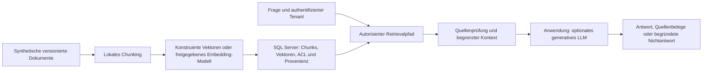

# KI mit und für Microsoft SQL Server 2025 – Workstream-Plan

| Merkmal | Wert |
|---|---|
| Planungsauftrag | `TSK-003`, ausdrücklich autorisiert am 2026-10-11 |
| Status | `DESIGNED`; Planungsintegration und Review sind im PR nachzuweisen |
| Entscheidung | `DEC-073`; neue Curriculumentscheidung, keine Entwicklungswiederaufnahme |
| Plattform | SQL Server 2025 (17.x); primär Enterprise Developer, CL 170 |
| Pflegeautorität | dieser Plan für Architektur/Pakete; Featurematrix für Produktgrenzen; Demoentwurf für Lifecycle |
| Allgemeiner Ausführungsstand | [CURRENT_EXECUTION_STATUS.md](CURRENT_EXECUTION_STATUS.md), weiterhin `PAUSED` |

## Aktueller Implementierungsstand

Der nachfolgende Plan dokumentiert den ursprünglichen Planungsschnitt. Der neue
Benutzerauftrag vom 2026-10-11 autorisiert dessen autonome Umsetzung; Scope, Budget
und aktueller Nachweis stehen im [Ausführungsstand](CURRENT_EXECUTION_STATUS.md#autonome-umsetzung-des-ki-workstreams-vom-2026-10-11).
Der zusätzliche Benutzerauftrag erweitert die lokale Entwicklungswelle auf
sechs kohärente Test-/Korrekturkandidaten je Schnitt; bisherige Versuche
zählen im gemeinsamen Ledger weiter mit. Wiederholungen nach FAIL benötigen
geänderte Ausführungsquellen; stabile positive Wiederholungen bleiben bei
tatsächlich erforderlichen Qualifikationsgates zulässig. Sicherheits-,
Cleanup- und Providergrenzen bleiben bestehen. Der aktuelle
[Kostenfolgeschnitt](SQL_SERVER_2025_AI_IDX012_COST_REVIEW.md#benutzererweiterung-und-dritter-kandidat)
setzt nach zwei Client-FAILs mit einer begrenzten literalen SQL-Eingabe fort.
Allgemeine Entwicklung und andere Automationen bleiben pausiert; der ausdrücklich
genehmigte KI-Heartbeat ist aktiv. Externe/Bezahl- und rote
Hoständerungen behalten ihre jeweiligen Gates. QRY-014 bis QRY-017 sind der erste
zusammenhängende Implementierungsschnitt; der Workstream ist damit noch nicht abgenommen.
QRY-018 ergänzt jetzt den Offline-RAG-Schnitt aus TSK-008; sein
[Qualifikationsnachweis](SQL_SERVER_2025_AI_OFFLINE_RAG_REVIEW.md) bleibt getrennt von Live-RAG.
QRY-019 beginnt TSK-009 mit fester SQL-Struktur, tatsächlicher Wertbindung und einem
eingeschränkten Datenbankbenutzer; sein [Nachweis](SQL_SERVER_2025_AI_SQL_INPUT_REVIEW.md)
belegt ausschließlich den synthetischen lokalen Kontrollharness.
DGN-009 ergänzt TSK-009 durch tatsächliches Retrieval manipulierter Quellen, feste
Antwort-/Toolfixtures und minimale SQL-Rechte. Sein [Nachweis](SQL_SERVER_2025_AI_INJECTION_REVIEW.md)
bleibt getrennt von Livegeneration. DGN-008 ergänzt tatsächlich erstellte Offline-
Modellmetadaten, getrennte SQL-Rollen und Grantreduktion; sein [Nachweis](SQL_SERVER_2025_AI_EXTERNAL_MODEL_REVIEW.md)
qualifiziert Modell-EXECUTE nur als Metadatenrecht, keine Inferenz oder echten Credentials.
CON-010 ist unter der erweiterten lokalen Wellenfreigabe mit zwei stabilen
privaten C5-Lifecycles wiederaufgenommen; genaue sechs CONNECT-/SELECT-Grants,
RLS/Quellen und tatsächliche Rechteverweigerungen sind im
[Teilnachweis](SQL_SERVER_2025_AI_TENANT_RESUME_REVIEW.md) gebunden. Historische
FAILs bleiben sichtbar. Die öffentliche Demo ist jetzt IMPLEMENTED; der
[Consumer-/Versionsnachweis](SQL_SERVER_2025_AI_TENANT_IMPLEMENTATION_REVIEW.md)
schließt lokal 192 Marker-/32 Resultabweisungen, tatsächliche Mutationsattestation,
Setupidempotenz, Versions-SKIPs und eigenen Cleanup. Aktuelle PR-/Main-Gates,
Pooling, Serverlogins, ANN und Seitenkanäle bleiben getrennte Grenzen.

PR 184 ist vollständig integriert; aktuelle Head-/Main-Gates, Treeübernahme,
Synchronisierung und eigener Branchcleanup sind abgeschlossen.
Die [private RES-008-Vorbereitung](SQL_SERVER_2025_AI_RESOURCE_DIMENSION_REVIEW.md)
belegt danach zwei stabile Quellen-/Dimensions-/Storage-Lifecycles für vier
kleine float32-Populationen einschließlich tatsächlicher negativer Quellenkontrolle
und vollständigem eigenem Cleanup. C1 bleibt FAIL; C2 korrigierte nur das Oracle.
RES-008 bleibt PROPOSED, TSK-010 und Performance-/TP-PERF-Abnahme bleiben offen.

Die [private RES-008-Messfolge](SQL_SERVER_2025_AI_RESOURCE_MEASUREMENT_REVIEW.md)
ergänzt nach vollständig abgeschlossenem PR185 zwei stabile Lifecycles mit je
20 Warmups, 54 tatsächlichen AB-/BA-/AA-Fenstern und 5420 einzelnen Queryoracles.
C1-Zeitauswertungs-FAIL erhalten; C2 trennt grobe DMV-Identität von feinem
Messzeitstempel. Quellen-/Querygegenproben, Restore und eigener Cleanup bestanden.
Pläne/Memory/Workergrenzen, öffentliches Paket und TP-PERF bleiben offen.

Die [repräsentative RES-008-Planfolge](SQL_SERVER_2025_AI_RESOURCE_PLAN_REVIEW.md)
ergänzt nach vollständig abgeschlossenem PR186 acht tatsächliche Exact-Pläne
in zwei stabilen Lifecycles. Eigene Scans100/Ergebnisroot1, tatsächliche Memory-
attribute, volle Quellen-/Konfigurationsgleichheit und eigener Cleanup bestanden.
C1-Root-FAIL bleibt erhalten; C2 direkte Projektion und strikter Rowparser,
24 synthetische Gegenfälle und enger unabhängiger Quellenabschluss bestanden.
Waits/Warnings NOT_CAPTURED, keine vollständige Worker-/Spill-/TP-PERF-Abnahme.
Öffentliche Demoqualifikation folgt getrennt; RES-008 bleibt PROPOSED.

Der [öffentliche begrenzte RES-008-Consumer](SQL_SERVER_2025_AI_RESOURCE_PUBLIC_REVIEW.md)
verbindet diese Quellen jetzt ohne private Imports: zwei lokale Vollprofile,
vier Versions-SKIPs vor Setup und tatsächlicher attestierter Setupfault mit
eigenem Cleanup. Native WARNs bleiben sichtbar; noch kein FWK-010-Manifest oder
vollständige FWK-011-Aggregation, RES-008 weiterhin PROPOSED. CI prüft den
tatsächlich anderen öffentlichen Shim-/Prozesspfad; voller TP-PERF-/Modulclaim offen.

## 1. Zielbild und Abgrenzung

Teilnehmende sollen KI-Funktionen technisch korrekt einsetzen, ihre Rechte begrenzen,
Performance messen und Such-/Modellergebnisse kritisch prüfen können. KI senkt die
Umsetzungshürde; Kosten und Validierungsaufwand bleiben Teil der Entscheidung.
Eine Hypothese wird über Ursache, Messung, Gegenprobe und Ergebnisgrenze bearbeitet.

Der Workstream erweitert das bestehende Performance-Curriculum eigenständig. M00–M07,
ihre 52 Lernziele, bestehende Demos und historischen Abnahmen bleiben erhalten.
Die frühere Vector/KI-Zeile des [Delta-Reviews](SQL_SERVER_2025_DELTA_REVIEW.md) bleibt
historisch `OUT_OF_SCOPE`; `DEC-073` ersetzt ausschließlich diese künftige Scopegrenze.
Neue Schulungsinhalte sind geplant und noch nicht Bestandteil einer freigegebenen Präsentation.

Dieser Auftrag umfasst Recherche, Planung, Registrierung, Integration und Review.
Ausgeschlossen sind Demoimplementierung, PowerPointänderungen, Cloudbereitstellung,
kostenpflichtige API-Aufrufe, produktive Systeme, andere Repositories, allgemeine Entwicklung
und Entwicklungsautomation. Selbst ein vollständig integrierter Plan erteilt keine
Implementierungsfreigabe. Bestehende DGN-007-, SESSION_END- und Collectorarbeiten werden
weder als Abhängigkeit aktiviert noch bearbeitet.

## 2. Architektur und Datenfluss

Engine, Inference-Provider, Embedding-Modell, generatives LLM und Anwendung sind getrennte
Komponenten. Das SQL-External-Model ist ein Embeddingobjekt; es wird kein generatives Modell
im Database Engine Prozess behauptet. Der Pflichtpfad benötigt weder Internet noch Modell.
Konstruierte Vektoren erklären Mathematik; echte Sprachsemantik benötigt den optionalen,
vorbereiteten lokalen Modellpfad. Offline-Replays werden ausdrücklich als Fixtures gekennzeichnet.

Das synthetische Korpus erklärt imaginäre technische Bausteine und enthält Synonyme,
Zahlen-/Identifierfragen, widersprüchliche Versionen, fehlende Antworten, zwei Tenants und
isolierte Injectiontexte. `Documents` führt DocId, Version, TenantId, Freigabestatus und Text;
`Chunks` führt clustered INT ChunkId, DocId, Version, Reihenfolge, Zeichenbereich, Text und
Embedding. Modellversion/Digest, Dimension, Normalisierung und Chunkparameter werden
in eigener Provenienz geführt. Unterschiedliche Embeddingräume erhalten getrennte Spalten
oder Tabellen, niemals eine nur dimensionsgleiche gemeinsame Suche. `Questions` und
`RelevanceJudgments` bilden eine vorab eingefrorene synthetische Bewertungsmenge.

## 3. Zielgruppen und Vorwissen

SQL-Server-Developer bewerten SQL-/Anwendungscode; Daten-/BI-Analysten beurteilen
Relevanz und Quellen; DBAs prüfen Berechtigungen, Egress und Betrieb; Performance Engineers
qualifizieren Ressourcen, Recall und Gesamtlatenz. Gemeinsam vorausgesetzt sind SELECT,
JOIN, Filter, einfache Transaktionen und sicheres Arbeiten in einer Testdatenbank.
ML-Vorwissen wird nicht benötigt. Für die Vertiefung helfen M02/M04/M05/M06 der bestehenden
Schulung; fehlende Grundlagen werden als Vorbereitung ausgewiesen.

## 4. Verbindliche Themeninventur

| Auftragsbereich | Abdeckung | Schwerpunkt und geplante Evidenz |
|---|---|---|
| A: Grundlagen | `CUR-013`, `CUR-014` | ML vs. Generative AI/LLM; Tokenisierung vs. Zeichenchunks; Embeddingraum, Dimension, Distanz, Exact/ANN, RAG; deterministische SQL-Verarbeitung und probabilistische Antwort |
| B: native KI | `CUR-014`–`CUR-016`, `CUR-019` | VECTOR/float32/float16, DISTANCE, NORM, NORMALIZE, VECTORPROPERTY, Index/SEARCH, CHUNKS, EXTERNAL MODEL, EMBEDDINGS; zusätzlich REST und Indexmetadaten |
| C: Integration | `CUR-016`, `CUR-022` | lokale Mathematik, Ollama/TLS, Azure OpenAI optional, generatives LLM in Anwendung, ONNX Windows optional; API-/Authentifizierungs-/Netzgrenzen |
| D: Suche/RAG | `CUR-015`, `CUR-017` | Import → Chunking → Embedding → Speicherung → Retrieval → Fachbewertung → Kontext → Antwort/Quellen; fehlende/widersprüchliche Evidenz |
| E: Security | `CUR-018`, `CUR-022` | Least Privilege, Credentials/TLS/Egress, Injection, Quellenmanipulation, RLS/Tenants, Filter, Embeddingschutz, Audit/Retention, Agenten und Supply Chain |
| F: Performance | `CUR-019`, `CUR-020` | relational/Full-Text/Exact/ANN, Filter, Build/Maintenance, Dimension/Storage, CPU/Reads/Grant/TempDB/Elapsed/DOP, Concurrency/Throughput/p50/p95/p99, Inferenz-/Netzzeit, Recall und Kosten |
| G: SQL-Assistenz | `CUR-021` | Generieren/Erklären/Fehlerprüfung, Plans/Indizes/Query Store/Waits/Konfiguration/Fehler; LLM-Hypothese gegen Messung; aktuelle SSMS-/Copilot-Clientfunktionen |

Die vollständigen Voraussetzungen, Syntaxformen und offenen Quellenkonflikte stehen in
der [Feature- und Provider-Matrix](../Research/SQL_SERVER_2025_AI_FEATURE_MATRIX.md).
Dokumentierte Eigenschaften sind dort von empirisch noch offenen Eigenschaften getrennt.
Keine unbelegte Beschleunigung, Rechts-/Compliancegarantie oder universelle Kostenersparnis.

## 5. Pfade und Zeitbedarf

Die Minuten sind geschätzte Netto-Lehrzeit einschließlich Demo/Übung, ohne Pausen,
Installation und Modelldownloads. BASIS ist eine kurze Einführung, STANDARD der vollständige
praktische Tagespfad, VERTIEFUNG ein zweitägiger Pfad einschließlich STANDARD-Inhalten.
Eine Vierstundenfassung kann nur als gekürzte Einführung angeboten werden.

| Modul | BASIS | STANDARD: Theorie / Praxis | VERTIEFUNG: Theorie / Praxis |
|---|---:|---:|---:|
| `CUR-013` Grundlagen | 20 | 15 / 10 | 20 / 15 |
| `CUR-014` Vektoren | 30 | 15 / 20 | 20 / 25 |
| `CUR-015` Chunking | 5 | 10 / 20 | 15 / 30 |
| `CUR-016` Modelle | 10 | 15 / 30 | 25 / 45 |
| `CUR-017` RAG | 10 | 15 / 35 | 25 / 50 |
| `CUR-018` Security | 25 | 20 / 35 | 30 / 50 |
| `CUR-019` ANN | 10 | 10 / 25 | 25 / 50 |
| `CUR-020` Performance | 10 | 15 / 30 | 30 / 65 |
| `CUR-021` Assistenz | 15 | 15 / 25 | 20 / 40 |
| `CUR-022` Entscheidung | 15 | 15 / 15 | 25 / 35 |
| **Summe** | **150 Minuten** | **145 / 245 = 390 Minuten** | **235 / 405 = 640 Minuten** |

BASIS führt kleine Vektor- und Rechtefälle vor; die übrigen Module sind Einordnung mit
Beispielen. STANDARD priorisiert lokale Embeddings; Cloud und ONNX sind keine Pflicht.
VERTIEFUNG ergänzt Indexinternals, Qualität/Concurrency/Diagnose und Angriffsszenarien.
Ersteinrichtung wird separat mit 60–120 Minuten geschätzt. Schulungslänge und Hardwarebedarf
werden in `TSK-014` mit Teilnehmenden geprüft, nicht aus diesen Schätzungen als belegt ausgegeben.

## 6. Modulverträge und Bewertung

Die Modul-IDs sind registrierte Curriculum-Arbeitspakete. Zeit/Theorie/Praxis gelten gemäß §5;
alle Module erhalten später Trainerlösung, Teilnehmerauftrag und die hier beschriebenen Kriterien.

### CUR-013 – Grundlagen

- Lernziel: ML, LLM und Embedding-Modell unterscheiden und den RAG-Datenfluss erklären.
  Vorwissen: einfache SQL-Abfragen. Theorie: Tokens, Vektoren, Distanz, ANN und probabilistische Ausgabe.
- Praxis: `QRY-014`/`QRY-015`, Vektoren mit eigener geometrischer Vorhersage ordnen.
  Beobachtung: mathematische Nähe allein belegt keine fachliche Richtigkeit.
- Frage: Warum sind Zeichenchunk und Tokenlimit verschieden? Fehlinterpretation: gleiche Dimension
  bedeutet gleicher Modellraum. Musterlösung: Tokenizer/Modellversion und Provenienz nennen;
  SQL-Ergebnis, Retrievalqualität und Generationsqualität getrennt bewerten.
- Quellen: `SRC-072`–`SRC-075`, `SRC-087`, `SRC-094`, `SRC-095`.

### CUR-014 – Vektoren und Exact Search

- Lernziel: VECTOR speichern, Metric/Norm auswählen und Exact Top-k lesen.
  Vorwissen: `CUR-013`, ORDER BY/TOP. Theorie: float32/float16, Rundung, Nullfälle und Grenzen.
- Praxis: `QRY-014`/`QRY-015`. Beobachtung: Modell-/Typ-/Dimensionsfehler und unterschiedliche Scores.
- Frage: Nutzt VECTOR_DISTANCE einen Vector Index? Fehlinterpretation: Index beschleunigt automatisch
  jede Distanzberechnung. Musterlösung: exakter Pfad ohne ANN und validierte Distanz-/Norminvarianten;
  Preview von GA und dokumentiertes CL von Labor-CL unterscheiden.
- Quellen: `SRC-072`–`SRC-076`.

### CUR-015 – Chunking und Wissensbasis

- Lernziel: Dokumentversion, Chunkreihenfolge und Quellenbereich durch Import/Chunking erhalten.
  Vorwissen: `CUR-014`, CROSS APPLY. Theorie: FIXED-Zeichenchunking, Overlap und Kontextgrenzen.
- Praxis: `QRY-016`. Beobachtung: Überlappung erhöht Wiederholungen; ein Split kann eine Erklärung trennen.
- Frage: Welche Quelle gehört zum Treffer nach Dokumentupdate? Fehlinterpretation: Chunk-ID genügt.
  Musterlösung: DocId/Version/Bereich/Modell-/Chunkparameter, Rekonstruktion und Re-Embeddingbedarf zeigen.
- Quellen: `SRC-079`, `SRC-081`, `SRC-087`.

### CUR-016 – Modelle und Integration

- Lernziel: Engine, Provider, Modell und Anwendung mit tatsächlichen Netzwerk-/Rechtegrenzen trennen.
  Vorwissen: `CUR-015`, DB-Rollen. Theorie: REST-Vertrag, TLS, Credentials, Modell-/Tokenlimits und Retry.
- Praxis: `QRY-020`, optional `QRY-021`/`QRY-022`, `DGN-008`.
  Beobachtung: gültiges HTTP-API allein erfüllt den SQL-HTTPS-Vertrag nicht; fehlerhafte Authentifizierung
  und Dimension werden vor Speicherung erkannt.
- Frage: Wo bedeutet localhost im Container dasselbe? Fehlinterpretation: lokales Modell braucht keine
  Security. Musterlösung: Erreichbarkeit aus Enginekontext, TLS-Vertrauen, least-privilege Rolle,
  Budget und Modelllizenz; fehlende Voraussetzungen kontrolliert SKIP.
- Quellen: `SRC-080`–`SRC-088`, `SRC-096`.

### CUR-017 – Semantische Suche und RAG

- Lernziel: Treffer gegen Relevanzurteile prüfen und eine Antwort an erlaubte Quellen binden.
  Vorwissen: `CUR-015`/`CUR-016`. Theorie: Retrieval, Kontextbudget, Abstention und Widersprüche.
- Praxis: `QRY-017`/`QRY-018`. Beobachtung: Keyword, semantische Suche und generative Antwort
  lösen unterschiedliche Aufgaben; plausible Antworten können unbelegt sein.
- Frage: Was tun ohne hinreichende Retrieval-Evidenz? Fehlinterpretation: Quellenlink beweist den Satz.
  Musterlösung: konkrete Claim-zu-Quellenstelle-Zuordnung, Widerspruch markieren, Nichtantwort zulassen.
- Quellen: `SRC-073`, `SRC-078`, `SRC-087`, `SRC-095`.

### CUR-018 – Security und Datenschutz

- Lernziel: keine zusätzlichen Rechte durch KI-Integration einführen und Tenantdaten vor Kontextübergabe isolieren.
  Vorwissen: `CUR-016`/`CUR-017`, objektbezogene Grants. Theorie: Bedrohungsmodell aus §8.
- Praxis: `CON-010`, `DGN-008`/`DGN-009`, `QRY-019`.
  Beobachtung: Promptfilter ersetzen weder DB-Autorisierung noch sichere Parametrisierung.
- Frage: Kann die Anwendung TenantId aus dem Prompt übernehmen? Fehlinterpretation: Approval oder
  ANN-WHERE ist die Sicherheitsgrenze. Musterlösung: authentifizierter serverseitiger Kontext,
  DB-Zugriffsgrenze, Gegenproben für Pooling/Revocation, geprüfter Kontext und kein DDL-Recht.
- Quellen: `SRC-080`, `SRC-082`, `SRC-088`, `SRC-090`, `SRC-091`, `SRC-093`, `SRC-096`.

### CUR-019 – ANN und Index-Lifecycle

- Lernziel: DiskANN als Approximation erklären und Indexgeneration/Recall/Maintenance gemeinsam beurteilen.
  Vorwissen: `CUR-014`/`CUR-017`, M04 empfohlen. Theorie: Graphsuche, Kandidaten und Trade-offs;
  Paper beschreibt Algorithmus, nicht verbindliche SQL-Internals.
- Praxis: `IDX-011`/`IDX-012`. Beobachtung: Altformat kann Postfilter-/DML-/Stale-Grenzen besitzen.
  [DEC-074](SQL_SERVER_2025_AI_ANN_PROFILE_DECISION.md) erlaubt ausschließlich für
  den empirisch gebundenen Build 17.0.5005.3 ein Legacy-TOP_N-Profil mit numerischer
  Generation UNKNOWN/WARN. Alle Qualitäts-/Plan-/Mess-/DML-/Recoverygates bleiben;
  keine Annahme einer numerischen Generation oder neuer Azure-Funktionalität.
- Frage: Ist niedrige Laufzeit ausreichend? Fehlinterpretation: TOP-k ist garantiert das exakte Top-k.
  Musterlösung: gleiche Candidate-/Metric-/Tie-Regel, Recall@k, Index-/Planbeleg, Update- und Buildkosten.
- Quellen: `SRC-073`, `SRC-077`, `SRC-078`, `SRC-094`, `SRC-097`.

### CUR-020 – Performance und Diagnose

- Lernziel: Ressourcen, Verteilungslatenz und Retrievalqualität mit getrennten Zeitbereichen messen.
  Vorwissen: `CUR-019`, M00/M06 empfohlen. Theorie: Messkonzept §9 und Auswahl der Evidenzquellen.
- Praxis: `RES-008`/`RES-009`, `DGN-011`, Vergleich `QRY-017`/`IDX-011`.
  Beobachtung: schnelleres SQL kann bei Modell-/Netzengpass die Anwendung kaum beschleunigen.
- Frage: Kann Query Store p99 der Anwendung belegen? Fehlinterpretation: mittlere Duration genügt.
  Musterlösung: Requestrohwerte mit Fehlerrate/Throughput, Quantilverfahren, belastbares Sample,
  Granularitäts-/Uhrgrenzen und Ressourcen-/Qualitätskosten nennen.
- Quellen: `SRC-027`, `SRC-028`, `SRC-032`, `SRC-081`, `SRC-082`, `SRC-094`.

### CUR-021 – LLMs für SQL-Entwicklung und Analyse

- Lernziel: generiertes SQL erklären/prüfen und Plan-, Index-, Query-Store-, Wait-, Konfigurations-
  oder Fehlerhypothesen gegen zugelassene Evidenz beurteilen. Vorwissen: M02/M03/M06 oder Vorbereitung.
  Theorie: fehlender Kontext, Halluzination, Versionsgrenzen und sichere Änderungsfreigabe.
- Praxis: `DGN-010` und `QRY-019`; synthetischer Fall für überflüssigen INCLUDE-Index mit zusätzlicher
  DML-/Speicherlast. Beobachtung: behaupteter Lesegewinn ist bei bereits abgedeckter Query unbelegt.
- Frage: Welcher Versuch könnte den Vorschlag widerlegen? Fehlinterpretation: Missing-Index-/LLM-Rat
  ist eine Freigabe. Musterlösung: identische Ergebnisse, A/B/AA-Vergleich, tatsächliche Reads/CPU/
  DML-Kosten, Rückfallpfad; vorgefertigte Antwort als Fixture, Liveantwort separat kennzeichnen.
- Quellen: `SRC-027`, `SRC-028`, `SRC-089`–`SRC-092`.

### CUR-022 – Architektur, Kosten und Agenten

- Lernziel: eine begründete Go-/No-Go-Entscheidung und einen begrenzten Agententoolvertrag entwerfen.
  Vorwissen: vorangehende Module. Theorie: TCO, Datenhoheit, Modellwechsel, Budgets und Betrieb.
- Praxis: Bewertung des RAG-Falls und Rechte-/Toolgegenprobe aus `DGN-008`/`DGN-009`.
  Beobachtung: Qualität, Rechte und Wartung können einen Laufzeitvorteil überwiegen.
- Frage: Welche Tools darf ein Suchassistent besitzen? Fehlinterpretation: autonome Iteration rechtfertigt
  sysadmin. Musterlösung: SELECT auf erlaubten Daten/Views, genehmigte Tools, Lauf-/Geld-/Retrygrenzen,
  getrennte menschliche Änderungsfreigabe und Abbruch/Recovery; keine autonome Produktionsänderung.
- Quellen: `SRC-088`–`SRC-092`, `SRC-098`; Kostenmodell §10 ist Methode, kein Anbieterpreisversprechen.

## 7. Demo- und Laborarchitektur

Der [vollständige Demoentwurf](../Demo_Catalog/SQL_SERVER_2025_AI_DEMO_DESIGNS.md) führt 18
registrierte Demos mit Preconditions, Lifecycle, Safety, Tests und Akzeptanzkriterien.
Keine neue manifest.json, SQL-Datei oder Runtimezuordnung wird in diesem Planungsschnitt angelegt.
Alle Entwürfe sind `PROPOSED`; Registry-REGISTERED beschreibt Identität, keine Runtimeabnahme.

Wiederverwendet werden FWK-001–FWK-012, markergebundene Testdatenbank-/Cleanupregeln,
deterministische Seedprofile, Sessionmessung und Assertions, Multi-Session-Signale,
begrenzte QS-/XE-Erfassung und PASS/WARN/SKIP/FAIL. Externe Integrationen erhalten
eigene Vorbedingungen, Kostenlimits und explizite Freigabe. Kein Redemo in Standard-CI.
Implementierte Demos werden später im Ausführungspfadregister und Ausführungsleitfaden ergänzt.

## 8. Security- und Threat-Modell

Die Trust Boundaries liegen zwischen Benutzer/Prompt, Anwendung, DB-Tenantkontext,
Dokumentenquellen, Inference-Provider und Agententools. Ein KI-System erhält nur die
Datenbankrechte seines konkreten Anwendungsfalls. RLS/Objektrechte, Netzregeln und Credentialzugang
werden auch bei Adminfehlern und Verbindungspooling geprüft. `SRC-090/091` belegen die
SQL-Ausführungsgrenze; weitere Bedrohungen und Gegenproben sind geplante Methoden.

| Bedrohung | Ursache / mögliche Wirkung | Reproduzierbarer Versuch | Gegenmaßnahme | Restrisiko |
|---|---|---|---|---|
| Rechteausweitung/Agenten | breit berechtigtes SQL-Konto; ungewollte DDL/DML | `DGN-008`, erlaubtes SELECT und verweigertes DDL/Modellregistrieren | getrennte Setup-/Query-/Ingestionrollen, positive/negative Grants; DB-Rechte erzwingen Grenze | privilegierter Betreiber kann Konfiguration ändern |
| Credential-/Datenabfluss | frei wählbarer Endpoint, Secret im Prompt/Log | `DGN-008`, nicht erlaubten Endpoint und Secretattrappe abweisen | Egress-Allowlist, TLS, Credentialpfadbindung, nur freigegebene synthetische Payloads | Provider-/Proxybetrieb und falsch konfigurierte Allowlist |
| TLS-/REST-Verwechslung | HTTP, falscher SAN/Trust Store/API | `QRY-020`, kontrollierte Negativfälle vor Setup | vertrauenswürdige Chain, Enginekontextprobe, erwartetes Payloadschema, Timeouts | CA-/Providerkompromittierung |
| Prompt Injection | untrusted Quelle enthält Toolinstruktion | `DGN-009`, synthetischer Text verlangt Rechte-/Toolwechsel | Daten/Instruktionen trennen, Toolallowlist, serverseitige Policy, kein Tool aus Retrievaltext | Promptmitigation allein ist unvollständig |
| Retrievalmanipulation | vergiftete Quelle/Version, falscher Claim | `DGN-009`, verändertes Dokument gegen eingefrorene Version | Provenienz/Version, Quellenfreigabe, Qualitytests und Rekonstruktion | fachlich falsche freigegebene Quelle |
| SQL Injection | Modelltext als ausführbarer Querystring | `QRY-019`, synthetische Mehrstatement-/Identifierattacke | feste Querytemplates, Wertparameter; Identifierallowlist und menschlicher Review für Änderungen | logische Fehler innerhalb erlaubter Queries |
| Tenantleck/Filterfehler | Prompt-Tenant, nachträglicher Filter oder alter Poolkontext | `CON-010`, zwei Tenants, selektive Filter, Kontextwechsel/Revocation | vertrauenswürdige Identität, RLS oder getrennte Tabellen/DBs, autorisierte Kandidaten, Kontextprüfung vor LLM | Timing-/Rankingseitenkanal bleibt gesondert zu bewerten |
| Embedding-/Logoffenlegung | vermeintlich anonyme Vektoren oder Volltextdiagnose | `CON-010`/`DGN-011`, verweigerter Vektorzugriff, Logbudgetprobe | Embeddings wie Quelldaten klassifizieren; synthetische Logs, kein Vollprompt/Secret, Zugriffs-/Retentionregeln | Rekonstruktion/Inference aus erlaubtem Zugriff |
| Modell/Supply Chain | unqualifizierte Gewichte/DLL/Tokenizer | `QRY-022`, Hash-/Lizenz-/Versionsfehler ablehnen, kein Schadcode ausführen | erlaubte Herkunft, Version/Digest, isolierte Runtime, minimaler Dateizugriff | kompromittierte qualifizierte Abhängigkeit |
| Überlast/Kosten | große Texte, Endlosschleifen, Retry, Concurrent Calls | `RES-009`/`DGN-011`, Quota-/Timeoutfixture | gemeinsame Zeit-/Request-/Token-/Geldlimits, Kill-Switch, eigener Recovery | Restkosten bereits begonnener Calls |

Audit führt synthetischen Run-Token, Rolle, Modell-/Dokumentversion, erlaubte Aktion, Status und
gemessene Kostenmenge. Prompts/Antworten bleiben standardmäßig flüchtig. Ausgewählte rein
synthetische Fehlerfixtures dürfen nach Privacyprüfung gespeichert werden; keine automatische
QS-/Plan-/XE-Rohexportierung. Lokale Messrohwerte werden nach Auswertung/Cleanup entfernt;
eine spätere Veröffentlichung benötigt eigene Herkunfts-/Privacyprüfung. Providerretention ist
konfigurationsabhängig (`SRC-088`); es wird kein generelles Zero-Retention-Versprechen abgeleitet.

## 9. Performance- und Benchmark-Konzept

Die Frage lautet, welcher Suchpfad unter einem vorab fixierten Qualitäts- und Ressourcenbudget
den Anwendungsfall erfüllt. Relationaler Filter, Full-Text Search, Exact Vector Search und ANN
werden am selben Korpus und autorisierten Candidate Scope geprüft. Keyword-/Identifierfälle,
Paraphrasen und fehlende Antworten erhalten getrennte Qualitätsurteile; ihre Scores sind nicht
direkt vergleichbar. Der Basispfad nutzt 1000 deterministische Vektoren; Skalenläufe planen
10000/100000 Vektoren nur bei freigegebenem Ressourcenprofil.

Vor dem Lauf einfrieren: Seed/Korpusversion, Modell/Digest, Dimension/Typ, Metric, k=5/10,
Filterselektivität, Tenant, Indexgeneration, SQLbuild/CL/Edition/OS, Treiber, DOP,
Cache-/Warm-up-Methode, Concurrency 1/2/4/8 und Grenzen. Im engen DEC-074-Pfad
Generation UNKNOWN/WARN und vollständiges empirisches Build-/Index-/Syntaxprofil
erfassen; keine numerische Generation ergänzen. Kein globales Cacheleeren. Fünf Warm-up-Requests
werden separat protokolliert, danach drei Reihenfolgeblöcke A/B und B/A sowie AA-Kontrolle.
Indexbuild und Ingestion gehören in eigene Messfenster. Umfang bleibt innerhalb §7/Demolimits.

Recall@k = Anzahl ANN-Treffer im exakten Top-k / min(k, Zahl erlaubter Kandidaten).
Leere Kandidatenmenge ergibt N/A, keinen künstlichen Recall von 1. Exact Ground Truth wird mit
gleicher Metric und denselben autorisierten Filtern erzeugt. Ties werden vorab über ChunkId für
das Exact-Oracle und eine dokumentierte tolerante Tie-Grenze für ANN festgelegt; zusätzlich
Distinct-/Duplicate- und fachliche Relevanzprüfung. Recall ist keine Antwortkorrektheit.
Der Implementierungsvertrag setzt die Zielqualität vor Messung fest; kein nachträgliches
Schwellenanpassen. Ohne erfüllte Qualität keine Optimierungsfreigabe.

SQL-Evidenz: FWK-004/005, STATISTICS IO/TIME, Actual Plans, passende sessionbezogene DMVs,
Query Store für Verlauf und FWK-007-XE. Erfasst werden CPU, Logical/Physical Reads, Writes,
Rows, Requested/Granted/Used Memory, Spills/TempDB, Elapsed, DOP/Threads, Index-/DBspeicher
und Build-/Maintenancekosten. Ein fehlendes Planattribut bleibt fehlend, kein Nullmesswert.
Wait-/Instanzsummen sind nur begrenzte Deltas mit explizitem Scope.

Anwendungsinstrumentierung misst pro Request getrennt: Query-Embedding, DB-Roundtrip,
SQL-Statement, Kontextaufbereitung, generative Inferenz und Gesamtzeit. Provider-/Proxy-
Telemetrie darf Modell- und Netzzeit ergänzen. DB-Roundtrip minus SQLzeit ist nur eine
Restzeit mit Treiber-/Queue-/Transferanteil, kein reiner Netzwerkbeweis. Query-Store-Aggregate
belegen keine Einzelrequestzuordnung. Verschiedene Uhren werden nicht exakt gleichgesetzt.

Durchsatz = erfolgreiche Requests pro Messfenster; Timeouts/Fehler/abgebrochene Requests
separat zählen und nicht aus der Latenzauswertung verschwinden lassen. Vorgesehen sind mindestens
200 abgeschlossene Requests je normalem Profil, für belastbare Tailauswertung mindestens
1000 je Concurrent-Profil innerhalb vorab genehmigter Limits. p50/p95/p99 per offengelegter
Nearest-Rank-Methode und Stichprobenzahl berichten; bei zu kleiner Stichprobe p99 als
explorativ/N/A ausweisen. Keine Signifikanzbehauptung aus drei Blöcken. Mehr Last benötigt
eine eigene Freigabe, nicht automatisch einen längeren Lauf.

## 10. Architektur- und Kostenentscheidung

TCO enthält einmalige Ingestion/Re-Embedding/Indexbuilds sowie laufende SQLressourcen,
lokale Inferenzenergie/Hardware/Modellbetrieb oder externe Input-/Output-/Requestkosten,
Netzwerk, Monitoring, Security, Evaluation und Wartung. Preise werden erst im freigegebenen
Implementierungsschnitt aktuell belegt; keine kostenpflichtige Probe in dieser Planung.
Berechnungsform: Mengen × belegter Einheitspreis plus anteilige Betriebs-/Entwicklungskosten.
Retry und Fehlrequests zählen mit; lokale Inferenz wird nicht als kostenlos bewertet.

Go-Kriterien: fachliche Qualität und Recall erfüllen den vorab fixierten Bedarf, keine Tenant-/
Rechteverletzung, beherrschbare Ressourcen/p95 und Fehlerquote, nachvollziehbare Quellen,
finanzierbares TCO und betreibbarer Reset/Modellwechsel. No-Go-Beispiele: reine Identifier-
Abfrage mit relationalem Index, fehlende Rechteisolation, verbotener Datenabfluss, unprüfbare
Antworten oder Previewabhängigkeit ohne akzeptierten Rückfallpfad. Die Entscheidung enthält
vergleichbare Messwerte, Annahmen, verbleibende Risiken und einen Nicht-KI-Vergleich.

## 11. Lehrmaterial- und Präsentationskonzept

Eine fachlich gepflegte PowerPoint-Masterquelle bleibt maßgeblich. `TSK-012` plant später
30–45 zusätzliche Lehrpositionen als Schätzung, mit stabilen SlideKeys aus dem bestehenden
Präsentationsprozess, BASIS/STANDARD/VERTIEFUNG-Profilen und Demo-/Quellenverweisen.
Noch keine neuen Slide-IDs und keine Präsentationsdatei in diesem Schnitt.

Diagramme zeigen Engine/Provider/Modell/Anwendung, Daten-/Trust Boundaries und RAG-Provenienz.
Performancecharts zeigen Laufzeit **und** Recall/Ressourcen mit n und Fehlerquote;
Securitydarstellungen verbinden Angriff, beobachtete Grenze und Gegenmaßnahme.
Speaker Notes enthalten Theorie, konkrete Vorführung, Beobachtungsfrage, erwartete Abweichung,
Preview-/Buildgrenze und Recovery. Trainerunterlagen führen Setup/Timing/Musterlösungen,
Teilnehmerunterlagen Vorbereitung, Aufgaben, sichere Runbooks, Glossar und Bewertungsrubrik.
Varianten werden aus derselben Quelle erzeugt. Render-/Office-Metadatenprüfung erst bei tatsächlicher Änderung.

Der erste unabhängige TSK-012-Teilentwurf ist das
[Offline-Arbeitsheft](../HowTo/SQL_SERVER_2025_AI_OFFLINE_WORKBOOK.md): acht Aufgaben,
Trainerlösungen, Beobachtungsbogen und Rubrik für die bereits qualifizierten Demos.
Es stellt keine neue SQL-Runtime oder vollständige didaktische Abnahme her;
Masterdeck/Notes, weitere Module und tatsächliche Teilnehmererprobung bleiben offen.

## 12. Priorisierte Arbeitspakete und Abhängigkeiten

Alle Folgepakete sind `PROPOSED` und durch fehlenden Implementierungsauftrag operativ gesperrt.
Arbeitstage sind Schätzungen zu 8 Stunden; kein gemessener Aufwand und keine Terminzusage.

| Paket | Priorität / Größe | Inhalt und überprüfbares Ergebnis | Abhängigkeit | Aufwand |
|---|---|---|---|---:|
| `TSK-004` | P0 / M | Build/CL/Edition/OS, Syntax/Resultattypen, Quellenkonflikte und Providerproben qualifizieren | `TSK-003`, Implementierungsfreigabe | 3–5 |
| `TSK-005` | P0 / L | `QRY-014`–`QRY-017`, Korpus/Provenienz und vollständig lokaler Unterrichtspfad | `TSK-004` | 5–8 |
| `TSK-006` | P1 / M | `IDX-011`/`IDX-012`, Indexgeneration, Recall und Update-/Buildvertrag | `TSK-005`, Previewentscheid | 4–6 |
| `TSK-007` | P1 / L | `QRY-020`–`QRY-022`, Provider-/TLS-/Secret-/Modellprofile; unabhängige optionale Slices | `TSK-004`, lokale Modellfreigabe; Cloud/ONNX separat | 5–8 |
| `TSK-008` | P1 / M | `QRY-018`, transparente RAG-Kette, Quellenrubrik und Offline-Replay | `TSK-005`; Livepfad zusätzlich `TSK-007` | 3–5 |
| `TSK-009` | P0 / L | `CON-010`, `DGN-008`/`DGN-009`, `QRY-019`; Rechte-/Tenant-/Injection-Negativfälle | `TSK-005`; Providerfälle zusätzlich `TSK-007` | 4–6 |
| `TSK-010` | P1 / L | `RES-008`/`RES-009`, `DGN-011`; Mess-/Quality-/Kostenvertrag und begrenzte Benchmarks | `TSK-006`, `TSK-009`; Inferenz zusätzlich `TSK-007` | 5–8 |
| `TSK-011` | P1 / M | `DGN-010`; LLM-Hypothese, korrekte Gegenmessung und Clientgrenzen | `TSK-005`, `TSK-009` | 2–4 |
| `TSK-012` | P2 / L | Modulverträge `CUR-013`–`CUR-022`, Masterdeck/Notes/Trainer-/Teilnehmermaterial | `TSK-008`–`TSK-011`, relevante Demoabnahmen | 5–8 |
| `TSK-013` | P0 / L | Versions-/Rechte-/Fehler-/Cleanupqualifikation aller implementierten Pfade | `TSK-005`–`TSK-011` | 4–6 |
| `TSK-014` | P2 / M | Generalprobe BASIS/STANDARD/VERTIEFUNG, unabhängige Abnahme und Releaseentscheidung | `TSK-012`, `TSK-013` | 2–3 |
| **Summe** | | vollständiger Umfang einschließlich optionaler Slices | | **42–67 Tage** |

Vorgeschlagener lokaler Erstumfang: `TSK-004`/`TSK-005`, lokaler Anteil `TSK-009`, Offline-
`TSK-008`/`TSK-011`, proportionale Qualifikation/Lehrmaterial; 18–28 Tage als separate Schätzung,
keine Summe zusätzlich zum Vollumfang. Preview, Cloud und ONNX können getrennt zurückgestellt
werden, ohne Security/Quellenbewertung des Pflichtpfads auszulassen.

Kritischer Pfad: Freigabe → `TSK-004` → `TSK-005` → `TSK-009` → `TSK-010` →
`TSK-013` → `TSK-014`; `TSK-012` muss vor Generalprobe abgeschlossen sein.
Providerarbeit ist nur für Live-RAG kritisch. Jeder Slice wird ein kleiner Branch/PR einschließlich
Demo-/Test-/Runbook-Abgleich; kein unprüfbarer Gesamtimplementierungs-PR.

## 13. Definition of Ready

Für einen zukünftigen Slice erforderlich: gesonderter Implementierungsauftrag; aktuelle Registry-
und Quellenbindung; konkrete Engine-/CL-/Edition-/OS-/Buildgrenzen; beantwortete relevante
Matrixfragen; Learning Objective, synthetische Fixtures, Rollen und Netz-/Kostenautorität;
vorab fixierte Invarianten/Quality-/Messgrenzen; Safetyklassifikation, Limits, Kill-Switch,
markergebundener Cleanup und Recovery. Optional fehlende Voraussetzungen müssen vor
Mutation SKIP erlauben. Eine noch ungeklärte Provider-/Previewfrage sperrt nur den betroffenen Slice.

## 14. Definition of Done und Abnahme

**Planungsabschluss:** alle A–G-Themen, zehn Module, 18 Demoidentitäten, Feature-/Provider-
grenzen, Threat-/Benchmarkkonzept, Pakete/Abhängigkeiten/Schätzungen, Quellen und offene Gates
sind widerspruchsfrei verknüpft; Privacy, betroffene statische Checks und unabhängiger Review
bestanden; Planungs-PR in origin/main integriert und eigener Branch nach Übernahme bereinigt.

**Spätere Implementierungsabnahme:** zutreffende Runtime-/Negativ-/Cleanupprüfungen bestanden;
Quelle → Aussage/Lernziel → Demo → Test → Lehrposition ist vollständig; lokale Pfade sind durch
Dritte ausführbar; ältere Engines skippen kontrolliert; optionale Pfade brauchen keine Secrets
im Repository; Tail-/Recall-/Kostenclaims besitzen echte Evidenz; keine Rechte-/Tenantverletzung;
Masterdeck und Notes sind gerendert/metadatengeprüft; Generalprobe belegt fachliche Selbstprüfung.
Weder vorhandene Dateien noch ein Planungs-PASS belegen Runtime oder didaktische Wirksamkeit.

## 15. Test- und Validierungsstrategie

Planung: Registrysemantik/Identifier, unveränderte historische Zuordnungen, Curriculum-/Delta-
Verträge, Privacy, lokale Links und Abdeckungs-/Abhängigkeitsprüfung; independent Review mit
konkretem Versions-/Security-/Vollständigkeitsscope. FOUNDATION_INTEGRITY bleibt getrennt
von PROJECT_SEMANTIC. Lokal keine SQL-Runtime oder Office-Renderprüfung für reine Planungsdateien.
Die vorhandenen CI-Pfadregeln für `Documentation/Demo_Catalog/**` wählen jedoch die
bestehenden OPT-017- und W-COV-001-Runtimeprüfungen auf 2019/2022/2025 aus.
Diese Pflichtgates werden regulär abgewartet; sie belegen keine neue KI-Runtime.

Implementierung: FWK-010/011-Lifecycles und TP-RUN/TP-PERF/TP-CON; positive und negative
Versions-/Feature-/Rechte-/Endpoint-/Timeout-/Dimensionalitätsfälle; Setupwiederholung,
Abbruch an Phasengrenzen, fehlende optionale Dienste und unabhängiger Cleanupcheck. SQL Server
2025 trägt Wirkungsnachweise; 2019/2022 tragen ausschließlich Unsupported-SKIP-Grenzen bei
nativen KI-Demos. Die Assistenzfälle mit rein relationalem SQL können zusätzlich auf älteren
Versionen qualifiziert werden. Keine Wiederholung fehlgeschlagener Messungen bis zufällig grün.

## 16. Risiken und benötigte Entscheidungen

| Risiko / offene Entscheidung | Zuständiger Slice | Vor Umsetzung zu entscheiden oder nachzuweisen |
|---|---|---|
| wechselnde Preview-/Indexgeneration | `TSK-004`/`TSK-006` | festen Build und zulässigen Previewumfang wählen; Syntax/Filter/DML prüfen |
| lokale Modell-/Hardware-/Lizenzwahl | `TSK-007` | genehmigtes Embedding- und generatives Modell mit Version/Digest, Offlinefähigkeit und Ressourcenprofil |
| Azure-Endpoint/Kosten/Datenregion | `TSK-007` | optional gesondert freigeben; Endpoint-/Credential-/Quota-/Geld-/Retentionvertrag |
| Windows-ONNX/Supply Chain | `TSK-004`/`TSK-007` | optional gesondert freigeben; Linuxwiderspruch offen, kein ungeprüftes Deployment |
| Feature-Referenzinkonsistenzen | `TSK-004` | EMBEDDINGS-Resultattyp und CL-/Treiber-/Indexgrenzen reproduzieren |
| RLS/ANN/Pooling/Seitenkanäle | `TSK-009` | negative Rollen-/Tenanttests, gegebenenfalls getrennte Datenbanken statt ANN-RLS-Pfad |
| Umfang/Hardware übersteigt Lernzeit | `TSK-014` | geschätzten STANDARD-Tagespfad oder gekürzten BASISumfang im Folgeauftrag auswählen |

Jetzt ist keine zusätzliche Fachentscheidung nötig, um die Planung zu integrieren.
Ein späterer Implementierungsauftrag wählt den konkreten Erstumfang und optionalen Lehrpfad.

## 17. Repositoryintegration und Pflege

Roadmap/Backlog/Masterplan erschließen diesen Plan; Curriculum/Traceability ordnen die
registrierten Module/Demos zu. SOURCE_REGISTER bleibt die einzige Quellen-ID-Autorität,
registry.json die Kennungsautorität; der zentrale Demo-Katalog verlinkt den Entwurf.
DEC-073 und der additive Delta-Review-Abschnitt erhalten die Historie.
Es gibt keinen parallelen Plan, kein konkurrierendes Quellenregister und keine neue Automation.
Neue Quellen-/Buildbefunde werden in der Matrix und ihrem Register nachgezogen.

## 18. Aufwandsteuerung und Evidenzgrenzen dieses Auftrags

Ein Verantwortlicher erstellt den zusammenhängenden Planungsschnitt, ein unabhängiger
Review prüft den stabilen Kandidaten. Höchstens zwei kohärente Reviewkorrekturwellen sind
vorgesehen; ein neuer sachlicher Blocker wird konkret berichtet. Deterministische Prüfungen
ersetzen zusätzliche Modellreviews für IDs, Links, Counts und Graphen. Keine Reviews von Reviews.
Keine Foundationinstallation oder materielle Änderung der aktiven Workflowregeln ist enthalten.
Die tatsächlichen CI-Trigger werden vor Push gegen die geänderten Pfade geprüft; vorhandene
Pflichtgates bleiben erhalten. Modell-/Tokenverbrauch ist nicht zuverlässig gemessen und wird
nicht geschätzt als Istwert ausgegeben. Prüfresultate und Head-/Base-/Mergebindung stehen im
Planungs-PR; spätere Runtime- und Generalproben bleiben ausdrücklich nicht ausgeführt.

Öffentliche [begrenzte RES-008-Aggregation](SQL_SERVER_2025_AI_RESOURCE_AGGREGATION_REVIEW.md)
bindet nach vollständig abgeschlossenem PR188 zwei vorhandene native Profile
ohne SQL-Wiederholung. 20 Warmups ausgeschlossen, sechs A/B-Batchfenster je
Paar, AA separat, N/A/Nullwerte/Ausreißer sichtbar. Je 30 numerische FWK-011-
Invarianten bestanden; Gesamt-WARN/PROPOSED und volle Worker-/TP-PERF-/Modul-
abnahme offen. Die öffentliche CLI und CI konsumieren diese begrenzte Auswertung.

Die getrennte [RES-008-Ergebnisleseaufgabe im Arbeitsheft](../HowTo/SQL_SERVER_2025_AI_OFFLINE_WORKBOOK.md#ergänzende-ergebnisleseaufgabe-res-008)
und ihre [Trainermoderation](../HowTo/SQL_SERVER_2025_AI_OFFLINE_TRAINER_GUIDE.md#getrennte-ergänzung-res-008-ergebnisse-lesen)
ergänzen unter TSK-012/CUR-020 die acht bestehenden Basisübungen. Vorliegende
gebundene Aggregate genügen; kein SQL-Retry. Populationsrechnung, getrennte
Batch-/Counter-/UTC-Grenzen, N/A/Nullwerte/Ausreißer und FWK-PASS bei Gesamt-WARN
stehen vor einer allgemeinen Dimensions-/Modellqualitätsaussage. Lösung/Rubrik
bleiben allein im Arbeitsheft; optionale Ergänzung getrennt von den 16 Basispunkten.
Keine tatsächliche Teilnehmererprobung, Lehrzeiten oder volle Curriculum-/Masterdeck-/
Notes-/Render-/Generalprobenabnahme; RES-008 weiterhin PROPOSED.

Der [begrenzte private DGN-010-Ownerplannachweis](SQL_SERVER_2025_AI_INDEX_PLAN_REVIEW.md)
ergänzt unter TSK-011/CUR-021 zweimal drei tatsächliche eigene Pläne mit gleichen
vollständigen zehn-Row-Resultaten, 16000 gebundenen Source-Rows, tatsächlicher
Quellennegative/Restore, unveränderten Readerrechten und vollständigem eigenen Cleanup.
Planwechsel und 17 zusätzliche Indexseiten ergeben keinen Performancegewinn oder
Widerlegung. Readerpläne, CPU/Elapsed/Reads, DMLkosten, AB/BA/AA/Effektseparation,
ältere Engines, öffentliche Demo und voller TP-PERF-/Modulnachweis bleiben offen;
DGN-010 PROPOSED. Nächster begrenzter Schritt ergänzt diese Messgrenze.

Die [private DGN-010-Readerbatchmessung](SQL_SERVER_2025_AI_INDEX_MEASUREMENT_REVIEW.md)
ergänzt TSK-011/CUR-021 nach erhaltenem C1-Counter-FAIL zweimal zehn Warmups und
18 feste AB-/BA-/AA-Fenster mit je 1810 vollständigen Queryoracles. Beide eigenen
Indizes bleiben vorhanden; sechs AB/BA-Samples je erzwungenem PK-/Candidatepfad,
drei AA-Paare separat. UTC-/Requestmessgrenzen, Buffer-/Impersonationaufwand,
Negativkontrollen/Restore, 22000 Source-Rows/vier Ownerpläne und eigener Cleanup
sind gebunden. Kein Index-abwesend/vorhanden-Nettonutzen, isolierte Query-/DML-/
vollständige Workerkosten oder volle TP-PERF-/Modulabnahme; DGN-010 PROPOSED.
Nächster begrenzter Schritt ergänzt DML-/Effektseparation.

Die [private DGN-010-DML-Effektseparation](SQL_SERVER_2025_AI_INDEX_DML_REVIEW.md)
ergänzt TSK-011/CUR-021 zweimal zehn Warmups/18 AB-/BA-/AA-Fenster mit je 1810
tatsächlichen UPDATEs/18100 vollständigen OUTPUT-Rowkontrollen. A ohne/B mit
Candidateindex, vier tatsächliche Build-/Dropzyklen je Profil außerhalb Messung,
92000 Source-Rows und eigener Rollback-/Negativ-/Cleanupnachweis gebunden.
UTC-/Requestgrenzen enthalten OUTPUT-/Transaktions-/Rollbackaufwand. Ungezwungener
SELECTvergleich ohne/mit Index, Nettonutzen, isolierte Index-/Commit-/vollständige
Workerkosten, öffentliche FWK-/Versions-/Recoveryqualifikation und vollständige
TP-PERF-/Modulabnahme bleiben offen; DGN-010 PROPOSED.

Der [private ungezwungene DGN-010-SELECTvergleich](SQL_SERVER_2025_AI_INDEX_SELECT_REVIEW.md)
ergänzt TSK-011/CUR-021 zweimal zehn Warmups/18 AB-/BA-/AA-Fenster und je 1810
vollständige Queryoracles ohne/mit Candidateindex. Identische Readerquery ohne
INDEX-Hints, vier getrennte Build-/Dropzyklen je Profil, 92000 Source-Rows und
Source-/Querynegative/Restore/eigener Cleanup gebunden. Buffer-/Impersonation-
aufwand und unterschiedliche Request-/UTC-Grenzen sichtbar; keine aktuellen
Readerpläne/Indexnutzung, individuelle Latenz/Indexnettonutzen oder volle TP-PERF-/
Modulabnahme. DGN-010 PROPOSED; nächster Schritt öffentliche Paketvorbereitung.

Der [öffentliche reine DGN-010-Auswertungsvertrag](SQL_SERVER_2025_AI_DGN010_BENCHMARK_CONTRACT.md)
bereitet SELECT-/DML-Scopes mit vollständiger Population, Source-/Request-/Result-
und DML-Ordinal-/Rollbackdepthbindung sowie getrennten Warmups/AA vor. 20 synthetische
Methoden und enger unabhängiger Quellenabschluss bestanden; vier vorhandene gebundene
Native-Records rein erneut ausgewertet, 48 numerische FWK-PASSs ohne SQLwiederholung.
Runtime-/TP-PERF-Qualifikation NOT_ESTABLISHED, aktuelle Indexnutzung NOT_CAPTURED.
Nächster Schritt öffentlicher bounded Runtimeproducer/Versions-/Marker-/Recovery-
qualifikation; DGN-010 PROPOSED, keine volle Modul-/Indexnettonutzenabnahme.
