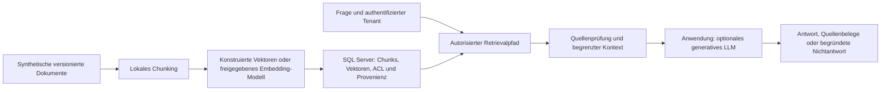

# KI mit und für Microsoft SQL Server 2025 – Workstream-Plan

| Merkmal | Wert |
|---|---|
| Planungsauftrag | `TSK-003`, ausdrücklich autorisiert am 2026-10-11 |
| Status | `DESIGNED`; Planungsintegration und Review sind im PR nachzuweisen |
| Entscheidung | `DEC-073`; neue Curriculumentscheidung, keine Entwicklungswiederaufnahme |
| Plattform | SQL Server 2025 (17.x); primär Enterprise Developer, CL 170 |
| Pflegeautorität | dieser Plan für Architektur/Pakete; Featurematrix für Produktgrenzen; Demoentwurf für Lifecycle |
| Allgemeiner Ausführungsstand | [CURRENT_EXECUTION_STATUS.md](CURRENT_EXECUTION_STATUS.md), weiterhin `PAUSED` |

## Aktueller Implementierungsstand

## TSK-004: reiner Clientlayoutvertrag nach PR230

PR230 ist vollständig geschlossen: elf erfolgreiche Head-Gates und ein
Runtime-SKIP, acht erfolgreiche Main-Workflows mit bestätigtem Runtime-SKIP,
vollständiger Tree/Main 9d731f55/FF-Synchronisierung, eigene Branches entfernt,
121 Dateien gesichert und eigener Worktree tatsächlich archiviert.
Unmittelbar [reiner Clientlayoutvertrag](SQL_SERVER_2025_AI_CLIENT_LAYOUT_REVIEW.md):
vorhandene Deps-/Asset-/Compilerpins, volle relative Pfade/RIDwahl/Hashes und
Basenamekollisionen; Sourcefrage, FileNotFound-Ursprung weiterhin UNPROVEN.
Sechs Sourcekandidaten, Checkpoint nach drei und Abbruch nach sechs; ein
Implementierungsverantwortlicher und enger Rootreview, ohne neue Laufzeit-,
Provider-, Modell- oder Hosteffekte.
Nur statische Trigger/Tests, Runtimebody/Selector unverändert. Vor einer rein
historischen Bestandsauswertung aktuelle Source-/Expected-/Privacy-/Rootgates;
keine Wiederaufnahme der VECTOR-/Pool-/Generationshardstops oder volle Abnahme.
C1-Bestandsauswertung FAIL, Originale und Quellen gesichert. Der explizite
C2-Folgeentscheid ergänzt ausschließlich den echten Ressourcenabschnitt;
kumulativ höchstens zwei Offlineprozesse/Reportversuche, danach Stop,
unverändert keine Laufzeitwirkungen.
C2 tatsächlich COHERENT/WARN abgeschlossen: 31 Appdateien/28 Runtimeassets,
fünf fehlende wörtliche runtimeTargets-Unterpfade bei vorhandenen flachen DLLs.
Originale und C1-Archiv51 unverändert; STOPPED_AFTER_C2, kein Loaderbeweis,
FileNotFound-Ursprung weiterhin UNPROVEN und volle TSK-004-Abnahme offen.

## TSK-006: reiner ANN-DML-/Rollenrecordvertrag nach PR229

PR229 vollständig geschlossen (7Head/5Main/Main d28761f2/Tree/FF/Branches/
391 gesicherte private Dateien/eigener tatsächlicher Worktreearchiv).
VECTOR FAIL_HARD6_UNKNOWN bleibt gestoppt, SQLcleanup NOT_ESTABLISHED.
Unmittelbar [reiner IDX-012-Recordvertrag](SQL_SERVER_2025_AI_IDX012_RECORD_CONTRACT_REVIEW.md):
6/CP3/hard6, ein Implementer/enger Rootreview,0 neue Laufzeit-/Host-/Modelleffekte.
Feste DML-/Rollen-/SID-/Restore-/Cleanuprecordgrenzen auf vorhandener Evidenz;
Callerflags nur deklariert, keine rekonstruierte End-/Serverrequestattestation.
Nach Sourceabschluss maximal ein historischer gebundener Offline-Durchlauf,
keine Producer-/Runtimejob-/Selectoränderung oder volle TSK-006-Abnahme.

C1 bekannter Offline-FAIL und fehlende Exception-/Attemptfelder erhalten.
Konkrete Sourceabweichung Base64 versus Handfixture-Hex; C2 mit dokumentiertem
kumulativem2-Prozess/4-Reportbudget, vollständiger Marker-/Dateinamensbytebindung
und13normal/3protected-O. Beide historischen Akten danach tatsächlich COHERENT/
WARN, Prozessende bekannt/0,2396s,80 Aktenfiles/ProduktSource5/Prepared2/Manifest
unverändert.0 neueNativewirkungen; Capturelücken offen, keine Runtimepromotion.
Paket STOPPED_AFTER_C2; aktuelle Integration, dann unabhängiger statischer
Dependency-Pfadplan auf bereits gesicherten VECTOR-Bytes.

## TSK-004: nativer VECTOR-Caller nach vollständigem PR228-Abschluss

PR228 vollständig geschlossen:8Head/6Main, vollerTree, primaryMain48d4e187,
FF/Branches/916 hashverifizierte private Dateien/tatsächlicher Worktreearchiv.
Unmittelbar folgt der [begrenzte Nativecaller](SQL_SERVER_2025_AI_VECTOR_NATIVE_REVIEW.md).
SourceC1–C3 bleiben gezählt, jetztC4–C6/hard6 ohneReset; höchstens drei zusätzliche
eigene serielle Container. Gepinnter vorhandener SqlClient6.1.4/net10-Bestand,
keine neuen Pakete/Restore/globalen Effekte. Konkreter Compilerplan und aktuelle
Source-/Input-/Oracle-/Request-/Deadline-/Test-/Rootgates vor Nativeadmission.
Zwei VECTOR(3)-Rows/typedNull/Dimensionnegative/volle Guard-/Restore-/Cleanupbelege,
300normal/eine60Cleanup. Jetzt null neueNative/Modelle; PoolUNKNOWN gestoppt,
volle TSK004 und Workstreamabnahme offen.

C4: ein Compile0,5911s mit zwei CS1701-Warnungen; geänderte Partialend-/
Dimensionoracles normal/-O bestanden. Nativeversuch endete vorCreate mit
zwei bekannten CLI-FAILs wegen Namespace-Konfigurationswurzel;0SQL/Client,
UNKNOWN=false, ursprüngliches closed=false/SQLcleanupNOT_ESTABLISHED erhalten.
Root frische Namens-/Inputabwesenheit getrennt belegt (Temp-WARN erhalten,
CID NOT_CREATED). C5 nur geänderte ENV-/No-create-Proof-Source nach aktuellen
Gates; C6 letzte Reserve, keine neue Compilation oder Pool-UNKNOWN-Wiederaufnahme.

C5 bekannter State-FAIL vor typisiertem Client: ein Container/acht SQLcmd-
Aufrufe, vier null-Kataloggruppen im vollständigen State. Eigener DB-Drop und
frische SQL-/CID-/Namens-/Inputabwesenheit tatsächlich bestanden, UNKNOWN=false.
C6 ändert nur Producer-Arrayfallbacks; zwei gezielte pure Methoden nach erhaltenem
Fixture-Lesecapfehler bestanden, vollständiger C5-Archiv-/Sourceabschluss gebunden.
Oracle/Guards/C#/Compile unverändert; Native vor Rootadmission gesperrt.
Anschließend STOP dieses Sechserbudgets und vollständige PR-Integration.

C6 tatsächlich FAIL_HARD6_UNKNOWN: korrigierter Vollstate bestanden, Child
bekannt rc1/FileNotFoundException, individuelle Requestenden fehlen. Kein
Folge-SQL; SQLcleanup/DB-Abwesenheit NOT_ESTABLISHED, Nativeinput erhalten,
Ledger closed=false. Ein eigener gebundener Namespaceabbau mit frischer ganzer
CID-/Namensabwesenheit bestätigt. Zwei Container/14 SQLcmd-Aufrufe/ein Child,
0 neue Modellcalls; keine weitere Probe/Fix dieser Welle. Fehlercheckpoint wird
integriert; unabhängig folgt reiner TSK-006-ANN-DML-/Rollenvertrag auf vorhandener
Evidenz vor jeder neuen Laufzeitwirkung. Volle TSK-004-Abnahme bleibt offen.

## TSK-004: isolierte native VECTOR-Client-Sourcevorbereitung nach PR227

PR227 vollständig geschlossen (8Head/6Main, Tree/FF/Branches/Belege/Archiv).
Der [neue begrenzte Clientpfad](SQL_SERVER_2025_AI_VECTOR_CLIENT_REVIEW.md) nutzt
vorhandenes SDK10.0.401 und projektlokal gepinntes SqlClient6.1.4 ohne globale
Installation/Hoständerung. MATERIAL-Dependency-/Lizenz-/Hash-/Lock-/Auditprüfung
und Codevorbereitung vor tatsächlichem CLRprovider-/SQL-/Containerlauf; ein
initialer Restore/max120s/40Pakete/150MB, einCompile/max90s.6/CP3/hard6,
später max6 eigene serielle Container/einer je Kandidat nur nach aktuellen
Source-/Privacy-/Tests-/Rootgates.0Native/Modelle jetzt, PoolUNKNOWN nichtresumiert,
volle Typ-/Wire-/Treiber-/TSK004-Abnahme offen; andereRepos unverändert.

Checkpoint3: C1-Konfigurations- und C2-150MB-FAIL erhalten. C2-SDK-Ende nur
quellengestützt gebunden; fehlende PID-/Returncode-/poll-Felder bleiben fehlend.
C3 unter geändertem eigenen300MB-Scope: ein tatsächlicher Compile ohne Restore
in3,3033s/poll0/rc0,31 gehaltene/27 ausgewählte Pakete, vollständige Dependency-/
Lizenz-/Audit-/Hashbindung und vier reine Gegenfälle normal/-O/enger Rootreview.
Private Library SOURCE_ONLY, null Provider-/SQL-/Container-/Modellaufrufe.
Aktuelle Integrationsgates folgen; unmittelbarer Nativecaller benötigt eigene
Oracles/Request-/Source-/Input-/Deadline-/Cleanupadmission. Volle TSK004 offen.

## TSK-004: Engine-/CL-/Client-Lesehilfe nach vollständigem PR226-Abschluss

PR226 vollständig geschlossen (10Head/8Main/Runtime, Tree/FF/Branches, gesicherte
Belege/eigenerWorktree). Der unmittelbar folgende
[Dokumentschnitt](SQL_SERVER_2025_AI_VECTOR_COMPATIBILITY_REVIEW.md) verbessert
den Einstieg anhand dreier Grenzen und dreier Fälle. Zwei Textkandidaten,
15 lokale Links/Produktprivacy2/enger Root-Aussageabgleich PASS; abschließende
Sechs-Dateien-Privacy und aktuelle PR-/Main-/Tree-/FF-/Cleanupgates vor Integration.
Keine neuen SQL-/CLR-/Provider-/Modell-/Containerproben oder Installationen.
Native Binärbindung/float16/volleTSK004 offen; Pool-UNKNOWNwelle bleibt gestoppt.

## TSK-004: unabhaengiger Engine-/CL-/Client-Dokumentschnitt vorbereitet

Der [begrenzte Abgleich](SQL_SERVER_2025_AI_VECTOR_COMPATIBILITY_REVIEW.md)
trennt Serverbuild, Compatibility Level und Clienttransport fuer den Einstieg.
Eigener Worktree/Sourcevorbereitung waehrend PR226-CIgates, Publikation erst nach
vollstaendigem PR226-/Tree-/FF-/Cleanupabschluss. Vorhandene Primaerquellen und
bestandene enge Teilnachweise; keine neue SQL-/CLR-/Provider-/Modell-/Containerprobe
oder Treiberinstallation, kein Reset der Pool-UNKNOWNwelle. 6/CP3/hard6 reine
Textkandidaten; native binaere Treiberbindung/float16/volleTSK004 offen.

## TSK-009: korrigierter öffentlicher Pool-Sourceabschluss vor Integration

Der [öffentliche Pool-Schnitt](SQL_SERVER_2025_AI_POOL_PUBLIC_REVIEW.md) ist
SOURCE_ONLY auf aktuellen15Sources:25neueMethoden über betroffene Prüfungen,
zuletzt4normal/-O mit vollständigen Originalkanälen PASS; AST3/Privacy11/Rootreview
geschlossen. APPDATA-only Namespaceumgebung, vollständige .ID-Abfragen,
--time=0-Abbau und sticky mutatives UNKNOWN korrigiert.
C1/C2FAIL/einContainer/0SQLcmd/0Poolchildren und getrenntes RecoveryUNKNOWN
bleiben erhalten; frische ganze CID/Name/Inputs abwesend, keinC3. Native-/SQLcleanup-/
TP-CON-Qualifikation NOT_ESTABLISHED. Aktueller PR-/Head-/Main-/Tree-/FF-/
Branch-/Worktreeabschluss folgt; unabhängige autorisierte Arbeit geht weiter.

## TSK-009: öffentliche Pool-Nativewelle nach UNKNOWN angehalten

[Öffentliches opt-in RED-Poolprofil](SQL_SERVER_2025_AI_POOL_PUBLIC_REVIEW.md):
C1 FAIL vor Create, C2 FAIL nach einem eigenen Container an Podman-Feldcase,
je null SQLcmd-/Poolchild-/Modellaufrufe. Root Resourcecleanup überschreitet den
8s-Cap; Request-Ende UNKNOWN bleibt sticky. Frische tatsächliche vollständige
CID-/Namens-/Inputabwesenheit bestätigt, kein zweiter rm/keine Folge-SQL.
Nativewelle nach zwei Kandidaten/einem Container gestoppt, keine C3-Probe.
Unabhängige reine Feldcase-/FullCID-/Abbau-/UNKNOWNkorrektur, betroffene Checks
und PR-/Main-/Tree-/FF-/Cleanupintegration folgen. Öffentliche Runtimequalifikation
und ursprünglicher SQL-/Profilcleanup NOT_ESTABLISHED; volle Abnahme bleibt offen.

## TSK-009: öffentlicher Poolproducer C1 vor Create fehlgeschlagen

Der [öffentliche opt-in RED-Poolproducer](SQL_SERVER_2025_AI_POOL_PUBLIC_REVIEW.md)
hat aktuelle Source-/Privacy-/Rootgates bestanden. C1 scheitert an der ersten
Podman-Abfrage mit beschränkter CLIumgebung, vor Create/SQL/Poolchild: null neue
Container/SQLcmd-/Modellaufrufe, kein UNKNOWN, tatsächliche neue Namensabwesenheit
in separater read-only Diagnose. Historischer FAIL/kein erfundener CIDabschluss.
Gezielte eigene CLIumgebung-/No-create-Failkorrektur wird vorbereitet; Native C2
erst nach geändertem gebundenem Sourceabschluss. 6/CP3/hard6 und bestehende
Host-/Cloud-/ONNX-/Fremdrepogrenzen unverändert; voller Runtime-/TP-CON-Nachweis offen.

## TSK-009: öffentliche Poolproducer-Sourcevorbereitung nach vollständigem PR225-Abschluss

PR225 vollständig geschlossen: c7dec2b15eb521f467690e6f33290a6088f2dd82,
10 Head/8 Main einschließlich betroffener Runtime-CI PASS, voller identischer Tree,
primärer Main FF/synchron/sauber, eigener Branch lokal/remote entfernt.
Im eigenen Worktree folgt der [öffentliche opt-in RED-Poolproducer](SQL_SERVER_2025_AI_POOL_PUBLIC_REVIEW.md),
zunächst SOURCE_ONLY. Aktuelle Sources/Privacy/Tests/enges Rootreview vor lokaler
Nativeadmission. 6/CP3/hard6/max6 neue eigene serielle Container/einer jeKandidat;
keine Default-RED-/Host-/Cloud-/ONNX-/Fremdrepoeffekte. Einzelne tatsächliche Client-
Requestreceipts, Marker-/HeldSID-/Source-/State-/Negativ-/Physical-/Cleanupbindung
werden konkret umgesetzt. Öffentlicher Runtime-/TSK009-/TP-CON-Nachweis noch offen.

## TSK-009: öffentliche Poolproducer-Sourcevorbereitung während PR225-Maingates

PR225 ist auf c7dec2b15eb521f467690e6f33290a6088f2dd82 gemergt, zehn Head-Gates PASS;
acht Main-Gates/primäre Synchronisierung/Cleanup werden noch im Orchestrator gebunden.
Der eigene Worktree bereitet unabhängig den [opt-in RED-Poolproducer](SQL_SERVER_2025_AI_POOL_PUBLIC_REVIEW.md)
vor: drei eigene Logins, zwei VECTOR(3)-Rows, sechs authentifizierte Checkouts,
tatsächliche Request-/Source-/Marker-/Principal-/State-/Negativ-/Cleanupverträge.
SOURCE_ONLY: 6/CP3/hard6, ein Owner/enger Rootreview, null lokale Domainprozesse/
SQL/Container/Provider-/Modellproben. Native erst nach vollständig geschlossenem
PR225 und aktuellem gebundenem Quellenabschluss/Admission. Maximal sechs neue eigene
serielle Container, einer je Kandidat; kein Default-RED-/Host-/Cloud-/ONNX-/Fremdrepo-
Effekt. Alle tatsächlichen Runtime-/Provider-/Serverrequest-/TP-CON-Grenzen offen.

## TSK-009: öffentlicher SQLcmd-Clientadapter nach PR224

PR224 vollständig geschlossen (8 Head/6 Main, Tree/FF/Branches), Main
04e4f08a8dfc9b5121a112c1083a1622f9057ecc. Unmittelbar folgt der
[öffentliche Clientadapter](SQL_SERVER_2025_AI_POOL_CLIENT_REVIEW.md): tatsächliche
Framework-APIs, Capturebindung an dasselbe gehaltene Prozessobjekt, sticky UNKNOWN,
Privacy vor Digests und unveränderte Deadlines mit erforderlicher Cleanupreserve.
SOURCE_ONLY: 6/CP3/hard6, ein Owner/enger Rootreview, null lokale echte Prozesse/
SQL/CLR/Container/Modelle/Provider-Metadaten. Neue Kontrollfolgentests mit Fakehandles;
keine Wiederholung alter grüner Checks oder privater C3-Proben. Pfadbetroffene CI
bleibt Pflicht; kein Selector-/RED-Defaultwechsel. Voller Producer/Runtime offen.

## TSK-009: öffentliche V2-Capturevorstufe nach PR223

PR223 vollständig geschlossen (8 Head/6 Main, Tree/FF/Branches), Main
c0e40cf8945cc7e135b871ed26641e223dc29d6d. Unmittelbar folgt die
[V2-Capturevorstufe](SQL_SERVER_2025_AI_POOL_CAPTURE_REVIEW.md): ausschließlich
vorhandene öffentliche Sources und kleine Capturehelper/Vertrag/Tests; V1 bleibt
unverändert. Processende ist kein TDS-Beweis, SQLcmd-InputSHA nur vor ENV-Expansion,
Credentialprüfung vor Digests; Timeout/UNKNOWN sperren Folge-SQL. 6/CP3/hard6,
ein Owner/enger Rootreview, heute null neue Prozesse/SQL/Container/Modell-/Provider-
Metadatenaufrufe. Keine Legacy-/C3-/CLRprobe, Default-CI ohne RED und keine Workflow-/
Selectorausnahme. Öffentlicher Producer/Nativeadmission bleibt separater Folgeumfang.

## TSK-009: öffentlicher Poolrecordvertrag kohärent, Capturegrenzen WARN

PR222 ist vollständig integriert (7 Head/5 Main, Tree/FF/Branches geschlossen).
Der [öffentliche reine Poolrecordvertrag](SQL_SERVER_2025_AI_POOL_RECORD_REVIEW.md)
ist implementiert: 14 neue reine Methoden mit betroffenen PASS-Nachweisen, drei
optimierte Root-Schutzmethoden und neuer optimierter Captureshape-Gegenfall bestanden.
C1-Offline-FAIL (nicht erfasstes predicates.operation) erhalten; C2 konsumiert
unveränderten C3-Payload erfolgreich: sechs Checkouts/drei physische Reuses/Resets,
zwölf vollständige Ergebnisse, acht Queryquellrows, zwei Vollstates und komplette
Rawclosuretexte. Record-Kohärenz PASS, Gesamtstatus WARN; individuelle Request-/
Inputcaptures fehlen und bleiben NOT_ESTABLISHED, Callerprovenienz nicht unabhängig
attestiert. Zwei Quellenkandidaten/zwei Reportaufrufe, kein weiterer Replay nach PASS,
max6/CP3/hard6 ohne Reset; null neue SQL-/Container-/Modell-/Metadatenaufrufe.
Kein Demos09-/Workflow-/Selectorwechsel. Aktuelle PR-/Main-Gates/Integration/FF/
Branches folgen vor Abschluss. Öffentlicher Producer/Capture-/Admission-/Recovery-
Runtimevertrag und volle CON-010-/TSK-009-/TP-CON-Abnahme bleiben offen.

## TSK-009: private Poolkomponente in C3 bestanden

Nach vollständig integriertem PR221 bestand die
[begrenzte private Poolkomponente](SQL_SERVER_2025_AI_TENANT_POOL_REVIEW.md)
in C3: sechs tatsächliche Checkouts, drei physische Wiederverwendungen und getrennte
Poolkeys/Serververbindungen; zwölf vollständige Before-/After-Identitäts-/Row-/
Kontextergebnisse, Reset vor Reparatur, zwei identische Vollstates. Tatsächliches
OwnClearPool/Close/neue physische Abwesenheit, gehaltene Login-Drops vor DBdrop,
frische getrennte SQL-/CID-/Namens-/SQLinputabwesenheit; kein UNKNOWN.
Root schloss [Quellen- und Recordreview](SQL_SERVER_2025_AI_TENANT_POOL_SOURCE_REVIEW.md)
unabhängig. Drei eigene Container/37 SQLcmd-Handles plus drei separate Poolchildren,
C3 17 Handles; beide historischen FAILs erhalten, C1/C2 SQL-/Pool-Cleanup
NOT_ESTABLISHED. Checkpoint3 gebunden; keine weitere Probe nach PASS. Alle Aktionen
innerhalb derselben 60s-Cleanupdeadline ab vor dem höchstens 40s-Child, kein Reset.
Keine neue Dependency, Inferenz, Provider-/Cloud-/Hoständerung oder rote Standard-CI.
Private Admission-/Messrecords bleiben privat. Öffentliche Poolconsumer, weitere
Provider/Authformen, Performance, ANN/Seitenkanäle, Passwort-/TLSintegrität und volle
CON-010-/TSK-009-Abnahme bleiben offen. Aktuelle PR-/Main-Gates, Integration,
Synchronisierung und eigener lokaler/Remote-Branchcleanup folgen vor Abschluss.

Nach vollständig geschlossenem PR218 bleibt die Generatorwelle FAIL/Hard6.
Unabhängig bestand unter TSK-009/CON-010 die
[private Tenant-Serverloginkomponente](SQL_SERVER_2025_AI_TENANT_LOGIN_REVIEW.md)
im fünften Kandidaten: drei echte Login-/Benutzer-/SIDbindungen, eigene A/B-
Quellen, authentifiziertes Unmapped, manipulierten Sessionwert abgewehrt/reset,
drei Rechtefehler, fünf echte Eigentumsabweisungen und 23 vollständige States
einschließlich Restore. Vollständiger tatsächlicher Login-/DB-/SQL-/Container-
Cleanup, kein UNKNOWN. Fünf eigene Container/95 Clienthandles, C5 60; vier
historische FAILs erhalten, SQL-Abwesenheit C1–C3 NOT_ESTABLISHED. Checkpoint3,
gemeinsames endliches Budget und unabhängiger neuer Sicherheitsreview eingehalten.
Null Modell-/Provider-/Hosteffekte; SRC-114 bindet die Primärquellen. Öffentliche
WITHOUT-LOGIN-Demo, Passwortintegrität-/Pooling-/ANN-/Gesamtabnahmegrenzen bleiben.
PR219 ist vollständig integriert: acht Head-/sechs Main-Gates PASS, voller Tree,
FF-Synchronisierung und eigener lokaler/Remote-Branchcleanup. Unmittelbar folgen
unabhängige TSK-012-Belegleseaufgaben, inzwischen über PR220 vollständig integriert,
an vorhandenen Embedding-/SQL-/Generation-/Tenantnachweisen, ohne weitere Native.
Arbeitsheft und Trainerleitfaden ergänzen drei optionale Aufgaben; Einsteiger
trennen Zweck, Erwartung, tatsächlichen Befund und offene Aussagegrenze.
Lösungen/Rubrik bleiben allein im Arbeitsheft, acht Basisaufgaben/16 Punkte und
RES-008 getrennt erhalten. Vorhandene 61-Folien-Artefaktprüfung wird übernommen,
keine neue Office-/SQL-/Modellprüfung oder Lehrzeit-/Lernwirksamkeitsbehauptung.
Maximal sechs Textkorrekturkandidaten/Checkpoint3/hard6, ein Owner/enges Rootreview,
zwei Material-/drei Steuerdateien. PR220: acht aktuelle Head-/sechs Main-Gates PASS,
voller identischer Tree, main FF/sauber und eigener lokaler/Remote-Branch entfernt.

Unmittelbare Folge unter TSK-009/CON-010:
[private Poolvorbereitung](SQL_SERVER_2025_AI_TENANT_POOL_REVIEW.md).
Vorhandene öffentliche SqlClient-API nur read-only bestätigt, keine Verbindung
geöffnet. Physische Server-DMV-Bindung/Sessionreset/OwnClearPool sind neue Fragen;
keine unbewiesene Client-GUID-Stabilität als Erfolgsoracle. Sechs Kandidaten/maximal
sechs neue eigene serielle Container, CP3/hard6, 300+ein60, je sechs Checkouts.
Scope-Review geschlossen; private Codevorbereitung ohne Native, Sourceschluss/
Review/Admission vor Native offen. Kein KI-Provider-/Host-/Cloudwechsel oder neue Installation,
keine neue Standard-CI oder volle öffentliche CON-010-/Poolingabnahme.

Der nachfolgende Plan dokumentiert den ursprünglichen Planungsschnitt. Der neue
Benutzerauftrag vom 2026-10-11 autorisiert dessen autonome Umsetzung; Scope, Budget
und aktueller Nachweis stehen im [Ausführungsstand](CURRENT_EXECUTION_STATUS.md#autonome-umsetzung-des-ki-workstreams-vom-2026-10-11).
Der zusätzliche Benutzerauftrag erweitert die lokale Entwicklungswelle auf
sechs kohärente Test-/Korrekturkandidaten je Schnitt; bisherige Versuche
zählen im gemeinsamen Ledger weiter mit. Wiederholungen nach FAIL benötigen
geänderte Ausführungsquellen; stabile positive Wiederholungen bleiben bei
tatsächlich erforderlichen Qualifikationsgates zulässig. Sicherheits-,
Cleanup- und Providergrenzen bleiben bestehen. Der aktuelle
[Kostenfolgeschnitt](SQL_SERVER_2025_AI_IDX012_COST_REVIEW.md#benutzererweiterung-und-dritter-kandidat)
setzt nach zwei Client-FAILs mit einer begrenzten literalen SQL-Eingabe fort.
Allgemeine Entwicklung und andere Automationen bleiben pausiert; der ausdrücklich
genehmigte KI-Heartbeat ist aktiv. Externe/Bezahl- und rote
Hoständerungen behalten ihre jeweiligen Gates. QRY-014 bis QRY-017 sind der erste
zusammenhängende Implementierungsschnitt; der Workstream ist damit noch nicht abgenommen.
QRY-018 ergänzt jetzt den Offline-RAG-Schnitt aus TSK-008; sein
[Qualifikationsnachweis](SQL_SERVER_2025_AI_OFFLINE_RAG_REVIEW.md) bleibt getrennt von Live-RAG.
QRY-019 beginnt TSK-009 mit fester SQL-Struktur, tatsächlicher Wertbindung und einem
eingeschränkten Datenbankbenutzer; sein [Nachweis](SQL_SERVER_2025_AI_SQL_INPUT_REVIEW.md)
belegt ausschließlich den synthetischen lokalen Kontrollharness.
DGN-009 ergänzt TSK-009 durch tatsächliches Retrieval manipulierter Quellen, feste
Antwort-/Toolfixtures und minimale SQL-Rechte. Sein [Nachweis](SQL_SERVER_2025_AI_INJECTION_REVIEW.md)
bleibt getrennt von Livegeneration. DGN-008 ergänzt tatsächlich erstellte Offline-
Modellmetadaten, getrennte SQL-Rollen und Grantreduktion; sein [Nachweis](SQL_SERVER_2025_AI_EXTERNAL_MODEL_REVIEW.md)
qualifiziert Modell-EXECUTE nur als Metadatenrecht, keine Inferenz oder echten Credentials.
CON-010 ist unter der erweiterten lokalen Wellenfreigabe mit zwei stabilen
privaten C5-Lifecycles wiederaufgenommen; genaue sechs CONNECT-/SELECT-Grants,
RLS/Quellen und tatsächliche Rechteverweigerungen sind im
[Teilnachweis](SQL_SERVER_2025_AI_TENANT_RESUME_REVIEW.md) gebunden. Historische
FAILs bleiben sichtbar. Die öffentliche Demo ist jetzt IMPLEMENTED; der
[Consumer-/Versionsnachweis](SQL_SERVER_2025_AI_TENANT_IMPLEMENTATION_REVIEW.md)
schließt lokal 192 Marker-/32 Resultabweisungen, tatsächliche Mutationsattestation,
Setupidempotenz, Versions-SKIPs und eigenen Cleanup. Aktuelle PR-/Main-Gates,
Pooling, Serverlogins, ANN und Seitenkanäle bleiben getrennte Grenzen.

PR 184 ist vollständig integriert; aktuelle Head-/Main-Gates, Treeübernahme,
Synchronisierung und eigener Branchcleanup sind abgeschlossen.
Die [private RES-008-Vorbereitung](SQL_SERVER_2025_AI_RESOURCE_DIMENSION_REVIEW.md)
belegt danach zwei stabile Quellen-/Dimensions-/Storage-Lifecycles für vier
kleine float32-Populationen einschließlich tatsächlicher negativer Quellenkontrolle
und vollständigem eigenem Cleanup. C1 bleibt FAIL; C2 korrigierte nur das Oracle.
RES-008 bleibt PROPOSED, TSK-010 und Performance-/TP-PERF-Abnahme bleiben offen.

Die [private RES-008-Messfolge](SQL_SERVER_2025_AI_RESOURCE_MEASUREMENT_REVIEW.md)
ergänzt nach vollständig abgeschlossenem PR185 zwei stabile Lifecycles mit je
20 Warmups, 54 tatsächlichen AB-/BA-/AA-Fenstern und 5420 einzelnen Queryoracles.
C1-Zeitauswertungs-FAIL erhalten; C2 trennt grobe DMV-Identität von feinem
Messzeitstempel. Quellen-/Querygegenproben, Restore und eigener Cleanup bestanden.
Pläne/Memory/Workergrenzen, öffentliches Paket und TP-PERF bleiben offen.

Die [repräsentative RES-008-Planfolge](SQL_SERVER_2025_AI_RESOURCE_PLAN_REVIEW.md)
ergänzt nach vollständig abgeschlossenem PR186 acht tatsächliche Exact-Pläne
in zwei stabilen Lifecycles. Eigene Scans100/Ergebnisroot1, tatsächliche Memory-
attribute, volle Quellen-/Konfigurationsgleichheit und eigener Cleanup bestanden.
C1-Root-FAIL bleibt erhalten; C2 direkte Projektion und strikter Rowparser,
24 synthetische Gegenfälle und enger unabhängiger Quellenabschluss bestanden.
Waits/Warnings NOT_CAPTURED, keine vollständige Worker-/Spill-/TP-PERF-Abnahme.
Öffentliche Demoqualifikation folgt getrennt; RES-008 bleibt PROPOSED.

Der [öffentliche begrenzte RES-008-Consumer](SQL_SERVER_2025_AI_RESOURCE_PUBLIC_REVIEW.md)
verbindet diese Quellen jetzt ohne private Imports: zwei lokale Vollprofile,
vier Versions-SKIPs vor Setup und tatsächlicher attestierter Setupfault mit
eigenem Cleanup. Native WARNs bleiben sichtbar; noch kein FWK-010-Manifest oder
vollständige FWK-011-Aggregation, RES-008 weiterhin PROPOSED. CI prüft den
tatsächlich anderen öffentlichen Shim-/Prozesspfad; voller TP-PERF-/Modulclaim offen.

## 1. Zielbild und Abgrenzung

Teilnehmende sollen KI-Funktionen technisch korrekt einsetzen, ihre Rechte begrenzen,
Performance messen und Such-/Modellergebnisse kritisch prüfen können. KI senkt die
Umsetzungshürde; Kosten und Validierungsaufwand bleiben Teil der Entscheidung.
Eine Hypothese wird über Ursache, Messung, Gegenprobe und Ergebnisgrenze bearbeitet.

Der Workstream erweitert das bestehende Performance-Curriculum eigenständig. M00–M07,
ihre 52 Lernziele, bestehende Demos und historischen Abnahmen bleiben erhalten.
Die frühere Vector/KI-Zeile des [Delta-Reviews](SQL_SERVER_2025_DELTA_REVIEW.md) bleibt
historisch `OUT_OF_SCOPE`; `DEC-073` ersetzt ausschließlich diese künftige Scopegrenze.
Neue Schulungsinhalte sind geplant und noch nicht Bestandteil einer freigegebenen Präsentation.

Dieser Auftrag umfasst Recherche, Planung, Registrierung, Integration und Review.
Ausgeschlossen sind Demoimplementierung, PowerPointänderungen, Cloudbereitstellung,
kostenpflichtige API-Aufrufe, produktive Systeme, andere Repositories, allgemeine Entwicklung
und Entwicklungsautomation. Selbst ein vollständig integrierter Plan erteilt keine
Implementierungsfreigabe. Bestehende DGN-007-, SESSION_END- und Collectorarbeiten werden
weder als Abhängigkeit aktiviert noch bearbeitet.

## 2. Architektur und Datenfluss

Engine, Inference-Provider, Embedding-Modell, generatives LLM und Anwendung sind getrennte
Komponenten. Das SQL-External-Model ist ein Embeddingobjekt; es wird kein generatives Modell
im Database Engine Prozess behauptet. Der Pflichtpfad benötigt weder Internet noch Modell.
Konstruierte Vektoren erklären Mathematik; echte Sprachsemantik benötigt den optionalen,
vorbereiteten lokalen Modellpfad. Offline-Replays werden ausdrücklich als Fixtures gekennzeichnet.

Das synthetische Korpus erklärt imaginäre technische Bausteine und enthält Synonyme,
Zahlen-/Identifierfragen, widersprüchliche Versionen, fehlende Antworten, zwei Tenants und
isolierte Injectiontexte. `Documents` führt DocId, Version, TenantId, Freigabestatus und Text;
`Chunks` führt clustered INT ChunkId, DocId, Version, Reihenfolge, Zeichenbereich, Text und
Embedding. Modellversion/Digest, Dimension, Normalisierung und Chunkparameter werden
in eigener Provenienz geführt. Unterschiedliche Embeddingräume erhalten getrennte Spalten
oder Tabellen, niemals eine nur dimensionsgleiche gemeinsame Suche. `Questions` und
`RelevanceJudgments` bilden eine vorab eingefrorene synthetische Bewertungsmenge.

## 3. Zielgruppen und Vorwissen

SQL-Server-Developer bewerten SQL-/Anwendungscode; Daten-/BI-Analysten beurteilen
Relevanz und Quellen; DBAs prüfen Berechtigungen, Egress und Betrieb; Performance Engineers
qualifizieren Ressourcen, Recall und Gesamtlatenz. Gemeinsam vorausgesetzt sind SELECT,
JOIN, Filter, einfache Transaktionen und sicheres Arbeiten in einer Testdatenbank.
ML-Vorwissen wird nicht benötigt. Für die Vertiefung helfen M02/M04/M05/M06 der bestehenden
Schulung; fehlende Grundlagen werden als Vorbereitung ausgewiesen.

## 4. Verbindliche Themeninventur

| Auftragsbereich | Abdeckung | Schwerpunkt und geplante Evidenz |
|---|---|---|
| A: Grundlagen | `CUR-013`, `CUR-014` | ML vs. Generative AI/LLM; Tokenisierung vs. Zeichenchunks; Embeddingraum, Dimension, Distanz, Exact/ANN, RAG; deterministische SQL-Verarbeitung und probabilistische Antwort |
| B: native KI | `CUR-014`–`CUR-016`, `CUR-019` | VECTOR/float32/float16, DISTANCE, NORM, NORMALIZE, VECTORPROPERTY, Index/SEARCH, CHUNKS, EXTERNAL MODEL, EMBEDDINGS; zusätzlich REST und Indexmetadaten |
| C: Integration | `CUR-016`, `CUR-022` | lokale Mathematik, Ollama/TLS, Azure OpenAI optional, generatives LLM in Anwendung, ONNX Windows optional; API-/Authentifizierungs-/Netzgrenzen |
| D: Suche/RAG | `CUR-015`, `CUR-017` | Import → Chunking → Embedding → Speicherung → Retrieval → Fachbewertung → Kontext → Antwort/Quellen; fehlende/widersprüchliche Evidenz |
| E: Security | `CUR-018`, `CUR-022` | Least Privilege, Credentials/TLS/Egress, Injection, Quellenmanipulation, RLS/Tenants, Filter, Embeddingschutz, Audit/Retention, Agenten und Supply Chain |
| F: Performance | `CUR-019`, `CUR-020` | relational/Full-Text/Exact/ANN, Filter, Build/Maintenance, Dimension/Storage, CPU/Reads/Grant/TempDB/Elapsed/DOP, Concurrency/Throughput/p50/p95/p99, Inferenz-/Netzzeit, Recall und Kosten |
| G: SQL-Assistenz | `CUR-021` | Generieren/Erklären/Fehlerprüfung, Plans/Indizes/Query Store/Waits/Konfiguration/Fehler; LLM-Hypothese gegen Messung; aktuelle SSMS-/Copilot-Clientfunktionen |

Die vollständigen Voraussetzungen, Syntaxformen und offenen Quellenkonflikte stehen in
der [Feature- und Provider-Matrix](../Research/SQL_SERVER_2025_AI_FEATURE_MATRIX.md).
Dokumentierte Eigenschaften sind dort von empirisch noch offenen Eigenschaften getrennt.
Keine unbelegte Beschleunigung, Rechts-/Compliancegarantie oder universelle Kostenersparnis.

## 5. Pfade und Zeitbedarf

Für das erweiterte 61-Folien-Deck gilt die folgende aktuelle Planung. Sie enthält
einen gemeinsamen Einsteigerblock von90 Netto-Minuten ohne KI-Vorkenntnisse.
Die [konkreten Teaching Paths](../HowTo/SQL_SERVER_2025_AI_TEACHING_PATHS.md) binden
Folienauswahl, Aktivitäten, Aufgaben und Ergebnisbesprechung an diese Planfenster.
Keine Zeit ist gemessen; TSK-014 prüft Lehrdauer und Verständlichkeit erst in der Generalprobe.

| Pfad | Geplantes Bruttofenster | Nettolehrzeit einschließlich Fragen/Reserve | Pausen | Inhalt |
|---|---:|---:|---:|---|
| BASIS | 240 Minuten | 210 Minuten | 30 Minuten | Gemeinsamer Einstieg, ausgewählte Vektor-/Rechtevorführung, Ergebnislesen und Einordnung |
| STANDARD | 480 Minuten | 420 Minuten | 60 Minuten | Gemeinsamer Einstieg und alle acht Offlinearbeitsheftaufgaben |
| VERTIEFUNG | 960 Minuten / zwei Tage | 840 Minuten | 120 Minuten | STANDARD plus begrenzte Belegleseaufgaben und ausdrücklich offene Vertiefungsentwürfe |

BASIS ist eine Auswahl aus dem Material, keine vollständige 61-Folien-/18-Livedemo-
Abnahme in vier Stunden. STANDARD ist der derzeit vorbereitete Offlinekern; der
geplante zusätzliche lokale Live-Embeddingpfad bleibt bis zu dessen Provider-/
Runtimequalifikation offen und ist nicht als ausgeführte Tagespraxis zugesagt.
Cloud und ONNX sind keine Pflicht des Offlinekerns. VERTIEFUNG verarbeitet offene
Index-/Modell-/Betriebsfragen ausdrücklich als begrenzte Belege oder Entwurfsaufgaben.
Pausen, Vorbereitung und Vorwissen werden von tatsächlicher Netto-Lehrzeit getrennt.

### Historische erste Modulschätzung vor dem erweiterten Einstieg

Die folgenden ursprünglichen Netto-Modulwerte bleiben als Planhistorie erhalten.
Sie sind weder aktuelle Lehrfenster des 61-Folien-Decks noch gemessene Kursdauer.

| Modul | BASIS | STANDARD: Theorie / Praxis | VERTIEFUNG: Theorie / Praxis |
|---|---:|---:|---:|
| `CUR-013` Grundlagen | 20 | 15 / 10 | 20 / 15 |
| `CUR-014` Vektoren | 30 | 15 / 20 | 20 / 25 |
| `CUR-015` Chunking | 5 | 10 / 20 | 15 / 30 |
| `CUR-016` Modelle | 10 | 15 / 30 | 25 / 45 |
| `CUR-017` RAG | 10 | 15 / 35 | 25 / 50 |
| `CUR-018` Security | 25 | 20 / 35 | 30 / 50 |
| `CUR-019` ANN | 10 | 10 / 25 | 25 / 50 |
| `CUR-020` Performance | 10 | 15 / 30 | 30 / 65 |
| `CUR-021` Assistenz | 15 | 15 / 25 | 20 / 40 |
| `CUR-022` Entscheidung | 15 | 15 / 15 | 25 / 35 |
| **Summe** | **150 Minuten** | **145 / 245 = 390 Minuten** | **235 / 405 = 640 Minuten** |

Ersteinrichtung wird separat mit 60–120 Minuten geschätzt. Schulungslänge und Hardwarebedarf
werden in `TSK-014` mit Teilnehmenden geprüft, nicht aus diesen Schätzungen als belegt ausgegeben.

## 6. Modulverträge und Bewertung

Die Modul-IDs sind registrierte Curriculum-Arbeitspakete. Aktuelle Pfadfenster gelten gemäß §5;
die dort erhaltenen ersten Modul-/Theorie-/Praxisschätzungen sind historisch, nicht erprobt.
alle Module erhalten später Trainerlösung, Teilnehmerauftrag und die hier beschriebenen Kriterien.

### CUR-013 – Grundlagen

- Lernziel: ML, LLM und Embedding-Modell unterscheiden und den RAG-Datenfluss erklären.
  Vorwissen: einfache SQL-Abfragen. Theorie: Tokens, Vektoren, Distanz, ANN und probabilistische Ausgabe.
- Praxis: `QRY-014`/`QRY-015`, Vektoren mit eigener geometrischer Vorhersage ordnen.
  Beobachtung: mathematische Nähe allein belegt keine fachliche Richtigkeit.
- Frage: Warum sind Zeichenchunk und Tokenlimit verschieden? Fehlinterpretation: gleiche Dimension
  bedeutet gleicher Modellraum. Musterlösung: Tokenizer/Modellversion und Provenienz nennen;
  SQL-Ergebnis, Retrievalqualität und Generationsqualität getrennt bewerten.
- Quellen: `SRC-072`–`SRC-075`, `SRC-087`, `SRC-094`, `SRC-095`.

### CUR-014 – Vektoren und Exact Search

- Lernziel: VECTOR speichern, Metric/Norm auswählen und Exact Top-k lesen.
  Vorwissen: `CUR-013`, ORDER BY/TOP. Theorie: float32/float16, Rundung, Nullfälle und Grenzen.
- Praxis: `QRY-014`/`QRY-015`. Beobachtung: Modell-/Typ-/Dimensionsfehler und unterschiedliche Scores.
- Frage: Nutzt VECTOR_DISTANCE einen Vector Index? Fehlinterpretation: Index beschleunigt automatisch
  jede Distanzberechnung. Musterlösung: exakter Pfad ohne ANN und validierte Distanz-/Norminvarianten;
  Preview von GA und dokumentiertes CL von Labor-CL unterscheiden.
- Quellen: `SRC-072`–`SRC-076`.

### CUR-015 – Chunking und Wissensbasis

- Lernziel: Dokumentversion, Chunkreihenfolge und Quellenbereich durch Import/Chunking erhalten.
  Vorwissen: `CUR-014`, CROSS APPLY. Theorie: FIXED-Zeichenchunking, Overlap und Kontextgrenzen.
- Praxis: `QRY-016`. Beobachtung: Überlappung erhöht Wiederholungen; ein Split kann eine Erklärung trennen.
- Frage: Welche Quelle gehört zum Treffer nach Dokumentupdate? Fehlinterpretation: Chunk-ID genügt.
  Musterlösung: DocId/Version/Bereich/Modell-/Chunkparameter, Rekonstruktion und Re-Embeddingbedarf zeigen.
- Quellen: `SRC-079`, `SRC-081`, `SRC-087`.

### CUR-016 – Modelle und Integration

- Lernziel: Engine, Provider, Modell und Anwendung mit tatsächlichen Netzwerk-/Rechtegrenzen trennen.
  Vorwissen: `CUR-015`, DB-Rollen. Theorie: REST-Vertrag, TLS, Credentials, Modell-/Tokenlimits und Retry.
- Praxis: `QRY-020`, optional `QRY-021`/`QRY-022`, `DGN-008`.
  Beobachtung: gültiges HTTP-API allein erfüllt den SQL-HTTPS-Vertrag nicht; fehlerhafte Authentifizierung
  und Dimension werden vor Speicherung erkannt.
- Frage: Wo bedeutet localhost im Container dasselbe? Fehlinterpretation: lokales Modell braucht keine
  Security. Musterlösung: Erreichbarkeit aus Enginekontext, TLS-Vertrauen, least-privilege Rolle,
  Budget und Modelllizenz; fehlende Voraussetzungen kontrolliert SKIP.
- Quellen: `SRC-080`–`SRC-088`, `SRC-096`.

### CUR-017 – Semantische Suche und RAG

- Lernziel: Treffer gegen Relevanzurteile prüfen und eine Antwort an erlaubte Quellen binden.
  Vorwissen: `CUR-015`/`CUR-016`. Theorie: Retrieval, Kontextbudget, Abstention und Widersprüche.
- Praxis: `QRY-017`/`QRY-018`. Beobachtung: Keyword, semantische Suche und generative Antwort
  lösen unterschiedliche Aufgaben; plausible Antworten können unbelegt sein.
- Frage: Was tun ohne hinreichende Retrieval-Evidenz? Fehlinterpretation: Quellenlink beweist den Satz.
  Musterlösung: konkrete Claim-zu-Quellenstelle-Zuordnung, Widerspruch markieren, Nichtantwort zulassen.
- Quellen: `SRC-073`, `SRC-078`, `SRC-087`, `SRC-095`.

### CUR-018 – Security und Datenschutz

- Lernziel: keine zusätzlichen Rechte durch KI-Integration einführen und Tenantdaten vor Kontextübergabe isolieren.
  Vorwissen: `CUR-016`/`CUR-017`, objektbezogene Grants. Theorie: Bedrohungsmodell aus §8.
- Praxis: `CON-010`, `DGN-008`/`DGN-009`, `QRY-019`.
  Beobachtung: Promptfilter ersetzen weder DB-Autorisierung noch sichere Parametrisierung.
- Frage: Kann die Anwendung TenantId aus dem Prompt übernehmen? Fehlinterpretation: Approval oder
  ANN-WHERE ist die Sicherheitsgrenze. Musterlösung: authentifizierter serverseitiger Kontext,
  DB-Zugriffsgrenze, Gegenproben für Pooling/Revocation, geprüfter Kontext und kein DDL-Recht.
- Quellen: `SRC-080`, `SRC-082`, `SRC-088`, `SRC-090`, `SRC-091`, `SRC-093`, `SRC-096`.

### CUR-019 – ANN und Index-Lifecycle

- Lernziel: DiskANN als Approximation erklären und Indexgeneration/Recall/Maintenance gemeinsam beurteilen.
  Vorwissen: `CUR-014`/`CUR-017`, M04 empfohlen. Theorie: Graphsuche, Kandidaten und Trade-offs;
  Paper beschreibt Algorithmus, nicht verbindliche SQL-Internals.
- Praxis: `IDX-011`/`IDX-012`. Beobachtung: Altformat kann Postfilter-/DML-/Stale-Grenzen besitzen.
  [DEC-074](SQL_SERVER_2025_AI_ANN_PROFILE_DECISION.md) erlaubt ausschließlich für
  den empirisch gebundenen Build 17.0.5005.3 ein Legacy-TOP_N-Profil mit numerischer
  Generation UNKNOWN/WARN. Alle Qualitäts-/Plan-/Mess-/DML-/Recoverygates bleiben;
  keine Annahme einer numerischen Generation oder neuer Azure-Funktionalität.
- Frage: Ist niedrige Laufzeit ausreichend? Fehlinterpretation: TOP-k ist garantiert das exakte Top-k.
  Musterlösung: gleiche Candidate-/Metric-/Tie-Regel, Recall@k, Index-/Planbeleg, Update- und Buildkosten.
- Quellen: `SRC-073`, `SRC-077`, `SRC-078`, `SRC-094`, `SRC-097`.

### CUR-020 – Performance und Diagnose

- Lernziel: Ressourcen, Verteilungslatenz und Retrievalqualität mit getrennten Zeitbereichen messen.
  Vorwissen: `CUR-019`, M00/M06 empfohlen. Theorie: Messkonzept §9 und Auswahl der Evidenzquellen.
- Praxis: `RES-008`/`RES-009`, `DGN-011`, Vergleich `QRY-017`/`IDX-011`.
  Beobachtung: schnelleres SQL kann bei Modell-/Netzengpass die Anwendung kaum beschleunigen.
- Frage: Kann Query Store p99 der Anwendung belegen? Fehlinterpretation: mittlere Duration genügt.
  Musterlösung: Requestrohwerte mit Fehlerrate/Throughput, Quantilverfahren, belastbares Sample,
  Granularitäts-/Uhrgrenzen und Ressourcen-/Qualitätskosten nennen.
- Quellen: `SRC-027`, `SRC-028`, `SRC-032`, `SRC-081`, `SRC-082`, `SRC-094`.

### CUR-021 – LLMs für SQL-Entwicklung und Analyse

- Lernziel: generiertes SQL erklären/prüfen und Plan-, Index-, Query-Store-, Wait-, Konfigurations-
  oder Fehlerhypothesen gegen zugelassene Evidenz beurteilen. Vorwissen: M02/M03/M06 oder Vorbereitung.
  Theorie: fehlender Kontext, Halluzination, Versionsgrenzen und sichere Änderungsfreigabe.
- Praxis: `DGN-010` und `QRY-019`; synthetischer Fall für überflüssigen INCLUDE-Index mit zusätzlicher
  DML-/Speicherlast. Beobachtung: behaupteter Lesegewinn ist bei bereits abgedeckter Query unbelegt.
- Frage: Welcher Versuch könnte den Vorschlag widerlegen? Fehlinterpretation: Missing-Index-/LLM-Rat
  ist eine Freigabe. Musterlösung: identische Ergebnisse, A/B/AA-Vergleich, tatsächliche Reads/CPU/
  DML-Kosten, Rückfallpfad; vorgefertigte Antwort als Fixture, Liveantwort separat kennzeichnen.
- Quellen: `SRC-027`, `SRC-028`, `SRC-089`–`SRC-092`.

### CUR-022 – Architektur, Kosten und Agenten

- Lernziel: eine begründete Go-/No-Go-Entscheidung und einen begrenzten Agententoolvertrag entwerfen.
  Vorwissen: vorangehende Module. Theorie: TCO, Datenhoheit, Modellwechsel, Budgets und Betrieb.
- Praxis: Bewertung des RAG-Falls und Rechte-/Toolgegenprobe aus `DGN-008`/`DGN-009`.
  Beobachtung: Qualität, Rechte und Wartung können einen Laufzeitvorteil überwiegen.
- Frage: Welche Tools darf ein Suchassistent besitzen? Fehlinterpretation: autonome Iteration rechtfertigt
  sysadmin. Musterlösung: SELECT auf erlaubten Daten/Views, genehmigte Tools, Lauf-/Geld-/Retrygrenzen,
  getrennte menschliche Änderungsfreigabe und Abbruch/Recovery; keine autonome Produktionsänderung.
- Quellen: `SRC-088`–`SRC-092`, `SRC-098`; Kostenmodell §10 ist Methode, kein Anbieterpreisversprechen.

## 7. Demo- und Laborarchitektur

Der [vollständige Demoentwurf](../Demo_Catalog/SQL_SERVER_2025_AI_DEMO_DESIGNS.md) führt 18
registrierte Demos mit Preconditions, Lifecycle, Safety, Tests und Akzeptanzkriterien.
Keine neue manifest.json, SQL-Datei oder Runtimezuordnung wird in diesem Planungsschnitt angelegt.
Alle Entwürfe sind `PROPOSED`; Registry-REGISTERED beschreibt Identität, keine Runtimeabnahme.

Wiederverwendet werden FWK-001–FWK-012, markergebundene Testdatenbank-/Cleanupregeln,
deterministische Seedprofile, Sessionmessung und Assertions, Multi-Session-Signale,
begrenzte QS-/XE-Erfassung und PASS/WARN/SKIP/FAIL. Externe Integrationen erhalten
eigene Vorbedingungen, Kostenlimits und explizite Freigabe. Kein Redemo in Standard-CI.
Implementierte Demos werden später im Ausführungspfadregister und Ausführungsleitfaden ergänzt.

## 8. Security- und Threat-Modell

Die Trust Boundaries liegen zwischen Benutzer/Prompt, Anwendung, DB-Tenantkontext,
Dokumentenquellen, Inference-Provider und Agententools. Ein KI-System erhält nur die
Datenbankrechte seines konkreten Anwendungsfalls. RLS/Objektrechte, Netzregeln und Credentialzugang
werden auch bei Adminfehlern und Verbindungspooling geprüft. `SRC-090/091` belegen die
SQL-Ausführungsgrenze; weitere Bedrohungen und Gegenproben sind geplante Methoden.

| Bedrohung | Ursache / mögliche Wirkung | Reproduzierbarer Versuch | Gegenmaßnahme | Restrisiko |
|---|---|---|---|---|
| Rechteausweitung/Agenten | breit berechtigtes SQL-Konto; ungewollte DDL/DML | `DGN-008`, erlaubtes SELECT und verweigertes DDL/Modellregistrieren | getrennte Setup-/Query-/Ingestionrollen, positive/negative Grants; DB-Rechte erzwingen Grenze | privilegierter Betreiber kann Konfiguration ändern |
| Credential-/Datenabfluss | frei wählbarer Endpoint, Secret im Prompt/Log | `DGN-008`, nicht erlaubten Endpoint und Secretattrappe abweisen | Egress-Allowlist, TLS, Credentialpfadbindung, nur freigegebene synthetische Payloads | Provider-/Proxybetrieb und falsch konfigurierte Allowlist |
| TLS-/REST-Verwechslung | HTTP, falscher SAN/Trust Store/API | `QRY-020`, kontrollierte Negativfälle vor Setup | vertrauenswürdige Chain, Enginekontextprobe, erwartetes Payloadschema, Timeouts | CA-/Providerkompromittierung |
| Prompt Injection | untrusted Quelle enthält Toolinstruktion | `DGN-009`, synthetischer Text verlangt Rechte-/Toolwechsel | Daten/Instruktionen trennen, Toolallowlist, serverseitige Policy, kein Tool aus Retrievaltext | Promptmitigation allein ist unvollständig |
| Retrievalmanipulation | vergiftete Quelle/Version, falscher Claim | `DGN-009`, verändertes Dokument gegen eingefrorene Version | Provenienz/Version, Quellenfreigabe, Qualitytests und Rekonstruktion | fachlich falsche freigegebene Quelle |
| SQL Injection | Modelltext als ausführbarer Querystring | `QRY-019`, synthetische Mehrstatement-/Identifierattacke | feste Querytemplates, Wertparameter; Identifierallowlist und menschlicher Review für Änderungen | logische Fehler innerhalb erlaubter Queries |
| Tenantleck/Filterfehler | Prompt-Tenant, nachträglicher Filter oder alter Poolkontext | `CON-010`, zwei Tenants, selektive Filter, Kontextwechsel/Revocation | vertrauenswürdige Identität, RLS oder getrennte Tabellen/DBs, autorisierte Kandidaten, Kontextprüfung vor LLM | Timing-/Rankingseitenkanal bleibt gesondert zu bewerten |
| Embedding-/Logoffenlegung | vermeintlich anonyme Vektoren oder Volltextdiagnose | `CON-010`/`DGN-011`, verweigerter Vektorzugriff, Logbudgetprobe | Embeddings wie Quelldaten klassifizieren; synthetische Logs, kein Vollprompt/Secret, Zugriffs-/Retentionregeln | Rekonstruktion/Inference aus erlaubtem Zugriff |
| Modell/Supply Chain | unqualifizierte Gewichte/DLL/Tokenizer | `QRY-022`, Hash-/Lizenz-/Versionsfehler ablehnen, kein Schadcode ausführen | erlaubte Herkunft, Version/Digest, isolierte Runtime, minimaler Dateizugriff | kompromittierte qualifizierte Abhängigkeit |
| Überlast/Kosten | große Texte, Endlosschleifen, Retry, Concurrent Calls | `RES-009`/`DGN-011`, Quota-/Timeoutfixture | gemeinsame Zeit-/Request-/Token-/Geldlimits, Kill-Switch, eigener Recovery | Restkosten bereits begonnener Calls |

Audit führt synthetischen Run-Token, Rolle, Modell-/Dokumentversion, erlaubte Aktion, Status und
gemessene Kostenmenge. Prompts/Antworten bleiben standardmäßig flüchtig. Ausgewählte rein
synthetische Fehlerfixtures dürfen nach Privacyprüfung gespeichert werden; keine automatische
QS-/Plan-/XE-Rohexportierung. Lokale Messrohwerte werden nach Auswertung/Cleanup entfernt;
eine spätere Veröffentlichung benötigt eigene Herkunfts-/Privacyprüfung. Providerretention ist
konfigurationsabhängig (`SRC-088`); es wird kein generelles Zero-Retention-Versprechen abgeleitet.

## 9. Performance- und Benchmark-Konzept

Die Frage lautet, welcher Suchpfad unter einem vorab fixierten Qualitäts- und Ressourcenbudget
den Anwendungsfall erfüllt. Relationaler Filter, Full-Text Search, Exact Vector Search und ANN
werden am selben Korpus und autorisierten Candidate Scope geprüft. Keyword-/Identifierfälle,
Paraphrasen und fehlende Antworten erhalten getrennte Qualitätsurteile; ihre Scores sind nicht
direkt vergleichbar. Der Basispfad nutzt 1000 deterministische Vektoren; Skalenläufe planen
10000/100000 Vektoren nur bei freigegebenem Ressourcenprofil.

Vor dem Lauf einfrieren: Seed/Korpusversion, Modell/Digest, Dimension/Typ, Metric, k=5/10,
Filterselektivität, Tenant, Indexgeneration, SQLbuild/CL/Edition/OS, Treiber, DOP,
Cache-/Warm-up-Methode, Concurrency 1/2/4/8 und Grenzen. Im engen DEC-074-Pfad
Generation UNKNOWN/WARN und vollständiges empirisches Build-/Index-/Syntaxprofil
erfassen; keine numerische Generation ergänzen. Kein globales Cacheleeren. Fünf Warm-up-Requests
werden separat protokolliert, danach drei Reihenfolgeblöcke A/B und B/A sowie AA-Kontrolle.
Indexbuild und Ingestion gehören in eigene Messfenster. Umfang bleibt innerhalb §7/Demolimits.

Recall@k = Anzahl ANN-Treffer im exakten Top-k / min(k, Zahl erlaubter Kandidaten).
Leere Kandidatenmenge ergibt N/A, keinen künstlichen Recall von 1. Exact Ground Truth wird mit
gleicher Metric und denselben autorisierten Filtern erzeugt. Ties werden vorab über ChunkId für
das Exact-Oracle und eine dokumentierte tolerante Tie-Grenze für ANN festgelegt; zusätzlich
Distinct-/Duplicate- und fachliche Relevanzprüfung. Recall ist keine Antwortkorrektheit.
Der Implementierungsvertrag setzt die Zielqualität vor Messung fest; kein nachträgliches
Schwellenanpassen. Ohne erfüllte Qualität keine Optimierungsfreigabe.

SQL-Evidenz: FWK-004/005, STATISTICS IO/TIME, Actual Plans, passende sessionbezogene DMVs,
Query Store für Verlauf und FWK-007-XE. Erfasst werden CPU, Logical/Physical Reads, Writes,
Rows, Requested/Granted/Used Memory, Spills/TempDB, Elapsed, DOP/Threads, Index-/DBspeicher
und Build-/Maintenancekosten. Ein fehlendes Planattribut bleibt fehlend, kein Nullmesswert.
Wait-/Instanzsummen sind nur begrenzte Deltas mit explizitem Scope.

Anwendungsinstrumentierung misst pro Request getrennt: Query-Embedding, DB-Roundtrip,
SQL-Statement, Kontextaufbereitung, generative Inferenz und Gesamtzeit. Provider-/Proxy-
Telemetrie darf Modell- und Netzzeit ergänzen. DB-Roundtrip minus SQLzeit ist nur eine
Restzeit mit Treiber-/Queue-/Transferanteil, kein reiner Netzwerkbeweis. Query-Store-Aggregate
belegen keine Einzelrequestzuordnung. Verschiedene Uhren werden nicht exakt gleichgesetzt.

Durchsatz = erfolgreiche Requests pro Messfenster; Timeouts/Fehler/abgebrochene Requests
separat zählen und nicht aus der Latenzauswertung verschwinden lassen. Vorgesehen sind mindestens
200 abgeschlossene Requests je normalem Profil, für belastbare Tailauswertung mindestens
1000 je Concurrent-Profil innerhalb vorab genehmigter Limits. p50/p95/p99 per offengelegter
Nearest-Rank-Methode und Stichprobenzahl berichten; bei zu kleiner Stichprobe p99 als
explorativ/N/A ausweisen. Keine Signifikanzbehauptung aus drei Blöcken. Mehr Last benötigt
eine eigene Freigabe, nicht automatisch einen längeren Lauf.

## 10. Architektur- und Kostenentscheidung

TCO enthält einmalige Ingestion/Re-Embedding/Indexbuilds sowie laufende SQLressourcen,
lokale Inferenzenergie/Hardware/Modellbetrieb oder externe Input-/Output-/Requestkosten,
Netzwerk, Monitoring, Security, Evaluation und Wartung. Preise werden erst im freigegebenen
Implementierungsschnitt aktuell belegt; keine kostenpflichtige Probe in dieser Planung.
Berechnungsform: Mengen × belegter Einheitspreis plus anteilige Betriebs-/Entwicklungskosten.
Retry und Fehlrequests zählen mit; lokale Inferenz wird nicht als kostenlos bewertet.

Go-Kriterien: fachliche Qualität und Recall erfüllen den vorab fixierten Bedarf, keine Tenant-/
Rechteverletzung, beherrschbare Ressourcen/p95 und Fehlerquote, nachvollziehbare Quellen,
finanzierbares TCO und betreibbarer Reset/Modellwechsel. No-Go-Beispiele: reine Identifier-
Abfrage mit relationalem Index, fehlende Rechteisolation, verbotener Datenabfluss, unprüfbare
Antworten oder Previewabhängigkeit ohne akzeptierten Rückfallpfad. Die Entscheidung enthält
vergleichbare Messwerte, Annahmen, verbleibende Risiken und einen Nicht-KI-Vergleich.

## 11. Lehrmaterial- und Präsentationskonzept

Eine fachlich gepflegte PowerPoint-Masterquelle bleibt maßgeblich. Der ursprüngliche
Plan schätzte 30–45 zusätzliche Lehrpositionen mit SlideKeys und Tiefenprofilen.
Der ausdrücklich parallel autorisierte TSK-012-Folienschnitt enthält jetzt
[61 editierbare KI-Folien](../../Presentations/SQL_Server_2025_KI.pptx) mit vollständigen
Sprechernotizen, Quellen und konkreten manifestbasierten Demoaufträgen.
[Masterquelle und Trainerhinweis](../../Presentations/AI_SQL_Server_2025/README.md)
sind reproduzierbar und decken CUR-013 bis CUR-022 sowie alle 18 Demoentwürfe ab.
Neun IMPLEMENTED- und neun PROPOSED-Demos bleiben getrennt. Das bestehende
Performance-Masterdeck und dessen Variantenmanifest sind unverändert. Neue
SlideKeys, separate KI-Tiefenprofile und ihre Generalprobe sind nicht abgenommen.
Der Benutzerauftrag zur niedrigeren Einstiegshürde ergänzt 27 Einführungsfolien
vor den bisherigen 34 Fachfolien. Ein durchgehender synthetischer Wissensbasisfall
erklärt Begriffe, Anwendungsfälle und Voraussetzungen. Eine angeleitete lokale
SELECT-/VECTOR-Vorführung verbindet Vorhersage, Code und mathematische Sollwerte.
Modellzugang, Preview, Cloudkonto und neue Datenbankobjekte sind dafür unnötig.
Die Unterrichtspfade bezeichnen Materialauswahl, keine gemessenen Lehrzeiten.
Die nachfolgende PowerPoint-Reparatur erhält den Namespacepräfix der
Datumsmetadaten. Das korrigierte Deck ist in PowerPoint 16.0 geöffnet sowie
für Text, Tabellen, Notizen und Speichern/erneutes Öffnen geprüft; die ursprüngliche
Office-Ablehnung und die weiterhin offene didaktische Abnahme bleiben im
[Ausführungsstand](CURRENT_EXECUTION_STATUS.md) getrennt dokumentiert.

Diagramme zeigen Engine/Provider/Modell/Anwendung, Daten-/Trust Boundaries und RAG-Provenienz.
Performancecharts zeigen Laufzeit **und** Recall/Ressourcen mit n und Fehlerquote;
Securitydarstellungen verbinden Angriff, beobachtete Grenze und Gegenmaßnahme.
Speaker Notes enthalten Theorie, konkrete Vorführung, Beobachtungsfrage, erwartete Abweichung,
Preview-/Buildgrenze und Recovery. Trainerunterlagen führen Setup/Timing/Musterlösungen,
Teilnehmerunterlagen Vorbereitung, Aufgaben, sichere Runbooks, Glossar und Bewertungsrubrik.
Varianten werden aus derselben Quelle erzeugt. Render-/Office-Metadatenprüfung erst bei tatsächlicher Änderung.

Der erste unabhängige TSK-012-Teilentwurf ist das
[Offline-Arbeitsheft](../HowTo/SQL_SERVER_2025_AI_OFFLINE_WORKBOOK.md): acht Aufgaben,
Trainerlösungen, Beobachtungsbogen und Rubrik für die bereits qualifizierten Demos.
Es stellt keine neue SQL-Runtime oder vollständige didaktische Abnahme her;
Der anschließende Folienschnitt ergänzt Masterquelle, Notes und vollständigen
34-Folien-Render mit Einzelprüfung. Tatsächliche Teilnehmererprobung, vollständige
Teaching Paths, Runtime-/TP-PERF-/Nettonutzengates und Generalprobe bleiben offen.
Die allgemeine Recherchebindung an main 83d28cd bleibt dokumentiert. Folie 31
ist nach dem neuen konkreten Befund auf main 4bfb191 mit zwei privaten
Original-Readerplanprofilen und dem kanonischen Clock-Nachweis aktualisiert.

## 12. Priorisierte Arbeitspakete und Abhängigkeiten

Alle Folgepakete sind `PROPOSED` und durch fehlenden Implementierungsauftrag operativ gesperrt.
Arbeitstage sind Schätzungen zu 8 Stunden; kein gemessener Aufwand und keine Terminzusage.

| Paket | Priorität / Größe | Inhalt und überprüfbares Ergebnis | Abhängigkeit | Aufwand |
|---|---|---|---|---:|
| `TSK-004` | P0 / M | Build/CL/Edition/OS, Syntax/Resultattypen, Quellenkonflikte und Providerproben qualifizieren | `TSK-003`, Implementierungsfreigabe | 3–5 |
| `TSK-005` | P0 / L | `QRY-014`–`QRY-017`, Korpus/Provenienz und vollständig lokaler Unterrichtspfad | `TSK-004` | 5–8 |
| `TSK-006` | P1 / M | `IDX-011`/`IDX-012`, Indexgeneration, Recall und Update-/Buildvertrag | `TSK-005`, Previewentscheid | 4–6 |
| `TSK-007` | P1 / L | `QRY-020`–`QRY-022`, Provider-/TLS-/Secret-/Modellprofile; unabhängige optionale Slices | `TSK-004`, lokale Modellfreigabe; Cloud/ONNX separat | 5–8 |
| `TSK-008` | P1 / M | `QRY-018`, transparente RAG-Kette, Quellenrubrik und Offline-Replay | `TSK-005`; Livepfad zusätzlich `TSK-007` | 3–5 |
| `TSK-009` | P0 / L | `CON-010`, `DGN-008`/`DGN-009`, `QRY-019`; Rechte-/Tenant-/Injection-Negativfälle | `TSK-005`; Providerfälle zusätzlich `TSK-007` | 4–6 |
| `TSK-010` | P1 / L | `RES-008`/`RES-009`, `DGN-011`; Mess-/Quality-/Kostenvertrag und begrenzte Benchmarks | `TSK-006`, `TSK-009`; Inferenz zusätzlich `TSK-007` | 5–8 |
| `TSK-011` | P1 / M | `DGN-010`; LLM-Hypothese, korrekte Gegenmessung und Clientgrenzen | `TSK-005`, `TSK-009` | 2–4 |
| `TSK-012` | P2 / L | Modulverträge `CUR-013`–`CUR-022`, Masterdeck/Notes/Trainer-/Teilnehmermaterial | `TSK-008`–`TSK-011`, relevante Demoabnahmen | 5–8 |
| `TSK-013` | P0 / L | Versions-/Rechte-/Fehler-/Cleanupqualifikation aller implementierten Pfade | `TSK-005`–`TSK-011` | 4–6 |
| `TSK-014` | P2 / M | Generalprobe BASIS/STANDARD/VERTIEFUNG, unabhängige Abnahme und Releaseentscheidung | `TSK-012`, `TSK-013` | 2–3 |
| **Summe** | | vollständiger Umfang einschließlich optionaler Slices | | **42–67 Tage** |

Vorgeschlagener lokaler Erstumfang: `TSK-004`/`TSK-005`, lokaler Anteil `TSK-009`, Offline-
`TSK-008`/`TSK-011`, proportionale Qualifikation/Lehrmaterial; 18–28 Tage als separate Schätzung,
keine Summe zusätzlich zum Vollumfang. Preview, Cloud und ONNX können getrennt zurückgestellt
werden, ohne Security/Quellenbewertung des Pflichtpfads auszulassen.

Kritischer Pfad: Freigabe → `TSK-004` → `TSK-005` → `TSK-009` → `TSK-010` →
`TSK-013` → `TSK-014`; `TSK-012` muss vor Generalprobe abgeschlossen sein.
Providerarbeit ist nur für Live-RAG kritisch. Jeder Slice wird ein kleiner Branch/PR einschließlich
Demo-/Test-/Runbook-Abgleich; kein unprüfbarer Gesamtimplementierungs-PR.

## 13. Definition of Ready

Für einen zukünftigen Slice erforderlich: gesonderter Implementierungsauftrag; aktuelle Registry-
und Quellenbindung; konkrete Engine-/CL-/Edition-/OS-/Buildgrenzen; beantwortete relevante
Matrixfragen; Learning Objective, synthetische Fixtures, Rollen und Netz-/Kostenautorität;
vorab fixierte Invarianten/Quality-/Messgrenzen; Safetyklassifikation, Limits, Kill-Switch,
markergebundener Cleanup und Recovery. Optional fehlende Voraussetzungen müssen vor
Mutation SKIP erlauben. Eine noch ungeklärte Provider-/Previewfrage sperrt nur den betroffenen Slice.

## 14. Definition of Done und Abnahme

**Planungsabschluss:** alle A–G-Themen, zehn Module, 18 Demoidentitäten, Feature-/Provider-
grenzen, Threat-/Benchmarkkonzept, Pakete/Abhängigkeiten/Schätzungen, Quellen und offene Gates
sind widerspruchsfrei verknüpft; Privacy, betroffene statische Checks und unabhängiger Review
bestanden; Planungs-PR in origin/main integriert und eigener Branch nach Übernahme bereinigt.

**Spätere Implementierungsabnahme:** zutreffende Runtime-/Negativ-/Cleanupprüfungen bestanden;
Quelle → Aussage/Lernziel → Demo → Test → Lehrposition ist vollständig; lokale Pfade sind durch
Dritte ausführbar; ältere Engines skippen kontrolliert; optionale Pfade brauchen keine Secrets
im Repository; Tail-/Recall-/Kostenclaims besitzen echte Evidenz; keine Rechte-/Tenantverletzung;
Masterdeck und Notes sind gerendert/metadatengeprüft; Generalprobe belegt fachliche Selbstprüfung.
Weder vorhandene Dateien noch ein Planungs-PASS belegen Runtime oder didaktische Wirksamkeit.

## 15. Test- und Validierungsstrategie

Planung: Registrysemantik/Identifier, unveränderte historische Zuordnungen, Curriculum-/Delta-
Verträge, Privacy, lokale Links und Abdeckungs-/Abhängigkeitsprüfung; independent Review mit
konkretem Versions-/Security-/Vollständigkeitsscope. FOUNDATION_INTEGRITY bleibt getrennt
von PROJECT_SEMANTIC. Lokal keine SQL-Runtime oder Office-Renderprüfung für reine Planungsdateien.
Die vorhandenen CI-Pfadregeln für `Documentation/Demo_Catalog/**` wählen jedoch die
bestehenden OPT-017- und W-COV-001-Runtimeprüfungen auf 2019/2022/2025 aus.
Diese Pflichtgates werden regulär abgewartet; sie belegen keine neue KI-Runtime.

Implementierung: FWK-010/011-Lifecycles und TP-RUN/TP-PERF/TP-CON; positive und negative
Versions-/Feature-/Rechte-/Endpoint-/Timeout-/Dimensionalitätsfälle; Setupwiederholung,
Abbruch an Phasengrenzen, fehlende optionale Dienste und unabhängiger Cleanupcheck. SQL Server
2025 trägt Wirkungsnachweise; 2019/2022 tragen ausschließlich Unsupported-SKIP-Grenzen bei
nativen KI-Demos. Die Assistenzfälle mit rein relationalem SQL können zusätzlich auf älteren
Versionen qualifiziert werden. Keine Wiederholung fehlgeschlagener Messungen bis zufällig grün.

## 16. Risiken und benötigte Entscheidungen

| Risiko / offene Entscheidung | Zuständiger Slice | Vor Umsetzung zu entscheiden oder nachzuweisen |
|---|---|---|
| wechselnde Preview-/Indexgeneration | `TSK-004`/`TSK-006` | festen Build und zulässigen Previewumfang wählen; Syntax/Filter/DML prüfen |
| lokale Modell-/Hardware-/Lizenzwahl | `TSK-007` | genehmigtes Embedding- und generatives Modell mit Version/Digest, Offlinefähigkeit und Ressourcenprofil |
| Azure-Endpoint/Kosten/Datenregion | `TSK-007` | optional gesondert freigeben; Endpoint-/Credential-/Quota-/Geld-/Retentionvertrag |
| Windows-ONNX/Supply Chain | `TSK-004`/`TSK-007` | optional gesondert freigeben; Linuxwiderspruch offen, kein ungeprüftes Deployment |
| Feature-Referenzinkonsistenzen | `TSK-004` | EMBEDDINGS-Resultattyp und CL-/Treiber-/Indexgrenzen reproduzieren |
| RLS/ANN/Pooling/Seitenkanäle | `TSK-009` | negative Rollen-/Tenanttests, gegebenenfalls getrennte Datenbanken statt ANN-RLS-Pfad |
| Umfang/Hardware übersteigt Lernzeit | `TSK-014` | geschätzten STANDARD-Tagespfad oder gekürzten BASISumfang im Folgeauftrag auswählen |

Jetzt ist keine zusätzliche Fachentscheidung nötig, um die Planung zu integrieren.
Ein späterer Implementierungsauftrag wählt den konkreten Erstumfang und optionalen Lehrpfad.

## 17. Repositoryintegration und Pflege

Roadmap/Backlog/Masterplan erschließen diesen Plan; Curriculum/Traceability ordnen die
registrierten Module/Demos zu. SOURCE_REGISTER bleibt die einzige Quellen-ID-Autorität,
registry.json die Kennungsautorität; der zentrale Demo-Katalog verlinkt den Entwurf.
DEC-073 und der additive Delta-Review-Abschnitt erhalten die Historie.
Es gibt keinen parallelen Plan, kein konkurrierendes Quellenregister und keine neue Automation.
Neue Quellen-/Buildbefunde werden in der Matrix und ihrem Register nachgezogen.

## 18. Aufwandsteuerung und Evidenzgrenzen dieses Auftrags

Ein Verantwortlicher erstellt den zusammenhängenden Planungsschnitt, ein unabhängiger
Review prüft den stabilen Kandidaten. Höchstens zwei kohärente Reviewkorrekturwellen sind
vorgesehen; ein neuer sachlicher Blocker wird konkret berichtet. Deterministische Prüfungen
ersetzen zusätzliche Modellreviews für IDs, Links, Counts und Graphen. Keine Reviews von Reviews.
Keine Foundationinstallation oder materielle Änderung der aktiven Workflowregeln ist enthalten.
Die tatsächlichen CI-Trigger werden vor Push gegen die geänderten Pfade geprüft; vorhandene
Pflichtgates bleiben erhalten. Modell-/Tokenverbrauch ist nicht zuverlässig gemessen und wird
nicht geschätzt als Istwert ausgegeben. Prüfresultate und Head-/Base-/Mergebindung stehen im
Planungs-PR; spätere Runtime- und Generalproben bleiben ausdrücklich nicht ausgeführt.

Öffentliche [begrenzte RES-008-Aggregation](SQL_SERVER_2025_AI_RESOURCE_AGGREGATION_REVIEW.md)
bindet nach vollständig abgeschlossenem PR188 zwei vorhandene native Profile
ohne SQL-Wiederholung. 20 Warmups ausgeschlossen, sechs A/B-Batchfenster je
Paar, AA separat, N/A/Nullwerte/Ausreißer sichtbar. Je 30 numerische FWK-011-
Invarianten bestanden; Gesamt-WARN/PROPOSED und volle Worker-/TP-PERF-/Modul-
abnahme offen. Die öffentliche CLI und CI konsumieren diese begrenzte Auswertung.

Die getrennte [RES-008-Ergebnisleseaufgabe im Arbeitsheft](../HowTo/SQL_SERVER_2025_AI_OFFLINE_WORKBOOK.md#ergänzende-ergebnisleseaufgabe-res-008)
und ihre [Trainermoderation](../HowTo/SQL_SERVER_2025_AI_OFFLINE_TRAINER_GUIDE.md#getrennte-ergänzung-res-008-ergebnisse-lesen)
ergänzen unter TSK-012/CUR-020 die acht bestehenden Basisübungen. Vorliegende
gebundene Aggregate genügen; kein SQL-Retry. Populationsrechnung, getrennte
Batch-/Counter-/UTC-Grenzen, N/A/Nullwerte/Ausreißer und FWK-PASS bei Gesamt-WARN
stehen vor einer allgemeinen Dimensions-/Modellqualitätsaussage. Lösung/Rubrik
bleiben allein im Arbeitsheft; optionale Ergänzung getrennt von den 16 Basispunkten.
Keine tatsächliche Teilnehmererprobung, Lehrzeiten oder volle Curriculum-/Masterdeck-/
Notes-/Render-/Generalprobenabnahme; RES-008 weiterhin PROPOSED.

Der [begrenzte private DGN-010-Ownerplannachweis](SQL_SERVER_2025_AI_INDEX_PLAN_REVIEW.md)
ergänzt unter TSK-011/CUR-021 zweimal drei tatsächliche eigene Pläne mit gleichen
vollständigen zehn-Row-Resultaten, 16000 gebundenen Source-Rows, tatsächlicher
Quellennegative/Restore, unveränderten Readerrechten und vollständigem eigenen Cleanup.
Planwechsel und 17 zusätzliche Indexseiten ergeben keinen Performancegewinn oder
Widerlegung. Readerpläne, CPU/Elapsed/Reads, DMLkosten, AB/BA/AA/Effektseparation,
ältere Engines, öffentliche Demo und voller TP-PERF-/Modulnachweis bleiben offen;
DGN-010 PROPOSED. Nächster begrenzter Schritt ergänzt diese Messgrenze.

Die [private DGN-010-Readerbatchmessung](SQL_SERVER_2025_AI_INDEX_MEASUREMENT_REVIEW.md)
ergänzt TSK-011/CUR-021 nach erhaltenem C1-Counter-FAIL zweimal zehn Warmups und
18 feste AB-/BA-/AA-Fenster mit je 1810 vollständigen Queryoracles. Beide eigenen
Indizes bleiben vorhanden; sechs AB/BA-Samples je erzwungenem PK-/Candidatepfad,
drei AA-Paare separat. UTC-/Requestmessgrenzen, Buffer-/Impersonationaufwand,
Negativkontrollen/Restore, 22000 Source-Rows/vier Ownerpläne und eigener Cleanup
sind gebunden. Kein Index-abwesend/vorhanden-Nettonutzen, isolierte Query-/DML-/
vollständige Workerkosten oder volle TP-PERF-/Modulabnahme; DGN-010 PROPOSED.
Nächster begrenzter Schritt ergänzt DML-/Effektseparation.

Die [private DGN-010-DML-Effektseparation](SQL_SERVER_2025_AI_INDEX_DML_REVIEW.md)
ergänzt TSK-011/CUR-021 zweimal zehn Warmups/18 AB-/BA-/AA-Fenster mit je 1810
tatsächlichen UPDATEs/18100 vollständigen OUTPUT-Rowkontrollen. A ohne/B mit
Candidateindex, vier tatsächliche Build-/Dropzyklen je Profil außerhalb Messung,
92000 Source-Rows und eigener Rollback-/Negativ-/Cleanupnachweis gebunden.
UTC-/Requestgrenzen enthalten OUTPUT-/Transaktions-/Rollbackaufwand. Ungezwungener
SELECTvergleich ohne/mit Index, Nettonutzen, isolierte Index-/Commit-/vollständige
Workerkosten, öffentliche FWK-/Versions-/Recoveryqualifikation und vollständige
TP-PERF-/Modulabnahme bleiben offen; DGN-010 PROPOSED.

Der [private ungezwungene DGN-010-SELECTvergleich](SQL_SERVER_2025_AI_INDEX_SELECT_REVIEW.md)
ergänzt TSK-011/CUR-021 zweimal zehn Warmups/18 AB-/BA-/AA-Fenster und je 1810
vollständige Queryoracles ohne/mit Candidateindex. Identische Readerquery ohne
INDEX-Hints, vier getrennte Build-/Dropzyklen je Profil, 92000 Source-Rows und
Source-/Querynegative/Restore/eigener Cleanup gebunden. Buffer-/Impersonation-
aufwand und unterschiedliche Request-/UTC-Grenzen sichtbar; keine aktuellen
Readerpläne/Indexnutzung, individuelle Latenz/Indexnettonutzen oder volle TP-PERF-/
Modulabnahme. DGN-010 PROPOSED; nächster Schritt öffentliche Paketvorbereitung.

Der [öffentliche reine DGN-010-Auswertungsvertrag](SQL_SERVER_2025_AI_DGN010_BENCHMARK_CONTRACT.md)
bereitet SELECT-/DML-Scopes mit vollständiger Population, Source-/Request-/Result-
und DML-Ordinal-/Rollbackdepthbindung sowie getrennten Warmups/AA vor. 20 synthetische
Methoden und enger unabhängiger Quellenabschluss bestanden; vier vorhandene gebundene
Native-Records rein erneut ausgewertet, 48 numerische FWK-PASSs ohne SQLwiederholung.
Runtime-/TP-PERF-Qualifikation NOT_ESTABLISHED, aktuelle Indexnutzung NOT_CAPTURED.
Nächster Schritt öffentlicher bounded Runtimeproducer/Versions-/Marker-/Recovery-
qualifikation; DGN-010 PROPOSED, keine volle Modul-/Indexnettonutzenabnahme.

Der [öffentliche begrenzte DGN-010-Producer](SQL_SERVER_2025_AI_DGN010_PUBLIC_REVIEW.md)
bestand C2 mit acht Versions-SKIPs vor Setup, je zwei vollständigen SELECT-/DML-
Profilen und zwei tatsächlichen Setupfaults mit Recovery. 23 eigene Container
einschließlich C1 geschlossen; historischer Editions-FAIL erhalten. 184000 Source-
Rows/116 positive Fensterframes/acht Native-Negative/48 numerische FWK-PASSs
an aktuelle Quellen und Rohframes gebunden. Regulärer markergebundener Cleanup
und unabhängige Abwesenheiten bestanden. Gesamt-WARN/NOT_ESTABLISHED, DGN-010
PROPOSED; vollständige Marker-Manipulationsqualifikation und volle TP-PERF-/
Indexnettonutzen-/Modulabnahme offen. Aktuelle Head-/Main-Gates vor Integration,
unmittelbare Folge native Marker-Manipulationsqualifikation.

PR196 vollständig geschlossen (Head zehn/Main acht Workflows samt tatsächlicher Matrix, ganzer Tree/FF-Sync/eigener Branchcleanup). Unmittelbar folgt die [begrenzte vollständige Markerqualifikation](SQL_SERVER_2025_AI_DGN010_MARKER_REVIEW.md): sechs Quellenkandidaten, zwölf eigene lokale Container, zwei stabile Lifecycles mit je 192 Nativeabweisungen und 24 Restores. Keine volle TP-PERF-Abnahme; DGN-010 PROPOSED. Nächste getrennte Frage tatsächliche Readerplan-/Indexnutzung.

[Native Markerqualifikation](SQL_SERVER_2025_AI_DGN010_MARKER_REVIEW.md) C4 zweimal vollständig bestanden: 384 echte 51004-Abweisungen, 482 volle Stateaufnahmen/482000 Rows, 48 Restores und eigener SQL-/DB-/CID-/Namenscleanup. Drei historische FAILs erhalten, alle fünf lokalen Container geschlossen; vier von sechs Quellenkandidaten, keine Budgeterneuerung. Frische Head-/Main-/Integrations-/Sync-/Branchcleanupgates vor Abschluss; danach eigene Readerplan-/Indexnutzungsfrage. DGN-010 bleibt PROPOSED/full-TP-PERF NOT_ESTABLISHED.

DGN-010-Marker über PR197 mit tatsächlichen Head9/Main7-Gates, kompletter Tree-/
FF-Synchronisierung und eigenem Branchcleanup integriert. Nächster endlicher
[privater Reader-Indexnutzungsschnitt](SQL_SERVER_2025_AI_DGN010_USAGE_REVIEW.md):
sechs Korrekturkandidaten/max12 serielle eigene Container, Checkpoint3/hard6,
zwei stabile Native-Lifecycles und aktuelle PR-/Main-Gates. Fehlende DMVrow
bleibt fehlend, tatsächliche Readerpläne und Indexnettonutzen bleiben offen.

Der erste Indexnutzungskandidat bestand zwei neue eigene Native-Lifecycles: sechs
volle Singlequeryfenster/60 Rows, 18000 Source- und 12000 State-Rows, vier native
Negativframes; tatsächliche PK→Candidate→PK-Seeks jeweils 1, keine Readerpläne
oder Nettonutzenqualifikation. Eigener SQL-/DB-/Containercleanup bestanden.
Aktuelle PR-/Main-Gates und Branchcleanup folgen. Nächste zulässige DGN-010-Frage
ist begrenzter Owner-INSERT mit tatsächlichem Rollbackrestore ohne/mit Candidate.

PR198-Indexnutzung Head7/Main5/ganzerTree/FF/Ownbranchcleanup abgeschlossen.
Nächster begrenzter [Owner-INSERT-/Rollbackkosten-Schnitt](SQL_SERVER_2025_AI_DGN010_INSERT_REVIEW.md):
1000Originalrows/max1010kurzzeitig, per-INSERTRestore, AB/BA/AA plus volleSource-/
Stateoracles; sechsKandidaten/max12serielleContainer, Checkpoint3/hard6.
Commit/Build/Worker/Readerpläne/Indexnettonutzen/fullTP-PERF bleiben offen.

INSERT-/per-Statement-Rollback C1 zweimal nativ bestanden: 3620 Benchmark-INSERTs
plus2 positive Controls, 36220 volle positive Roworacles/3622 tatsächliche
Rollbackkontrollen, 92000 Source-/116000 State-Rows und vier echte Negative.
Candidate-Mediane für CPU/LogicalReads/Elapsed in beiden Profilen höher;
Prüf-/OUTPUT-/Rollbacks im Messscope enthalten, keine reine INSERT-/Commit-/
Nettonutzenqualifikation. Source/Rechte/Config und eigener Cleanup erhalten.
Aktuelle PR-/Main-/Tree-/FF-/Ownbranchgates folgen; danach nächste zulässige
begrenzte Kosten-/Planfrage.

PR199 Head7/Main5/ganzer Tree/FF/Ownbranchcleanup abgeschlossen. Nächster
[begrenzter tatsächlicher Readerplanschnitt](SQL_SERVER_2025_AI_DGN010_READER_PLANS_REVIEW.md)
unter TSK-011: Originalquery/Readerrechte unverändert, temporäre gebundene XE-
Sitzung im eigenen Container; sechs Kandidaten/max12, Checkpoint3/hard6.
Planaufnahme getrennt von Performance-Messungen; voller Nettonutzen offen.

[Readerplanwelle](SQL_SERVER_2025_AI_DGN010_READER_PLANS_REVIEW.md): C1–C6 FAIL,
alle sechs eigenen DB-/Containerlifecycles sicher geschlossen, kein UNKNOWN.
C6 erreicht vollständige Source-/Preparedtextbindung, scheitert an Ereigniszeitvergleich;
keine Zweiprofilqualifikation. Harte Sechsergrenze sichtbar erreicht, kein Reset.
Konsistenter FAIL-Checkpoint mit aktuellen PR-/Head-/Main-/Tree-/FF-/Cleanupgates
folgt; parallel explizit autorisierte KI-Schulungsfolien im eigenen Worktree.
Öffentliche Producer-WARN/PROPOSED und volle TP-PERF-/Nettonutzengrenzen erhalten.

[UTC-Readerplan-Folgewelle](SQL_SERVER_2025_AI_DGN010_READER_CLOCK_REVIEW.md)
nach vollständig integriertem PR200: kumulativ C7–C12, erste sechs FAILs erhalten,
max18 serielle eigene Container gesamt; Checkpoint C9/hard C12. Tatsächliche
Millisekunden-UTC-Sourcekorrektur, unveränderte Sicherheits-/Runtime-/Cleanup-
Floors und Zweiprofilnachweis. Fünfzehn reine Tests PASS, Native noch offen.

[Originalreaderpläne](SQL_SERVER_2025_AI_DGN010_READER_CLOCK_REVIEW.md): C7 zweimal
nativ bestanden, sechs ungezwungene SELECTs/60 Queryrows/Root10+Source10,
tatsächliche Runtimeparameter/Stack-Statementbindung,18000 Source-/12000 State-Rows,
vier echte Negative, alle eigenen XE-/DB-/Containerlifecycles geschlossen.
Historische sechs FAILs erhalten; Folgewelle C7–C12, positive Schnittgrenze erreicht.
Private Beobachtung PASS; öffentliche Producer-WARN/TP-PERF-/Nettonutzengrenzen
erhalten. Aktuelle PR-/Main-/Tree-/FF-/Ownbranchgates folgen; danach Buildkostenfrage.

Die nächste begrenzte [Build-/Dropkostenfrage](SQL_SERVER_2025_AI_DGN010_BUILD_COST_REVIEW.md)
ist vor Admission mit sechs Kandidaten/max12 eigenen seriellen Containern und
Checkpoint3/hard6 gebunden. Zwei CREATE-/DROP-Zyklen je stabilem Profil erfassen
tatsächlichen Request, Textdigest, gehaltene Index-/Spalten-Lease und vollständige
unabhängige Source-/State-/Negativ-/Cleanuporacles. Keine Vermischung mit bisherigen
Reader-/Rollbackzeiten oder Ableitung voller Worker-/Log-/Nettonutzenqualifikation.
Native C1 bestand zweimal: acht vollständige DDL-Fenster, 16000 Source-Rows,
20000 Vollstate-Rows, vier echte Negativen und vollständiger eigener DB-/
Containerabbau. Alle beobachteten Zahlen bleiben getrennt gebunden; allgemeine
Kosten, Worker/Commit/Nettonutzen und vollständige TP-PERF-Abnahme offen.
Die reine [Indexseitenfolgefrage](SQL_SERVER_2025_AI_DGN010_INDEX_PAGES_REVIEW.md)
nutzt exakt dieselben gebundenen Native-Vollrecords ohne neue SQLcalls: je Profil
fünf A/B/A/B/A-Aufnahmen, PK 18 Used/33 Reserved Pages, zusätzlicher Candidate
in B 17/33. Abwesender Candidate bleibt Abwesenheit; keine Umdeutung in gemessene
Null oder vollständigen DB-/Datei-/RAM-/Log-/Nettonutzenclaim. Anschließend
öffentlichen getrennten Kostenrecord-/Aggregationsvertrag vorbereiten.

Der [öffentliche reine Kostenrecordvertrag](SQL_SERVER_2025_AI_DGN010_COST_CONTRACT.md)
bindet anschließend TSK-011/CUR-021 an die beiden bestehenden Vollrecords, null
neue SQLcalls/Container. 15 synthetische Methoden und enger unabhängiger
Quellenabschluss nach drei geschlossenen P2; volle siebenstellige UTC-Ordnung,
nullable Typbindung und Statekontinuität. Beide Samples/Nullen/exakte Mediane und
A/B/A/B/A-Allokationen bleiben getrennt. Numerische Recordvalidierung ist keine
Runtime-/TP-PERF-/Worker-/Nettonutzenqualifikation. DGN-010 PROPOSED und öffentlicher
Producer WARN; unmittelbar nach Integration begrenzte Produceranbindung vorbereiten.

Der nächste kleine Producerteil stellt [feste öffentliche Kosten-SQLeingaben](SQL_SERVER_2025_AI_DGN010_COST_INPUT_REVIEW.md)
bereit: vollständige DB-/Marker-/NULL-sichere Source-/gehaltene Leasebindung,
keine freien DDL- oder Modelleingaben. Sechs reine Methoden/enger unabhängiger
Quellenabschluss PASS, acht vorhandene DDL-Leases rein angebunden. Null neue
SQLcalls/Container und keine Nativequalifikation dieser API; danach tatsächlicher
öffentlicher begrenzter Kostencontroller/Versions-/Runtimequalifikation.
TSK-011/CUR-021 und DGN-010 PROPOSED/WARN; volle Abnahme bleibt offen.

Die [öffentliche begrenzte Kostencontroller-Vorbereitung](SQL_SERVER_2025_AI_DGN010_COST_CONTROLLER_REVIEW.md)
verbindet unter TSK-011/CUR-021 die festen Eingaben mit vier DDL-Fenstern, acht
Source-/zehn Vollstates, echten Negativen, KnownEnd- und Owninput-/SQLcleanup.
Elf reine Controller-/sieben Eingabemethoden und enger unabhängiger Quellenabschluss
PASS; keine neue lokale Controller-Nativequalifikation. Neue Demosource verlangt
aktuelle bestehende CI-Runtime True; anschließend getrennte neue Controller-Native-
Version-/Fault-/Owncontainerqualifikation. PROPOSED/WARN/volle Abnahme offen.

Die [separate native öffentliche Kostenqualifikation](SQL_SERVER_2025_AI_DGN010_COST_PUBLIC_REVIEW.md)
folgt nach vollständiger Controllerintegration unter TSK-011/CUR-021. VorAdmission
sechs Quellenkandidaten/max12 neue eigene serielle Container, Checkpoint3/hard6;
zwei2025positive, je zwei2019/22-SKIPs vorSetup und ein2025Setupfault/Recovery.
Öffentliche Quellen/Adapter eng geprüft, Native zunächst offen; gleicher vollständiger
Marker-/KnownEnd-/300-60-/DB-/CID-/Namenscleanupfloor. WARN/PROPOSED und volle
Runtime-/TP-PERF-/Worker-/Commit-/Nettonutzen-/Modulabnahme bleiben erhalten.

Öffentliche Kosten-C1 bestand alle sieben Slots: zwei2025positive/WARN, vier
Versions-SKIPs vorSetup, ein erwarteter Setupfault/Recovery; 97 protokollierte
Nativephasen ohne Bootstrapqueries, acht DDL-Fenster, 16000 Source-/20000 State-Rows,
vier echteNegativen/Restore und alle sieben eigenen Lifecycles/Inputs geschlossen.
Alle tatsächlichen Zahlen/Vollframes rein gebunden; EOL-Helfer-Ablaufbefund erhalten.
Begrenzte Kosten-/Versions-/Recoveryqualifikation PASS, ProducerWARN/PROPOSED und
volle Runtime-/Worker-/Commit-/TP-PERF-/Nettonutzen-/Lehrpfad-/Modulabnahme offen.

Die neue [begrenzte CL-Istwertqualifikation](SQL_SERVER_2025_AI_CL_RESULT_REVIEW.md)
greift TSK-004 mit neuem Result-/NULL-/Fehleraufbewahrungsscope auf: sechs neue
Kandidaten/max12 zusätzlicheeigeneContainer, Checkpoint3/hard6/zwei stabileProfile.
Alte dreiFAIL-Container/Beobachtungen bleiben erhalten. CL150/160/170 mit echten
Skalarwerten/24 NativeNULL-Kontrollen jeProfil, vollständigen Chunkrows/Fehlern
undCL170BaselineRestore; keineLockerungöffentlicherCL170Profile. Acht reine
Methoden/engerQuellenabschluss bestanden, Native zunächst offen.

NeueCL-Istwert-C1 bestandzweimal:96 protokolliertePhasen ohneBootstrap, sechs
Skalarrecords/48 nativeNULL-Rejections/sechsChunkrecords/16Vollstates, beide
CL170BaselineRestores undvoller eigenerCleanup. LowCL150/160tatsächlicher
Error102/State38near= erklärt diealte208-Annahme; keinegenerelleVerfügbarkeits-
freigabe. CL170positiveFixturevollständig. AlleFrames/Caller/Quellen/Cleanup
rein gebunden, alteFAILs/öffentlicheCL170Grenzen undvolleTSK004Abnahmeoffen.

## TSK-007: öffentliche Providergrenzen erneut gebunden

Am 2026-10-12 den [Modellpfad-Leitfaden](../HowTo/SQL_SERVER_2025_AI_MODEL_PATHS.md#aktualisierte-öffentliche-verträge-am-2026-10-12)
gegen den aktuellen sauberen Lab-Commit erneut geprüft. Neue öffentliche Shared-
Gateway-Sitzungs-APIs für Llama.cpp/OVMS sind vorhanden; keine allgemeine Ollama-
Bridge daraus abgeleitet. RAG bleibt wegen tatsächlichem sqlcmd-Passwortargument
BLOCKED_DEC033. Lokaler Dienst erreichbar, reine Katalogverfügbarkeit ist keine
Capability-/Digest-/Inferenzabnahme. Null SQL-/Modellaufrufe, keine Labänderung.
Keine neue Freigabegrenze, kein Zurücksetzen alter FAILs und kein TSK-007-Abschluss.
Nach Integration unmittelbar unabhängige TSK-013-Kostencontrollerqualifikation.

## TSK-013: Kostencontroller in den tatsächlichen Runtimegates

Nach vollständigem Abschluss von PR213 unmittelbar den [getrennten Kosten-CI-Schnitt](SQL_SERVER_2025_AI_DGN010_COST_CI_REVIEW.md)
begonnen. Ein statischer Verbrauchertest und ein bounded Runtimeconsumer im
bestehenden Drei-Versionsjob; Kostenmodule jetzt wirkliche Nativeabhängigkeiten.
Zweimal2025WARN, je zweimal2019/22SKIP vorSetup, ein2025Setupfault/Recovery
verbindlich. Kein neuer lokaler Native-Lauf und keine volle Performanceabnahme.
Endliches Budget sechs Quellenkandidaten/Checkpoint3/hard6 und maximal21 eigene
CI-Container einschließlich finaler Integration; aktuelle Gateergebnisse offen.

## TSK-007: öffentliche lokale Modellkomponente vor SQL-Integration

Nach vollständigem Abschluss von PR214 unmittelbar die [AiModel-Komponentenfrage](SQL_SERVER_2025_AI_MODEL_COMPONENT_REVIEW.md)
aufgenommen: explizite lokale öffentliche API ohne SQL, zwei feste synthetische
Nomic-Vektoren mit vollständiger Live-Bindung vor/nach Inferenz und eigenem
Prozessbudget/UNKNOWN-Sperre. Reine Binding-/Vektorgegenfälle und Parenttests
Normal/-O bestanden; enger unabhängiger Quellenabschluss vor Nativeadmission.
Sechs Quellenkandidaten/max12 Inferenzcalls/max90 Metadatacalls, Checkpoint3/hard6;
C1-Ergebnis zunächst offen. Kein Cloud-/ONNX-/SQLREST-/Hostkonfigurationseffekt,
kein vollständiger QRY020-/RAG-/Workstreamabschluss.

Die getrennte AiModel-C1-Komponente ist inzwischen lokal nativ bestanden: zwei
vollständige768-Vektoren/1536 endliche Koordinaten, wiederholter Input mit
Koordinatendifferenz0 und tatsächlicher gleicher Modell-/Digest-/Versionsbindung;
Vollrecords/Normen/ausgeführte Quellen rein neu gebunden. Eigener Prozess beendet,
keine SQL-/Labänderung oder UNKNOWN. Zwei Inferenzaufrufe, keine Wiederholung
für die Ergebnisprüfung. Begrenzte Entwicklungsevidenz, keine volle TSK007-/
RAG-/SQLHTTPS-/QRY020-Abnahme. Aktuelle Integrationsgates folgen.

## TSK-008/007: fester lokaler Dokument-/Fragekorpus

PR215 ist frisch vollständig geschlossen: 9Head/7Main PASS, Squash
1ed895bb8bbebef286aeb46cffd4c1c97cdf6d2b, voller identischer Tree,
main FF/sauber und eigener lokaler/Remote-Branch entfernt. Die zuvor offenen
Integrationsgates der getrennten Zwei-Vektor-Komponente sind damit geschlossen;
TSK007/008 und volle RAG-/SQLHTTPS-/QRY020-Abnahme bleiben offen.

Unmittelbarer eigener [Vier-Input-Korpus](SQL_SERVER_2025_AI_MODEL_CORPUS_REVIEW.md):
drei feste englische Dokumente mit search_document: und eine crimson-Frage mit
search_query:, erwartetes Top1=A bereits vor Admission eingefroren. Öffentliche
lokale API, Nomic768, vier vollständige finite Vektoren, unabhängige Cosine-/
Tie-/Identitätskontrolle und Beobachtungsbindung vor/nach jedem Call. Sechs
Quellenkandidaten/max24 Inferenz-/max162 Metadatacalls, Checkpoint3/hard6;
C1 4+27, 300s einschließlich Startup und einmal5s-Recovery, UNKNOWN-Sperre.
13 reine Methoden und PS-Selftest PASS; Rootreview geschlossen, C1-Native
offen. Keine SQL-/Cloud-/Generator-/RAG-/HTTPS-Wirkung, kein allgemeiner
Qualitäts- oder TSK007/008-Vollabschluss. SRC112/113 wiederverwendet;
Rawvectors/Receipt privat und Modell-/Tokenverbrauch unbekannt.

C1 des festen Dokument-/Fragekorpus lokal bestanden: vier tatsächliche öffentliche
Inferenzcalls/27 Metadatenrequests, vier vollständige768-Vektoren/3072 endliche
Koordinaten, vorabTop1A beobachtet (CosineA0.8031306189541002,
B0.7859511311854047, C0.7826607701190610; Margin0.01717948776869549).
Root hat die Vollrecords und Cosines unabhängig neu berechnet; eigener Prozess
bestätigt beendet, Labquellen/-checkout unverändert, keine SQLcalls/UNKNOWN.
Ein Kandidat verbraucht, keine Wiederholung nach PASS. Dieser einzelne
synthetische Fall ersetzt keine allgemeine Retrieval-/Sprach-/Antwortqualität
oder Live-RAG-/SQLHTTPS-/TSK007/008-Abnahme. Aktuelle Integration folgt.

## TSK-008: SQL-Persistenz des tatsächlichen Modellkorpus

PR216 vollständig abgeschlossen: acht aktuelle Head-/sechs Main-Workflows
PASS, Squash914f8b72f61ab3d538c3898c2b56db4c8dbc4cf8, voller identischer
Tree, main FF/synchron/sauber, eigener lokaler/Remote-Branch entfernt.
Unmittelbar [getrennten SQL-Korpuskomponentenschnitt](SQL_SERVER_2025_AI_CORPUS_SQL_REVIEW.md)
aufgenommen: vorhandener tatsächlicher Vier-Inputreceipt, null neue Inferenz,
VECTOR768/float32 und vollständiges Exact-Retrieval-/Cosineoracle, eigene
Frameworkmarker und tatsächliche Negativ-/Restore-/Abwesenheitskontrollen.
Sechs Kandidaten/maxsechs serielle eigene Container, Checkpoint3/hard6,
300snormal/ein60sCleanup; Quellenreview/Admission/Native noch offen.
Keine Umdeutung von Offline-QRY018, keine Live-RAG-/SQLHTTPS-/Generator-/
allgemeine Qualitäts- oder TSK007/008-Abnahme. Andere Repositories unverändert,
keine Cloud-/ONNX-/Hostkonfiguration, Modell-/Tokenverbrauch unbekannt.

Die getrennte SQL-Korpus-C1 ist anschließend tatsächlich bestanden: ein neuer
eigener SQL17.0.5005.3-Container/CL170,69Nativephasen ohneBootstrap/29Vollstates,
vier vollständige768-float32-Records und unabhängiges Top1A-/Cosine-/Koordinaten-
oracle. Drei tatsächliche51003-Resultatgegenproben,16 tatsächliche51004-
Ownershipabweisungen und4Vollstaterestores. Eigentumsgebundener echterDrop,
Probe-/Parent-DB-Abwesenheit und frischeOwnCID-/Namensabsence, Inputdateien0/
UNKNOWNfalse. EinKandidat/einContainer,0 neueModellaufrufe, keine Runtime-
wiederholung für reinen Vollrecordabschluss; ModeltokensUNKNOWN. Einzelner
synthetischer Suchfall, keine volle Live-RAG-/SQLHTTPS-/Generator-/TSK007/008-
Abnahme; aktuelle Integration folgt.

## TSK-008/007: lokale Generation am geprüften SQL-Snapshot

PR217 vollständig geschlossen:8 aktuelleHead/6Main PASS,
Squash1101a14499e8ee3d6cb009f69c3c7ad09ad7f3fe, vollerTree/FF/synchron/sauber,
eigenerlokaler/Remote-Branch entfernt. SQL-Korpus-C1/OwnDB-/Container-/
Inputcleanup abgeschlossen, keinUNKNOWN. Unmittelbar [lokale Generatorkomponente](SQL_SERVER_2025_AI_GENERATION_COMPONENT_REVIEW.md)
aufgenommen. Begrenzte Discovery3Metadata+1WhatIf,0Inference/SQL, vorhandener
lokaler öffentlicherQwenkey/completion/remoteFieldsnull; keineAntwortabnahme.
PositiveQuelle aus tatsächlich geprüftem unverändertem SQL-Snapshot; drei feste
JSONcases ANSWER/A/red beziehungsweise zweimalABSTAIN/null/null, fail-first
vorFolgecall und unabhängiges Wholeoracle. Max6Kandidaten/18Inference/126Metadata,
CP3/hard6, C1 3+21/300+ein5. Sourceprep/Review/Admission/Native noch offen.
KeineModelldownloads/Neustarts/Cloud-/ONNX-/Hoständerung, ModelltokensUNKNOWN.
Kein vollständigerLive-End-to-End-RAG-/SQLHTTPS-/QRY020-/TSK007/008-Abschluss.

Die lokale Generation C1 ist FAIL_RESULT_CONTRACT: ein Inferenz- und sechs
Metadatenrequests. Der positive Case liefert eine Nichtantwort im Markdown-
Codeblock statt des festgelegten JSONobjekts ANSWER/A/red. Case2 und Case3
wurden nicht aufgerufen; kein ABSTAIN-PASS. Fail-first greift tatsächlich.
Requestenden bekannt, eigener Caller beendet, kein UNKNOWN und keine SQL-/
Hoständerung. C1 bleibt FAIL. C2 ändert ausschließlich den Prompt: festes
crimson=red-Übungsglossar und rohe JSONbeispiele. Quellen-/Fragebytes und alle
Ergebnisoracles bleiben unverändert; keine Codefenceentfernung oder Anpassung
des Solls an das beobachtete Ergebnis. Budget sechs Kandidaten, 18 Inferenz-/
126 Metadatenrequests unverändert; neue Quellenprüfung und Admission vor Calls.

C2 der lokalen Generation ist vor API-Aufrufen mit FAIL beendet: null neue
Inferenz-/Metadatenrequests, keine Records, eigener Caller beendet und kein
UNKNOWN. Nachfolgend festgestellte parallele Lab-Änderungen bleiben unangetastet;
der Receipt enthält keinen konkreten Fehlercode. C3 bereitet einen unveränderten
vollständigen Export des geprüften Lab-Commits in eigenes Runtime mit voller
Tree-/Blob-/SHA-/Populationbindung vor. C2-Prompts und Ergebnisoracles bleiben
unverändert. Beide historischen FAILs bleiben erhalten; bisher insgesamt ein
Inferenz- und sechs Metadatenrequests. Quellenreview und Admission vor C3 offen,
Budget sechs Kandidaten mit Dreiercheckpoint unverändert. Details und Grenzen:
[Generationsnachweis](SQL_SERVER_2025_AI_GENERATION_COMPONENT_REVIEW.md).

Die Generation C3 ist semantisch FAIL: ein Inferenz-/sechs Metadatenrequests,
gültiges rohes JSON mit Nichtantwort im positiven Fall. Weitere Cases wurden
nicht gestartet; eigener Caller beendet, bekannte Requestenden, kein UNKNOWN.
Dreiercheckpoint gebunden; drei FAIL-Kandidaten erhalten, insgesamt zwei
Inferenz-/zwölf Metadatenrequests. C4 ändert ausschließlich die Promptstruktur
und entfernt konkrete Antwortbeispiele; tatsächliche SQL-Quellen, Frage und
Ergebnisoracles unverändert. Hard6 und übrige Effekte unverändert. Quellenreview
und Admission vor weiteren Calls offen; keine allgemeine Qualitätsabnahme.

Generation C4 ist ebenfalls FAIL (ein Inferenz-/sechs Metadatenrequests,
Nichtantwort mit Codeblock im positiven Fall). Eigener Caller beendet,
Requestenden bekannt, kein UNKNOWN; weitere Cases nicht gestartet. Eine
einzelne anschließende read-only Vorlagendiagnose liefert keinen belegten
Enthaltungszwang. C4 inklusive Diagnose sieben Metadatenrequests innerhalb
seiner Reservation21; global tatsächlich drei Inferenz-/19 Metadatenrequests.
Vier historische FAIL-Kandidaten erhalten. C5 wird als kürzere generische
Fallentscheidung bei unveränderten Quellen und Oracles vorbereitet; keine
unveränderte Wiederholung. Hard6 bleibt, neue Review-/Admissiongates offen.

Generation C5 semantisch FAIL: gültiges JSON mit Nichtantwort im positiven Fall,
ein Inferenz-/sechs Metadatenrequests. Eigener Caller beendet, Requestenden
bekannt, kein UNKNOWN. Fünf FAIL-Kandidaten archiviert; global tatsächlich vier
Inferenz-/25 Metadatenrequests. Letzter C6-Kandidat ergänzt separat deklarierte
deterministische Glossarnormalisierung zur erhaltenen Originalfrage. Tatsächliche
SQL-Quelle und Oracles unverändert; Pipelineänderung und eingeschränkter Claim
ausdrücklich sichtbar. Review/Admission offen; nach C6 Hardstop dieser Welle.

## Lokale Generatorwelle abgeschlossen: FAIL

Sechs geschlossene Kandidaten, fünf tatsächliche Inferenz-/31 Metadatenrequests,
kein korrekter positiver Antwortfall. Kein Negativfall gestartet; keine bestandene
Enthaltung. Alle eigenen Caller und Requestenden bestätigt, kein UNKNOWN. Null
neue SQL-/Container-/Cloud-/Hoständerungen. Vollständiger unveränderter Lab-Export
nach Native erneut geprüft. Historische FAILs und ausdrückliche C6-Vorverarbeitung
bleiben sichtbar. Hard6 erreicht, keine weiteren Calls dieser Welle. Eine neue
begründete Route benötigt geänderten Vertrag/Evidenz und endliche neue Planung;
volle Live-RAG-/QRY-020-/TSK-007/008-Abnahme bleibt offen. Modell-/Tokens unbekannt.
Details: [begrenzter Generationsnachweis](SQL_SERVER_2025_AI_GENERATION_COMPONENT_REVIEW.md).
Unabhängige lokale Tenant-/Serverloginqualifikation unter TSK-009 folgt nach
vollständiger Integration; allgemeine Entwicklung und DGN-007 bleiben pausiert.
